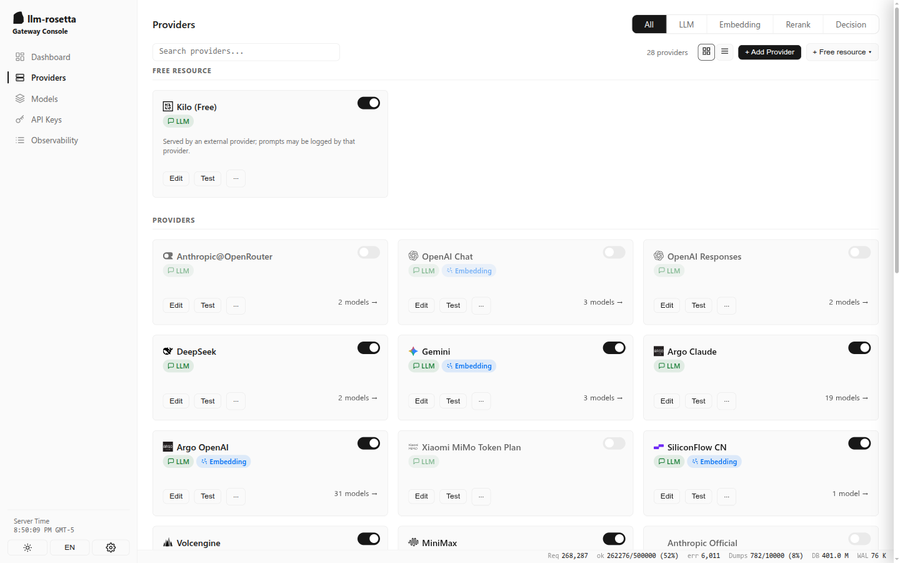
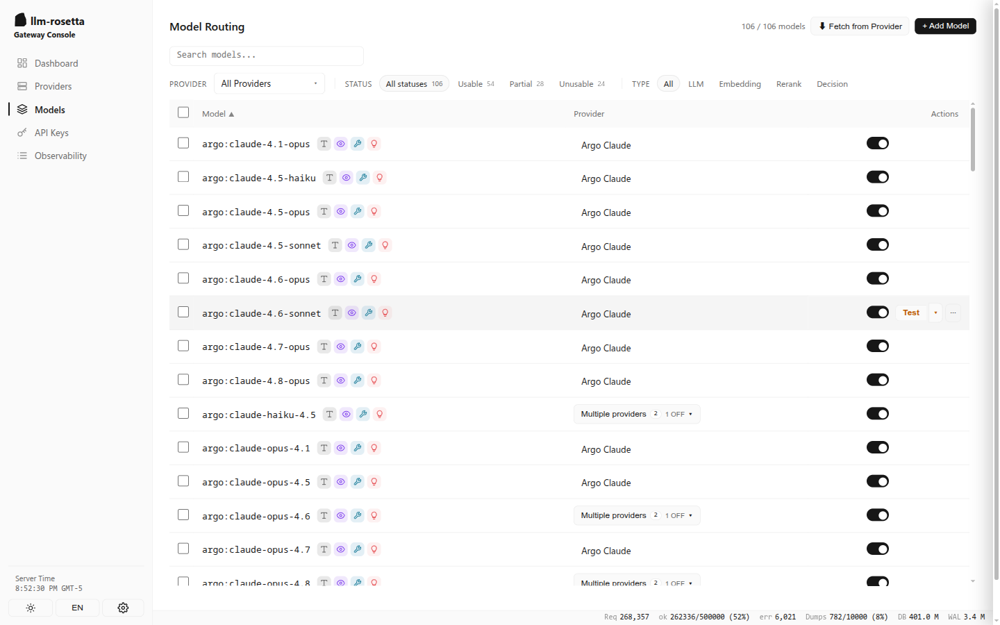
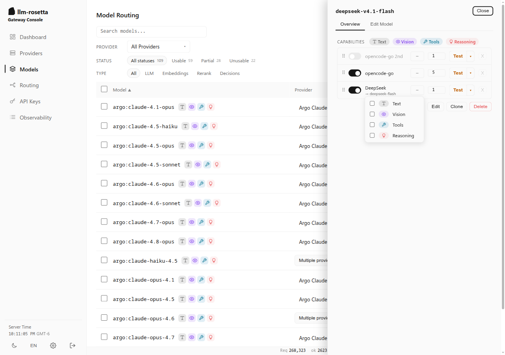
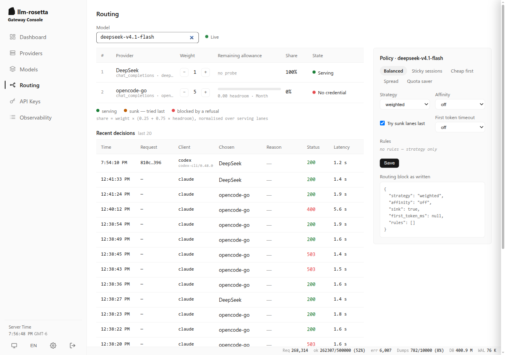
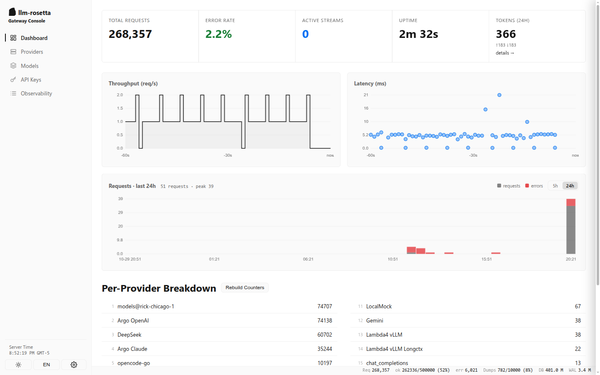
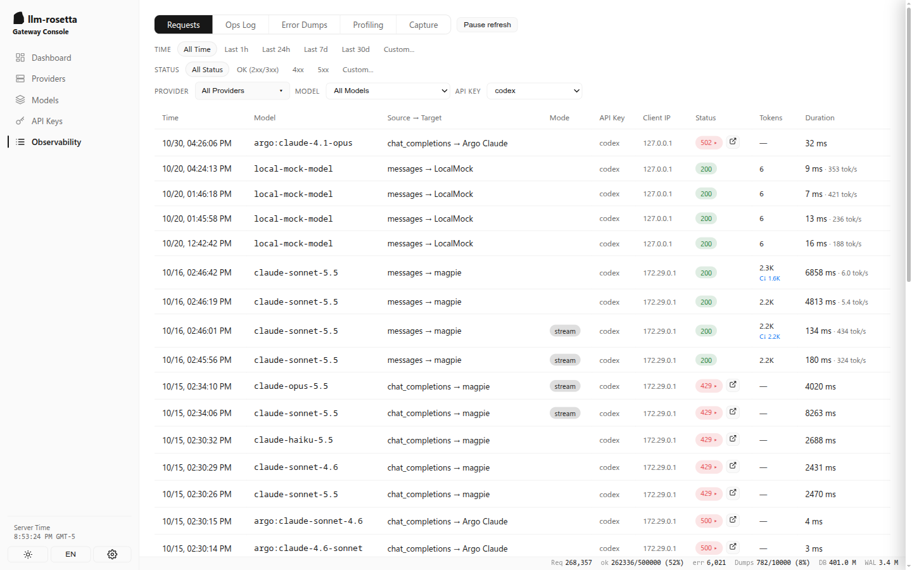
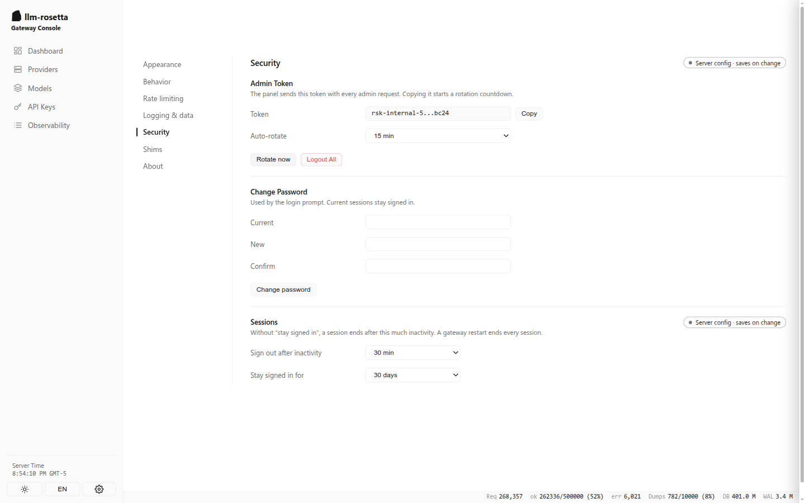
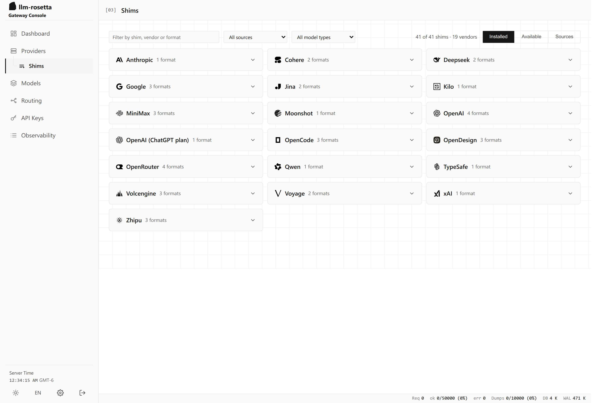
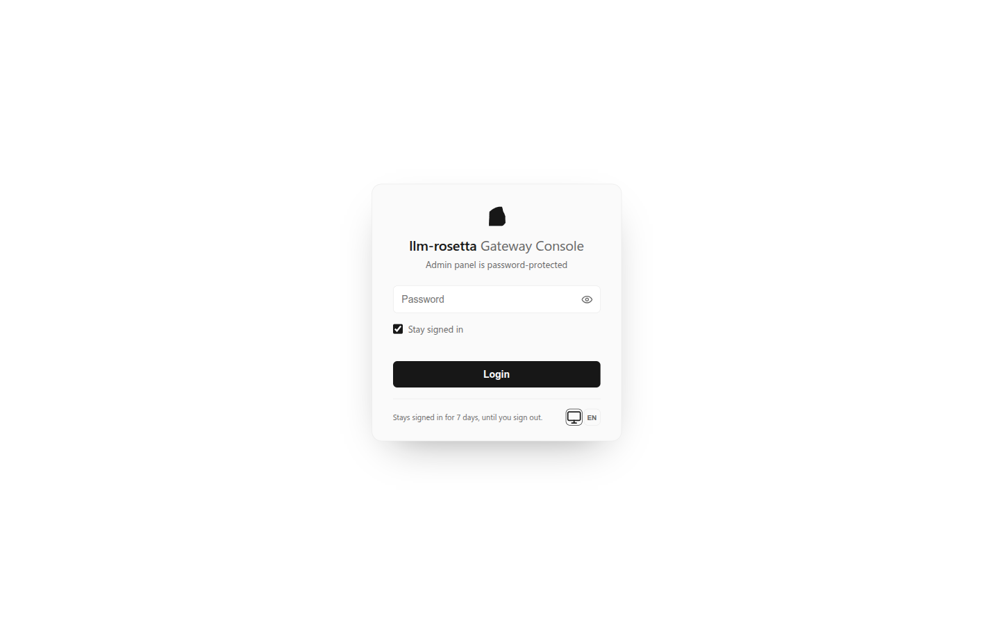

# Admin Panel

The gateway ships a built-in web console for configuration, traffic and diagnostics — no config file to edit by hand, no restart to apply a change.

Open **`http://localhost:8765/admin/`**.

## The console

The console is a left rail of sections — **Dashboard**, **Providers**, **Models**, **API Keys** and **Observability** — with the mode, language, settings and logout buttons in one row at the bottom, and a status bar along the bottom edge that reports the request counters. Below 900 px the rail folds into a top bar.

The rail's foot carries the clock. It shows the gateway's own wall time, not the browser's: `/health` reports the process's clock and zone, and a click on the time switches to the browser clock (the label says which one is showing, and the choice is remembered). The zone beside it is a second click target — the GMT offset (`GMT-5`) by default, the IANA name (`America/Chicago`) when switched; a name wider than the rail is trimmed with an ellipsis. A bare `/admin` opens the dashboard rather than resuming the last section; an explicit hash (`#providers`, `#models`) still deep-links. The logs section is `#observability`, and an old `#logs` bookmark opens it and is rewritten in the address bar.

`Alt+1` … `Alt+5` jump to a section, `[` and `]` step through them, Back and Forward move between the sections you visited, and `?` opens the shortcut list.

## Providers

The **Providers** section manages every upstream the gateway can call.



The header filters by model type — **All**, **LLM**, **Embeddings**, **Rerank**, **Decisions** — and searches by name, shim or base URL; the count beside it is how many providers the filters leave. The grid/list toggle switches between cards and a compact table, and the choice is stored in `localStorage`. **+ Add Provider** opens the form; **+ Free resource** lists the free lanes the gateway knows about, and picking one is the same as adding that provider.

The toolbar's **Status** facet — **All**, **Needs attention**, **Disabled** — filters by what the provider is doing, with live counts over the slice the other filters left. The list itself is ordered: providers with a problem come first, healthy ones next, and providers switched off last, so an endpoint that stopped routing is at the top rather than lost in the grid. That order holds while you work: a switch flip keeps the row where it is, and the list re-sorts when you come back to the section or change a filter or the search — otherwise the provider you just disabled would leave the viewport under the pointer.

Each card shows the logo and name, the capability badges for the model types the provider serves, an enable switch and the number of models on it. A disabled provider greys its logo and dims its name; the card stays readable. A capability badge that is not routing is greyed as well, and a degraded one carries an `!` overlay whose tooltip pairs the translated category with the gateway's own message, so the fault — which shim, which field — is one hover away. A whole-provider failure — an unknown shim, a missing base URL — names itself in the same warning row the per-type failures use. The actions are **Edit**, **Test** and a **⋯** menu holding **Clone**, **Refresh** (when the shim declares a model-listing path), **Quota** (when the shim ships a probe) and **Delete**.

An endpoint can be switched off on its own: `<type>_enabled: false` on the provider entry removes that provider from that model type's pool only, keeping its configuration for later. The form carries one **Enabled** switch per endpoint section, and the LLM section's switch is the provider's own `enabled` flag — chat is the provider rather than one of its endpoints, so it has no `<type>_enabled` of its own. A new provider opens with no capability selected: which ones it serves is the first decision, and saving with none is refused rather than writing a provider that serves nothing. A failed endpoint keeps its switch on and says why on its own line — unchecking it would turn the automatic failure into a manual disable, and fixing the shim afterwards would leave it off. For an automatically disabled provider the LLM switch is drawn on as well, so fixing the cause and saving restores it, as the status line says.

The card omits the type row and the base URL on purpose: one provider can serve several model types at once, which the badges say better than a single cell, and the URL is in the name's tooltip and in the form.

### Adding and editing

The provider form is a right-side drawer with a sticky title, a tab bar and a sticky action bar. It is split into two panes: **Basic** holds identity, transport and routing; **Auth** holds the credential. The drawer always opens on **Basic**, and the **Auth** tab carries a red dot while its credential needs an action — a missing sign-in, a failure, an unreadable record or a legacy marker. Switching tabs never touches the type picker, so the endpoint choice does not change under the operator.

- **Basic** — logo, name, a read-only model-type summary, Base URL, models path, proxy and timeout, a read-only credential summary (the source in effect, a status pill and its detail, with **Change in Auth**), the model-type checkboxes, and the endpoint cards. The LLM endpoint card keeps the type picker, the URL templates, the tool flags and the max tool-description length.
- **Auth** — the credential source cards, the key box, the command editor, the sign-in record panel, the refresh log and a preview of the fields the save will write.

- **Rename** rewrites every model reference automatically.
- **Clone** pre-fills the drawer with the source provider's settings and the name `<name> Clone` (`<name> 克隆` in Chinese).
- **Delete** opens a type-to-confirm dialog that warns about the cascade: the provider's models go with it.

An API key field auto-detects comma-separated values and switches to a multi-entry list with one password row per key. **+ Add key** appends a row at any time; each row has an eye toggle and a copy button, and the footer offers view-all and copy-all for the whole comma-separated value. Masked keys on cards are never written back to the config file. The panes are static DOM: switching tabs, languages or providers never rebuilds the key rows or a pasted record.

### Credential sources

The **Auth** pane opens on the source the entry actually uses, derived from the loader's own precedence: a `token_command` written into the entry outranks the shim, then the shim's command, then its `auth.py`, then a static key. Four cards offer the sources, and only the ones the loader can honour are shown:

| Source | When it is offered | What it stores |
|--------|--------------------|----------------|
| static API key | the shim mints no credential (a keyless shim still gets the card, for a paid key) | `api_key` |
| command from the config | always | `token_command`, `token_command_env`, `token_refresh_interval` |
| command from the shim | the shim declares `connection.token_command` | `token_refresh_interval` only; the argv is read-only |
| sign-in (`auth.py`) | the shim ships an exchange, or the entry already uses one | the record the exchange owns |

Choosing a source is a statement about the others: selecting a shim command, a sign-in or a static key clears the entry's `token_command`, and moving off a static key sends `clear_api_key` so the old key is deleted rather than kept. The preview under the cards names what the save will write — `<set>`, `<kept>` or `<cleared>` for a key, never a value or its prefix.

The command editor works in argv rows: one argument per row, the executable first. A command keeps at least one argument — the × disappears on the last row, and removing a command means choosing another credential source. `token_refresh_interval` must be at least 60 seconds. A command that receives the operator's key through `token_command_env` keeps the key box — there the key is the command's input, not a second credential. The same rule keeps the box for an exchange that declares `consumes_key`.

The status card shows the live `token_status`: the last mint, consecutive failures, the last error, whether an interactive sign-in is required, and `initializing` while the first token has not arrived. Only a digest (`cmd:<sha256>` for a command, `key:<sha256>` for a key) and timestamps are shown, never the token itself.

**Refresh now** (`POST …/credential/refresh`) mints a token out of cycle — the upstream-401 path debounces a burst, the button does not. **Test credential** (`POST …/credential/test`) mints a token and calls the provider's models endpoint with it; the answer says whether the upstream accepted the credential, so "the command exited 0" is not mistaken for "the account works". Both run the **saved** command: while the draft differs they are disabled and say so, rather than testing something the operator has not saved.

For a shim `auth.py` exchange the same pane holds the record actions, rendered only when the exchange reports `can_install` / `can_revoke` — a button that would answer 501 is not offered:

| State | What the panel shows |
|-------|----------------------|
| connected | the account the exchange's summary names, the access token's expiry, **Manage usage** (when the shim declares a page) and **Sign out** |
| needs setup | no credential yet — **Install a record**; the provider may still be saved in this state, so the CLI has something to sign in to |
| unreadable | a record exists but cannot be read — install a replacement or sign out |

**Install a record** takes the JSON the CLI prints (`llm-rosetta-gateway credential <provider>`, see the [CLI reference](cli.md#credential-provider)) and hands it to the exchange over `PUT …/credential`; a record that does not verify is refused with the exchange's own message. **Sign out** calls `DELETE`, which revokes the grant upstream when the vendor allows it and takes the token out of the gateway's key ring immediately.

An entry whose key slot holds the literal `token_command` — a label the previous editor wrote — gets a warning in the Auth pane. The next save drops the literal; beside a command the loader would reject the pair.

A provider save or an enable builds the affected providers in memory before anything is written. A document the loader rejects returns 400 and leaves the config file untouched, instead of reporting "Config saved but reload failed" after the damage.

## Models

The **Models** section is the model routing table: every configured model, the capabilities it declares, and the provider that serves it.



- **Filters** — provider and a status facet (**All statuses**, **Usable**, **Partial**, **Unusable**, each counting the rows the other filters leave) share the first facet row; model type sits on its own row below, the way the log filters are laid out, instead of wrapping mid-group at narrow widths.
- **Badges** are icon-only; the capability name is the tooltip. A model served by more than one provider says **Multiple providers**, and the cell opens a list with each provider's own switch, weight, capability picker and **Test**. The picker draws the entry's capabilities as one dot each, in that capability's badge colour; clicking it opens a checklist of `text`, `vision`, `tools` and `reasoning`, and a hollow dot means the entry inherits the provider's own capabilities.
- **Actions** — **Test** and **⋯** appear when a row is hovered; the enable switch never hides, because it is the row's state.
- **A row opens a side panel** with the capabilities, every provider with its weight and the same capability picker, and **Edit** in the same panel — there is no separate model modal.
- **Provider order** — a model served by several providers lists them in the order the selector tries them. The rows can be dragged by their grip, both in the cell's **Multiple providers** list and in the side panel; the drop writes the model's `providers` list. A provider that is switched off keeps its slot.
- **Ordering** — the header stays put while the table scrolls, and a model no provider can serve sorts below the usable rows.



Two actions are not in the table: **+ Add Model** in the header, and **Fetch from Provider**, which queries the upstream `/v1/models` endpoint, lists what it returns with checkboxes, and bulk-adds the selection with an optional name prefix. Its failure messages are diagnostic rather than generic:

- **Connection refused** — the upstream service is not running, or a firewall blocks the connection
- **Timeout** — the upstream host is not reachable from the gateway
- **DNS failure** — the Base URL hostname does not resolve

Renaming a model onto a name that already exists merges the providers instead of failing: the confirm dialog adds the new provider to `providers[]` rather than replacing the entry that already held the name.

### Model capabilities

Each model can declare capabilities that determine the available test types and are returned in the `/v1/models` response:

| Capability | Description | Badge Color |
|------------|-------------|-------------|
| `text` | Text generation | Grey |
| `vision` | Image comprehension | Magenta |
| `tools` | Function/tool calling | Cyan |
| `embedding` | Text embeddings (mutually exclusive with vision/tools) | Blue |
| `reasoning` | Extended thinking / chain-of-thought (mutually exclusive with embedding) | Lime |

The hues stay clear of the status vocabulary — red, green and orange already mean failed, healthy and warning elsewhere in the console — with one deliberate exception: reasoning is a lime green, far enough toward yellow that it does not read as the routing board's healthy dot.

### Model testing

**Test** on a model row runs a quick test; the types on offer follow the declared capabilities:

| Test Type | Description | Requires |
|-----------|-------------|----------|
| Text | Simple text query | `text` |
| Vision | Image comprehension (embedded test image) | `vision` |
| Stream | Streaming text response | `text` |
| Tools | Function calling with a weather tool | `tools` |
| Embedding | POST to `/v1/embeddings`, displays dimension count | `embedding` |
| Reasoning | Text query with `reasoning_effort: "low"` | `reasoning` |

Embedding models show a single Test button, since only one test type applies.

A model served by several providers is tested against the one picked in its provider list, pinned with the `X-Rosetta-Provider-Pin` header — which the gateway honours only for admin-internal tokens. While a test runs, **Cancel** aborts it and an elapsed timer ticks beside the status. Test payloads use `max_tokens=256`. Results show the extracted reply, with collapsible sections for the raw request, the raw response body and, for a vision test, the image preview.

### Delete confirmations

Destructive operations use two confirmation patterns:

- **Provider delete** — a type-to-confirm dialog that names the cascade effects.
- **Model delete**, **API key delete** and **Clear Log** — an inline two-step confirmation: the button becomes **Sure? Yes** and reverts after 3 seconds.

## Routing

The **Routing** section answers one question per model: which lane serves it, and why. It reads the selector's own answer rather than re-deriving one — every number on the page comes from `GET /admin/api/routing/<model>`.



- **Board** — the route in the order the selector reads it: each candidate's position, the lane and the wire format and shim behind it, a weight stepper that writes the model entry, the remaining allowance, the share it serves at, and the state with its countdown. A row can be dragged by its grip; the drop writes the model's `providers` list, so the order the board shows is the order the selector reads. Every row also carries a switch that writes the provider's own entry, so a lane can be taken out and put back without leaving the page. A lane whose provider is switched off stays on the board: it is appended after the candidates with an **Off** state, its reason in the sub-line, its switch available and its weight, drag and share inert — a lane that vanished from the page is a lane nobody notices is down. Flipping a switch keeps that row where it is; the board re-sorts on the next visit or when another model is picked.
- **Legend** — names the three dots (**serving**, **sunk**, **blocked by a refusal**) and how this model's share is made: weight × (0.25 + 0.75 × headroom) for `weighted`, the first eligible lane for `ordered`, equal turns for `rotate` and `least_used`, and the allowance alone for `pace`.
- **Decisions** — the last requests for this model from the request log: time, request id, client, chosen lane, any failover hop, status and latency. The client cell shows the API key's label with the `User-Agent` the request sent beneath it, so a row names the program that made the request, not only the key it used. A click opens the chain under the row — who asked, which lane served, and why — and a second click closes it.
- **Sessions** — one line per conversation in the model's recent log: the key label with its `User-Agent`, the lane it last reached, how many requests it made, and when. The gateway derives a conversation id from the client key and the request's first message and keeps only the digest in the request log, so concurrent sessions behind one key and one `User-Agent` stay apart. A line with no id — a row written before the column existed, or a request with nothing to derive one from — falls back to the client identity and says **client group**. The line above the table states how many conversations the sampled requests hold and that two conversations with the same client and first message count as one; it also says whether the model's affinity keeps a conversation on one provider.
- **Policy** — the pane the tab opens on: the board, its legend, and the model's `routing` block in a card below them: five presets as chips (**Balanced**, **Sticky sessions**, **Priority first**, **Spread**, **Quota saver**), strategy and affinity, the sunk-lane switch, the first-token timeout, the rules as written, and the block as JSON. A preset writes the literal block an operator could have typed; a block that is no preset leaves every chip unpressed.

The remaining-allowance cell reports the window the lane is closest to exhausting, and names it in the sub-line (for example `0.00 headroom · Month`). Clicking the cell cycles through the windows the lane reports, and the tooltip lists every window with its remaining percentage and reset time. A provider with no quota probe reads **no probe**, and a probe with no reading yet reads **not measured**; either way the lane keeps its configured weight, because the share formula reads an unmeasured headroom as no penalty.

States follow the eligibility predicate, so the panel and the proxy agree by construction:

| State | Meaning |
|-------|---------|
| **Serving** | A candidate; nothing is holding it back |
| **Sunk** | Still a candidate, but a recent 429 orders it last |
| **Blocked** | A provider-wide block (a keyless 429, a rotating credential whose account is out); the row counts down to its end and the board refetches when it expires |
| **Rate limited** | Continuous 429s disabled the lane until the cooldown ends |
| **Spent** | Every credential's freshest reading says its window is spent |
| **No credential** | The key ring has nothing usable left |
| **Starting** | A credential has not been seeded yet |
| **Off** | The provider is switched off in the Providers section, so the route does not carry the lane; the row stays after the candidates, read-only apart from its switch |

The model list on the left is the selector: a row per routable model, ordered by the moment it was last requested, with that window's request count, its provider count, the shares those providers carry and how many lanes are blocked. The top row — the model requested most recently — is selected when the tab opens; a later visit keeps the model on screen. The search box narrows the list as you type. The window switch (**5h**, **24h**, **7d**, **All**) recomputes the counts and the order; five hours is the default because the tab answers what is being routed now. The list shows what `GET /admin/api/routing?window=…` returns, which is the runtime's route table rather than every key in the config document, so a model whose provider was skipped at load is not offered.

Saving the policy writes through `PUT /admin/api/routing/<model>`, which rebuilds the config — so a value the parser refuses comes back as the parser's own message, and a key the editor does not own (`rules`, `first_token_ms`) is carried through the save unchanged.

## API Keys

The **API Keys** section issues and revokes the keys that call `/v1/*`. Each key has a label, an allowed-shim list (`*` for any), a creation time and a last-used time. A new key is shown once, in full; the list keeps only its id and label. Deleting a key takes effect on the next request — no restart.

## Dashboard

The **Dashboard** is the landing section and reports live traffic.



**Summary cards** — Total Requests, Error Rate, Active Streams, Uptime and Tokens (24h), the last with a link to its breakdown.

**Rolling charts** — Throughput (req/s) and Latency (ms) over the last 60 seconds. With no traffic they say "No data yet" rather than drawing a flat line.

**Requests histogram** — the request log folded into buckets, with a **5h** / **24h** toggle. Success stacks on the baseline and errors cap the bar, so the height stays the request count and red only ever means errors; hovering a bucket breaks it down.

**Token usage** — clicking a token count opens a modal with prompt / completion / total, cache creation and cache read (Anthropic-style providers), reasoning tokens, and the rolling 24-hour figures.

**Per-Provider Breakdown** — requests grouped by target provider in a two-column list. **Rebuild Counters** recomputes the totals from the request log when a counter has drifted.

**Network Diagnostics** — three checks from the gateway process:

| Item | Description |
|------|-------------|
| **IP Location** | The gateway's outgoing public IP and geolocation, from an external lookup |
| **Host IP** | The Docker host's gateway IP (e.g. `172.29.0.1`), read from the container's default route via `/proc/net/route`. Only shown inside a container. |
| **Google** | Basic connectivity check to `google.com` |

## Observability

**Observability** is one panel with five views of the same traffic.



| View | Shows |
|------|-------|
| **Requests** | One row per proxied call — the request log |
| **Ops Log** | Server-level events: lifecycle, config, keys, data mutations, security, health |
| **Error Dumps** | The bodies behind a failed request |
| **Profiling** | Toggle for the phase profiler |
| **Capture** | Toggle for request/response capture |

### Filters

Every view shares one filter vocabulary:

- **Time** — All time, Last 1h, Last 24h, Last 7d, Last 30d, or a custom range
- **Status** — All, OK (2xx/3xx), 4xx, 5xx, or a custom code
- **Provider**, **Model**, **API Key** — the same lists the config defines

### Request rows

| Column | Description |
|--------|-------------|
| Time | Request timestamp |
| Model | Model name from the request |
| Source → Target | Source format and target provider |
| Mode | `stream`, or a blank cell for a non-streaming call |
| API Key | Label of the key that called |
| Client IP | Peer address |
| Status | HTTP status, colour-coded |
| Tokens | Prompt and completion counts, plus cache reads where the provider reports them |
| Duration | End to end, and output tokens per second where token usage is known |

A stream's duration is the span of the streamed body, not the time to headers, so the rate beside it reflects what the client actually waited for.

**Pause refresh** freezes the list while you read it. **Clear Log** empties the view behind an inline confirmation.

### Error dumps

An error dump opens full screen at `#dump/<id>` — behind the same login gate as the rest of the panel — with copy and download per section, and a bulk selection (**select all**, **invert**) scoped to the filtered result rather than the page. The header box reflects the rows the filter leaves.

### Server ops log

The ops log records mutations and security events with structured metadata.

#### Event categories

| Category | Event Types | Description |
|----------|-------------|-------------|
| Lifecycle | `startup`, `shutdown` | Server start and graceful stop |
| Configuration | `config_reload`, `admin_setup` | Config hot-reload, admin panel init |
| API Keys | `key_create`, `key_update`, `key_delete`, `key_rotate` | Key management operations |
| Data Mutations | `data_cleared`, `data_cleanup`, `data_trimmed`, `data_vacuumed`, `data_rebuilt` | Database maintenance operations |
| Security | `password_changed`, `token_rotated`, `session_logout_all` | Authentication and session events |
| Health | `health_status_change` | Provider health state changes |

#### Severity levels

- **info** — non-destructive operations (key creation, config reload, vacuum)
- **warning** — destructive data mutations (clear, trim, cleanup) and security events (password change, token rotation)

An operation that fails is recorded with elevated severity automatically.

#### Source filtering

| Source | Operations |
|--------|-----------|
| `admin` | Admin panel actions (clear data, session logout) |
| `auth` | Password change, token rotation |
| `keys` | API key create/update/delete/rotate |
| `persistence` | Background prune, periodic cleanup |
| `gateway` | Startup, shutdown |
| `config` | Configuration reload |

#### ops_log vs request_log

The **request log** records every proxy request (high volume, traffic-focused). The **ops log** records mutations and security events (low volume, audit-focused). They are queried independently, and auto-refresh follows the active view.

### Retention

Retention lives in **Settings → Logging & data** and applies per store — request log, error dumps and the ops log each have their own cap and age:

- **Count-based**: the maximum number of entries to keep (the oldest are pruned)
- **Age-based**: entries older than a threshold are cleaned up

Both thresholds apply independently — whichever triggers first wins.

## Settings

**Settings** is a full-width console with a left sub-nav, not a drawer of cards. Each line is one setting and the control is sized to its content instead of stretched across the page. Server-scoped groups save on change; the groups that touch the database keep an explicit **Save**.



| Pane | Holds |
|------|-------|
| **Appearance** | Colour scheme, mode, language, model type names, auto-refresh interval and the theme override |
| **Behavior** | Console output level, error detail, credential reveal, the global proxy URL |
| **Rate limiting** | Switch, algorithm (sliding window, token bucket, fixed window, GCRA) and scope (global, per IP, per key, per model) |
| **Logging & data** | Request log cap and age, error dump cap, export and cleanup, ops log retention |
| **Security** | Admin token and its rotation, **Logout All**, the password form and the session lifetimes |
| **Shims** | Declared sources and the loaded-shim inventory |
| **About** | Config file path, versions and links |

The **global proxy URL** lives here rather than on the Providers page: it is server-scoped, and it applies to every provider that does not override it.

### Theme override

**Appearance → Theme override** appends CSS to the admin page after the built-in schemes and after any downstream fragment. It saves to `server.admin_custom_css` and applies on save and on every later page load, so an operator can restyle the panel from the console instead of shipping a `custom_head` from code. A rule that sets a theme token needs the scheme's own selector.

### Session lifetimes

**Security → Sessions** holds two answers, and only one of them applies to a given session:

- **Sign out after inactivity** — the window a session slides on every authenticated request (`server.admin_session.idle_minutes`, default 30, `0` = never). The panel's own idle timer reads the same number.
- **Stay signed in for** — the persistent-cookie lifetime a remembered sign-in gets (`server.admin_session.remember_days`, default 30, `0` = the login page does not offer it). A remembered session ignores the idle window and ends at its own lifetime.

Both apply on the next request, and both are reported by `/admin/api/auth-check` before sign-in, so the login card can say which one is in force.

### Shims { #shim-sources }

The **Shims** pane declares external sources and lists what loaded.



**Declared sources** — the top-level `shims` section (see [External Shim Sources](configuration.md#external-shim-sources)): **Directories** (one per line), **Preload presets** (a dropdown of catalog packages), **Remotes** (a JSON array), and the remaining knobs — cache directory, re-fetch TTL and fail-startup-on-a-bad-source. **Save** persists the section and re-applies it, so a source removed here stops loading without a restart; **Refetch** forces every remote to be downloaded again, bypassing its cache and `refresh` mode; **Check now** re-reads each remote's commit from GitHub and refreshes the update badges. A source that fails is reported here without stopping the gateway.

**Preload presets.** The dropdown lists every standalone shim package the gateway knows about, each row carrying its name and shim count with the repository on hover — free resources above paid packages. Clicking a row toggles its key in `shims.presets`; nothing is written until **Save**, which is why the pane keeps a one-line guide beside the picker and an *Unsaved changes* note next to the button. A key expands server-side, and an explicit remote overrides its preset when the URLs match; a declared key this catalog does not know has no row, stays in the declaration and is named by the trigger. See [Standalone shim packages](../guide/shims.md#standalone-shim-packages).

**Loaded shims.** Below the sources, the inventory lists every registered shim, grouped by the source it came from — the group head carries the source's state, resolved ref, count, any failure, and the update verdict: *Up to date*, *Update `<old>` → `<new>`* (clicking runs a full refetch of every remote source) or *Check failed*, with the API error on hover. The verdict compares the commit the source was fetched at with the commit its declared ref — or the default branch, for a source with no `ref` — points at now; the answer is cached for five minutes. A shim in a declared local directory can be opened, edited and deleted here; an edit that does not load is rolled back to the previous file, and deletion is refused while a configured provider still names the shim. A shim can also be **disabled** and re-enabled through `shims.disabled` — a declaration rather than a deletion, so the same definition comes back. Built-in and remote shims are read-only, with the reason on the row; so is a definition sitting at the root of a declared source, because the loader does not read it and removing "its directory" would take the whole source.

**Removal advisories.** Below the inventory, the advisories name each provider in the config whose shim is going away, the release that removes it and the source that replaces it — with an **Add the replacement source** action that appends it to the remotes list. The list is derived per request from the config and the load report, so it is current without a restart.

!!! warning
    A declared shim directory or archive runs third-party Python
    (`transforms.py`) at load time. Only add sources you trust, and prefer
    pinning a tag or commit SHA.

## Themes

The panel ships two colour schemes, **Minimal** and **Emerald**, each in a light and a dark mode. The rail's mode button cycles light / dark / system, and **Settings → Appearance** carries the same choice as selects. The choice is stored per browser profile in `localStorage` (`llm-rosetta-scheme` and `llm-rosetta-mode`) and applied before the first paint, so a stored scheme does not flash the default. The login card carries the same mode and language buttons, because both live in `localStorage` and a login page in the wrong language is otherwise a dead end.

A scheme declares token values only; the components decide where those values land. If you are adding a scheme, see [Admin Themes](../contributing/admin-themes.md): the contract is enforced by `make test-js`, and `make theme-matrix` renders every scheme × mode × width against a live panel and saves screenshots.

## Authentication

The admin panel does **not** require the gateway API key.

Set `server.admin_password` in your config to enable built-in password protection for the admin panel:

```jsonc
{ "server": { "admin_password": "${ADMIN_PASSWORD}" } }
```

See [Configuration — Admin Panel Security](configuration.md#admin-panel-security) for details.

With password protection enabled, the console shows a login card: the product mark, one password field with a reveal button, a Caps Lock hint and a submit button that goes busy. A **Stay signed in** checkbox appears only when the gateway offers it, and it follows the last choice. The server's own message is shown verbatim, so a lockout names its remaining seconds instead of "Invalid password".



!!! info "No content flash"
    While the browser verifies the stored session, the admin UI stays hidden (`body.auth-pending`) until authentication is confirmed. This prevents a brief flash of the interface before the login card appears.

- Authentication uses **HttpOnly + SameSite=Lax** session cookies with `Path=/admin` — no token is exposed to JavaScript.
- Without **Stay signed in**, the cookie dies with the browser and the session ends after the idle window (default 30 minutes without activity; mouse movement, keyboard input, scrolling and clicks all count).
- With it, the cookie carries a `Max-Age` of the remembered lifetime (default 30 days) and the session ignores the idle window — "stay signed in" and "idle timeout" are two promises, so only one applies to a given session.
- A **Logout** button sits in the rail footer. A password change mints the replacement session with the lifetime the user asked for, so remembering survives it.
- Sessions live in memory: a gateway restart ends every one, remembered or not.
- For programmatic API access, the `X-Admin-Token` header is still accepted as a fallback.

Alternatively, protect the admin panel using a reverse proxy:

- **Caddy**: Use `basicauth` directive
- **Nginx**: Use `auth_basic` directive
- **Traefik**: Use BasicAuth middleware

Gateway API keys (managed in the **API Keys** section) protect AI request endpoints (`/v1/*`). See [Configuration — Gateway API Keys](configuration.md#gateway-api-keys) for details.

## Updates { #updates }

The console can say that a newer release exists, show what changed, and install it without leaving the panel.

**The bubble.** The gateway asks the package index for the newest release once every six hours (`server.update_check`), and while one is newer than the running version a small pill sits in the top-right corner — `v0.15.0 available`. A click opens the details: what is running, what is available, a link to the full changelog on Read the Docs in the interface language, and **Update now**.

**Updating.** **Update now** runs `pip install --upgrade` for the distributions that publish that release, then replaces the process image with the same command line. The PID survives, so a systemd unit or a container restart policy is not what brings the gateway back. The panel polls `/health` and reloads itself when the new version answers; if the install fails, the old version keeps serving and pip's reason is shown.

Two installations are refused, with the reason in the bubble:

- an **editable install** (a source checkout) — pip would replace the working tree's package with an index release;
- an interpreter without `pip`, or `server.self_update: false` in the configuration file.

Inside a container the installed version survives until the container is recreated; a new image is the durable path.

**The changelog dialog.** The first time the panel loads after an update, it opens the new release's notes, read from a changelog file shipped inside the wheel. **Close** only closes it — the dialog returns on the next load; **Don't show again** remembers the version in `localStorage` and stops it coming back. A build without the bundled file — a source checkout that never ran `scripts/dev/sync_changelog.py` — shows no dialog at all.

## Internationalization

The console supports English and Chinese (中文). The language button sits in the rail footer, and on the login card. Every interface string — tooltips, placeholders, aria-labels and toasts included — goes through the translation layer, and the selection persists in `localStorage`.

Model type names are the exception, and they have their own switch: the panel spells a type the way the API does (`llm`, `embeddings`, `rerank`, `decisions`) on every surface — badges, warning rows, facets, type radios and model rows — and the hover carries the localized word. **Settings → Appearance → Model type names** flips the two, so an operator who prefers the words on screen to follow the language gets them there, with the English on the hover instead. The default is English. The **Docs** link in About follows the interface language as well: Chinese opens `/zh-cn/latest/` on Read the Docs rather than the site root's English redirect.

!!! note "Chinese label update"
    The Chinese translation for "provider" was updated from **服务商** to **服务方** to better reflect the local usage convention.

## Data Persistence

Metrics and request log data are persisted in a single SQLite database alongside the config file:

```
~/.config/llm-rosetta-gateway/
    config.jsonc
    data/
        gateway.db    # SQLite database — request log + metrics (WAL mode)
```

### How it works

- **Request log** entries are written directly to `gateway.db` on each request
- **Metrics counters** are saved to `gateway.db` after each update
- On **startup**, persisted data is loaded back — metrics and logs survive restarts
- **WAL mode** ensures crash-safe writes without blocking reads

### Retention

Up to **5,000** request log entries are retained. When the limit is reached, the oldest entries are automatically pruned.

### Legacy migration

On first startup, if `request_log.jsonl` or `metrics.json` exist in the data directory from a previous installation, they are automatically imported into `gateway.db` and renamed to `*.migrated`.

## Accessing Host Services from Docker

When the gateway runs inside a Docker container and needs to reach a service on the host machine (e.g. another API proxy listening on `localhost:44501`), you cannot use `127.0.0.1` as the Base URL — that refers to the container itself.

Instead, use the **Host IP** shown in the Dashboard's Network Diagnostics section. This is the Docker bridge gateway address (typically `172.x.0.1`) and is automatically detected from the container's default route. The provider proxy URL placeholder in the admin panel dynamically shows this detected IP so you can copy it directly.

### Firewall configuration (ufw)

If the host runs `ufw`, Docker container traffic is blocked by default even though the container and host share a bridge network. You need to explicitly allow the Docker subnet.

The recommended approach is to allow the entire Docker private address range (`172.16.0.0/12`) in one rule. This covers all Docker networks — default bridge, compose-created networks, and any future networks — so you never have to add per-network rules:

```bash
sudo ufw allow from 172.16.0.0/12 comment 'Docker all subnets'
```

This is safe because `172.16.0.0/12` is an [RFC 1918](https://datatracker.ietf.org/doc/html/rfc1918) private address range that is not routable on the public internet. Only containers running on the same host can use these addresses.

!!! warning "Why per-network rules are fragile"
    Docker assigns subnets dynamically. If you only allow a specific `/16` (e.g. `172.29.0.0/16`), a container started with `docker run` instead of `docker compose` may land on a different subnet (e.g. `172.17.0.0/16`) and lose access to host services. The `/12` rule avoids this entirely.

If the firewall is blocking traffic, "Fetch from Provider" and model tests will show timeout errors. Check the Network Diagnostics Host IP and add the corresponding ufw rule to resolve it.

## Caching / Reverse Proxy

The admin panel sets `Cache-Control: no-cache, no-store, must-revalidate` on all `/admin/api/*` responses. This prevents aggressive reverse proxy caches (e.g. Caddy with the Souin plugin) from serving stale dashboard metrics or request log data.

Model test polling also uses POST requests instead of GET, which avoids being cached by intermediaries.

## Mobile / Responsive

The console is responsive — below 900 px the rail becomes a top bar, the settings sub-nav folds into a bar above the pane, and data tables scroll horizontally so no column is clipped.
