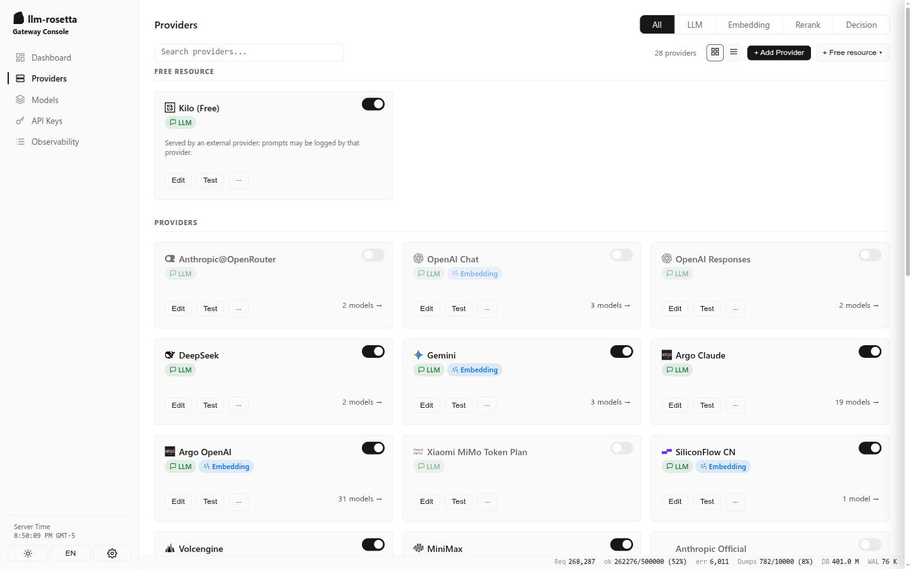
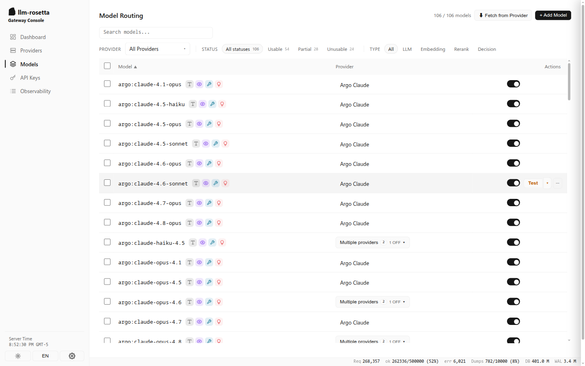
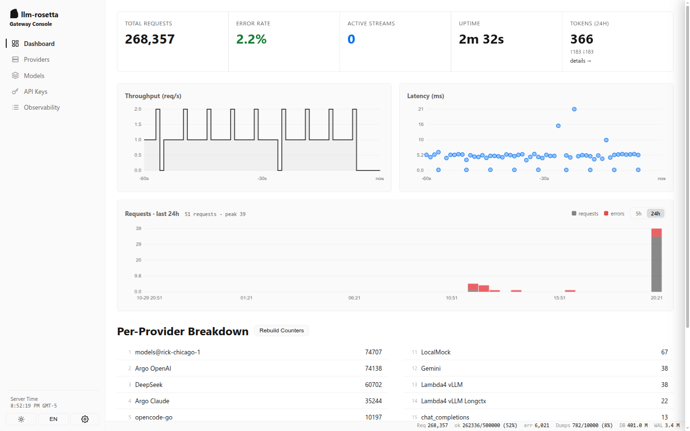
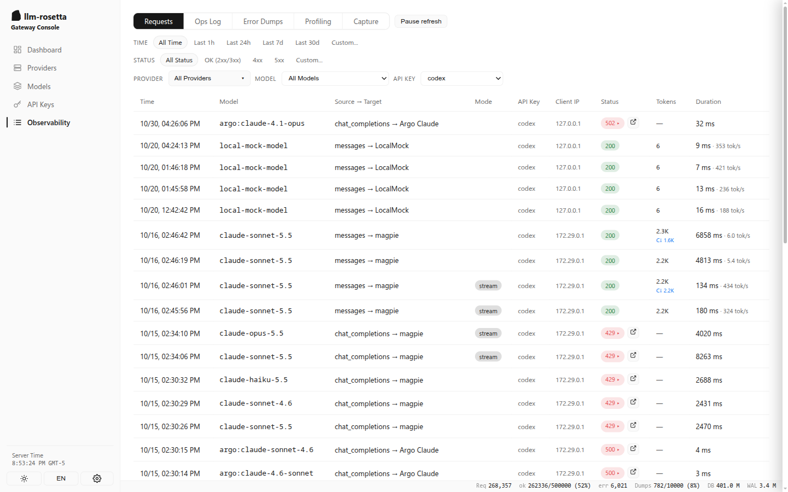
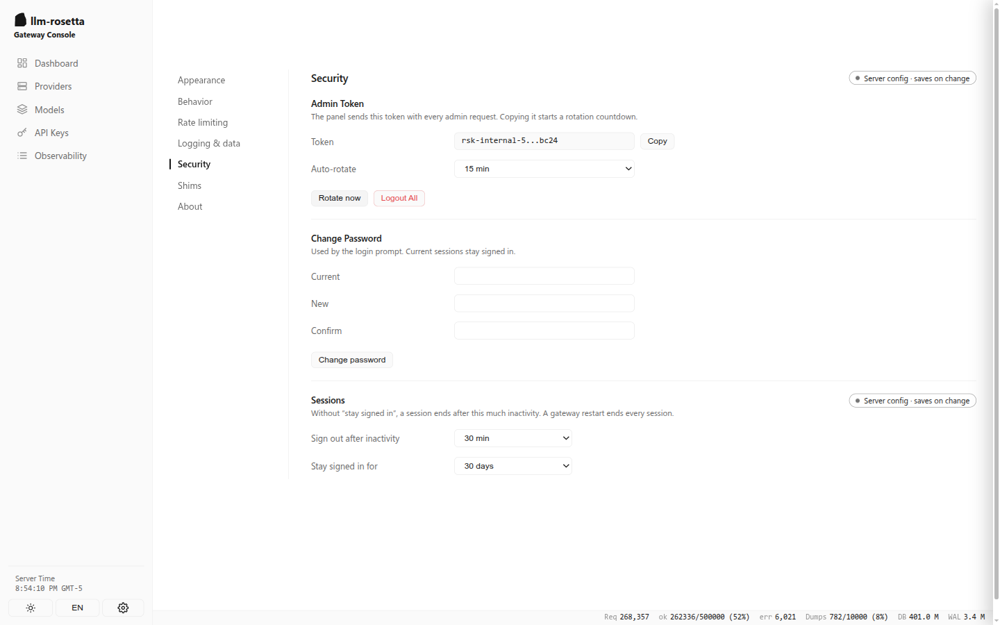
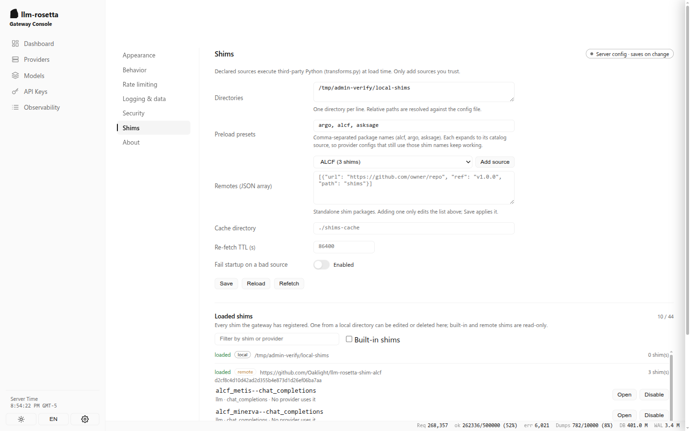
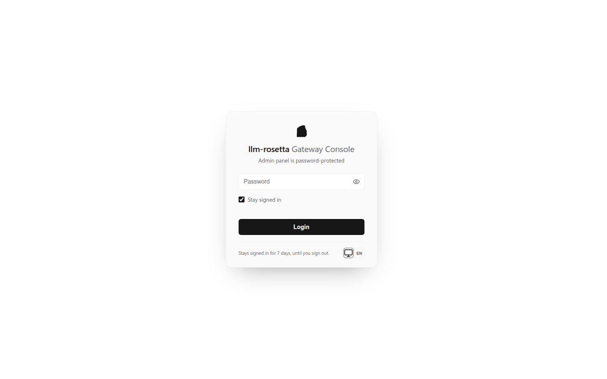

# 管理面板（Admin Panel）

网关内置一个 Web 控制台，用来管配置、看流量、做诊断 —— 不用手改配置文件，改完也不用重启。

访问地址：**`http://localhost:8765/admin/`**

## 控制台

控制台左侧是分区导航栏：**Dashboard**、**Providers**、**Models**、**API Keys**、**Observability**。底部一行放模式、语言、设置与登出按钮；最下沿的状态栏常驻显示请求计数。窗口窄于 900 px 时，侧栏折叠为顶栏。

`Alt+1` … `Alt+5` 直接跳到某个分区，`[` 与 `]` 依次切换，浏览器的前进后退在访问过的分区之间移动，`?` 打开快捷键列表。

## 提供方（Providers）

**Providers** 分区管理网关能调用的全部上游。



顶部按模型类型筛选 —— **All**、**LLM**、**Embeddings**、**Rerank**、**Decisions** —— 并按名称、shim 或 Base URL 搜索；旁边的数字是筛选后剩下的提供方数量。网格 / 列表按钮在卡片和紧凑表格之间切换，选择保存在 `localStorage`。**+ Add Provider** 打开表单；**+ Free resource** 列出网关已知的免费通道，选中一个等同于添加对应提供方。

每张卡片显示 Logo 与名称、该提供方所服务模型类型的能力徽章、启用开关，以及其下的模型数量。禁用的提供方只把 Logo 灰化、名称变淡，卡片仍然可读。操作按钮是 **Edit**、**Test** 与 **⋯** 菜单，菜单里有 **Clone**、**Refresh**（shim 声明了模型列表路径时）、**Quota**（shim 带有探针时）与 **Delete**。

工具条上的**状态**分面 —— **All**、**Needs attention**（需要处理）、**Disabled**（已禁用）—— 按提供方当前的状态筛选，计数随其他筛选后的剩余集合实时变化。列表本身也有顺序：有问题的排在最前，正常的其次，被关闭的排最后，因此停止路由的端点浮在顶部，而不会淹没在网格里。

不参与路由的能力徽章同样灰化；因解析失败而降级的徽章还带一个 `!` 角标，角标的 tooltip 先给翻译后的分类，再附上网关自己的原句，具体是哪个 shim、哪个字段一悬停就能看到。整条提供方失败（未知 shim、缺少 Base URL）会出现在与按类型失败相同的那一行警告里。

端点可以单独关闭：provider 条目上的 `<type>_enabled: false` 只把该提供方从该模型类型的池中移除，配置原样保留。表单里每个端点段各有一个 **Enabled** 开关；LLM 段的开关就是提供方自己的 `enabled` —— 对话就是提供方本身，而不是它的某个端点，所以没有单独的 `<type>_enabled`。新建提供方时四个能力都不勾选：它服务哪些能力是第一个要做的决定；一个都不选就保存会被拒绝，而不会写入一个什么都不服务的提供方。失败的端点开关保持打开，并在单独一行说明原因 —— 若把开关关掉，下一个保存就会把自动故障变成手动关闭，修好 shim 之后它仍然是关的。被自动禁用的提供方，LLM 开关同样是打开状态，修好原因后保存即可恢复，正如状态行所说。

卡片故意不显示类型行和 Base URL：一个提供方可以同时服务多种模型类型，徽章比单个单元格说得更清楚；URL 放在名称的 tooltip 和表单里。

### 添加与编辑

提供方表单从右侧以抽屉形式打开，标题与操作区固定在顶部。表单包含名称、提供方类型或 shim、Base URL、API Key、可选代理与 Logo。

- **重命名**会自动改写所有引用该提供方的模型。
- **克隆**会把源提供方的设置预填进抽屉，名称预填为 `<name> Clone`（中文界面为 `<name> 克隆`）。
- **删除**会弹出输入确认框，并提示级联影响：该提供方下的模型会一并删除。

API Key 字段自动识别逗号分隔的多个密钥，并切换为多条目列表 —— 每个密钥一行密码输入框。**+ Add key** 随时追加一行；每行有显示 / 隐藏切换与复制按钮，底部提供整段逗号分隔值的"查看全部"和"复制全部"。卡片上显示的脱敏 Key 不会被写回配置文件。

### 登录 shim 声明的凭据

shim 随包提供 `auth.py` 的提供方没有可填写的密钥 —— 交换通过需要浏览器的登录来生成凭据。编辑这类提供方时，API Key 输入框会换成 **Credential** 区，读取 `GET /admin/api/config/providers/<name>/credential`：

| 状态 | 面板显示 |
|------|----------|
| 已连接 | 交换摘要给出的账号、访问令牌到期时间、**管理用量**（shim 声明了页面时）与 **退出登录** |
| 需要登录 | 尚无凭据 —— **安装记录** |
| 无法读取 | 记录存在但读不出来 —— 可安装新记录或退出登录 |

**安装记录** 接收 CLI 打印的 JSON（`llm-rosetta-gateway credential <provider>`，见 [CLI 参考](cli.md#credential-provider)），经 `PUT …/credential` 交给交换；校验不通过的记录会带着交换自己的说明被拒绝。**退出登录** 调用 `DELETE`：厂商允许时会在上游撤销授权，并立刻把令牌从网关的 key ring 中移除。面板从不渲染令牌，只显示交换愿意给出的账号与到期时间。

## 模型（Models）

**Models** 分区就是模型路由表：每个已配置的模型、它声明的能力，以及为它提供服务的提供方。



- **筛选** —— 提供方与状态分面（**All statuses**、**Usable**、**Partial**、**Unusable**，计数按其他筛选后的结果重算）占第一行；模型类型单独占第二行，与日志页的分面排法一致，窄屏时不会在组内折行。
- **徽章**只有图标，能力名称是 tooltip。由多个提供方服务的模型显示 **Multiple providers**，点击单元格展开列表，每个提供方各有开关、权重与 **Test**。
- **操作** —— 鼠标悬停到行上才出现 **Test** 与 **⋯**；启用开关始终显示，它就是这一行的状态。
- **点击行打开侧面板** —— 能力、每个提供方及其权重、**Edit** 都在同一个面板里，不再有独立的模型弹窗。
- **排序** —— 表格滚动时表头固定；没有任何提供方能服务的模型排在可用行之后。

不在表内的操作有两个：标题栏的 **+ Add Model**，以及 **Fetch from Provider** —— 它查询上游 `/v1/models`，带复选框列出返回结果，按可选前缀批量添加。失败信息是可操作的诊断结论，而不是笼统报错：

- **连接被拒绝** —— 上游服务未运行，或防火墙拦截了连接
- **超时** —— 从网关无法访问上游主机
- **DNS 解析失败** —— Base URL 的主机名解析不出来

把模型重命名为已存在的名称时会合并提供方，而不是失败：确认框会把新提供方加入 `providers[]`，而不是覆盖原本持有该名称的条目。

### 模型能力

每个模型可声明能力，决定可用的测试类型，并在 `/v1/models` 响应中返回：

| 能力 | 说明 | 徽章颜色 |
|------|------|---------|
| `text` | 文本生成 | 蓝色 |
| `vision` | 图像理解 | 绿色 |
| `tools` | 函数/工具调用 | 橙色 |
| `embedding` | 文本嵌入（与 vision/tools 互斥） | 青色 |
| `reasoning` | 扩展思考/思维链（与 embedding 互斥） | 紫色 |

### 模型测试

点击模型行上的 **Test** 运行快速测试；可选的测试类型取决于声明的能力：

| 测试类型 | 说明 | 需要能力 |
|---------|------|---------|
| Text | 简单文本查询 | `text` |
| Vision | 图像理解（内嵌测试图片） | `vision` |
| Stream | 流式文本响应 | `text` |
| Tools | 函数调用（天气工具） | `tools` |
| Embedding | POST 到 `/v1/embeddings`，显示维度数量 | `embedding` |
| Reasoning | 文本查询，附带 `reasoning_effort: "low"` | `reasoning` |

Embedding 模型只显示单一的 Test 按钮，因为只有一种测试适用。

由多个提供方服务的模型，按你在其提供方列表里选中的那个来测，通过 `X-Rosetta-Provider-Pin` 头固定 —— 网关只对管理面板内部令牌认可该头。测试进行中可以 **Cancel** 中止，状态旁有实时计时器。测试负载使用 `max_tokens=256`。结果主区域显示提取出的回复，可折叠区域包含原始请求、原始响应体，以及视觉测试的图片预览。

### 删除确认

破坏性操作按严重程度使用两种确认方式：

- **删除提供方** —— 弹出输入确认框，并说明级联影响。
- **删除模型**、**删除 API Key** 与 **Clear Log** —— 内联两步确认：按钮变为 **Sure? Yes**，3 秒内未确认则自动恢复。

## API Keys

**API Keys** 分区签发和吊销调用 `/v1/*` 的密钥。每个密钥有标签、允许的 shim 列表（`*` 表示不限）、创建时间与最近使用时间。新建密钥时完整显示一次，列表里只保留 id 与标签。删除密钥在下一个请求生效，无需重启。

## 仪表盘（Dashboard）

**Dashboard** 是落地分区，显示实时流量。



**摘要卡片** —— Total Requests、Error Rate、Active Streams、Uptime 与 Tokens (24h)，最后一项可点开分解。

**滚动图表** —— 最近 60 秒的 Throughput (req/s) 与 Latency (ms)。尚无流量时显示 "No data yet"，而不是画一条平线。

**请求直方图** —— 把请求日志折叠成桶，可切换 **5h** / **24h**。成功叠在基线上，错误盖在柱顶，所以柱高始终是请求数、红色只表示错误；悬停某个桶可看分解。

**Token 用量** —— 点击 token 计数打开弹窗：prompt / completion / total、cache creation 与 cache read（Anthropic 风格提供方）、reasoning tokens，以及滚动 24 小时统计。

**Per-Provider Breakdown** —— 按目标提供方分组的请求数，两列排布。计数器漂移时，**Rebuild Counters** 会按请求日志重算总数。

**网络诊断** —— 网关进程发出的三项检查：

| 检测项 | 说明 |
|--------|------|
| **IP 位置** | 网关的出口公网 IP 及地理位置，通过外部查询服务检测 |
| **Host IP** | Docker 宿主机的网关 IP（如 `172.29.0.1`），通过容器默认路由 `/proc/net/route` 检测。仅在容器内运行时显示。 |
| **Google** | 对 `google.com` 的基本连通性检查 |

## 可观测性（Observability）

**Observability** 是一个面板，用五个视角看同一批流量。



| 视角 | 内容 |
|------|------|
| **Requests** | 每个代理调用一行 —— 请求日志 |
| **Ops Log** | 服务端事件：生命周期、配置、密钥、数据变更、安全、健康 |
| **Error Dumps** | 失败请求背后的报文 |
| **Profiling** | 阶段性能分析的开关 |
| **Capture** | 请求 / 响应抓取的开关 |

### 筛选

五个视角共用一套筛选词：

- **Time** —— All time、Last 1h、Last 24h、Last 7d、Last 30d，或自定义区间
- **Status** —— All、OK (2xx/3xx)、4xx、5xx，或自定义状态码
- **Provider**、**Model**、**API Key** —— 与配置里定义的列表一致

### 请求行

| 列 | 说明 |
|----|------|
| Time | 请求时间戳 |
| Model | 请求中的模型名称 |
| Source → Target | 来源格式与目标提供方 |
| Mode | 流式请求显示 `stream`，非流式留空 |
| API Key | 发起调用的密钥标签 |
| Client IP | 对端地址 |
| Status | HTTP 状态码（颜色标记） |
| Tokens | prompt 与 completion 计数，提供方上报时含 cache read |
| Duration | 端到端耗时；已知 token 用量时附带每秒输出 token 数 |

流式请求的耗时是流式正文的时间跨度，而不是收到响应头的时间，因此旁边的速率反映的是客户端真正等待的时长。

**Pause refresh** 冻结列表便于细看。**Clear Log** 在内联确认后清空当前视图。

### 错误转储

错误转储在 `#dump/<id>` 全屏打开 —— 与其他页面一样位于登录门禁之后 —— 每一节都有复制与下载按钮，批量选择（**select all**、**invert**）作用于筛选后的结果而不是当前页。标题框显示筛选后剩下的行数。

### 服务端运维日志

运维日志以结构化元数据记录变更与安全事件。

#### 事件类别

| 类别 | 事件类型 | 描述 |
|------|----------|------|
| 生命周期 | `startup`、`shutdown` | 服务器启动和优雅停止 |
| 配置 | `config_reload`、`admin_setup` | 配置热重载、管理面板初始化 |
| API Key | `key_create`、`key_update`、`key_delete`、`key_rotate` | 密钥管理操作 |
| 数据变更 | `data_cleared`、`data_cleanup`、`data_trimmed`、`data_vacuumed`、`data_rebuilt` | 数据库维护操作 |
| 安全 | `password_changed`、`token_rotated`、`session_logout_all` | 认证和会话事件 |
| 健康 | `health_status_change` | 提供方健康状态变化 |

#### 严重性级别

- **info** —— 非破坏性操作（密钥创建、配置重载、vacuum）
- **warning** —— 破坏性数据变更（清除、裁剪、清理）和安全事件（密码更改、令牌轮换）

操作失败时自动以更高严重性记录。

#### 来源过滤

| 来源 | 操作 |
|------|------|
| `admin` | 管理面板操作（清除数据、会话注销） |
| `auth` | 密码更改、令牌轮换 |
| `keys` | API 密钥创建/更新/删除/轮换 |
| `persistence` | 后台修剪、定期清理 |
| `gateway` | 启动、关闭 |
| `config` | 配置重载 |

#### ops_log 与 request_log 对比

**请求日志**记录每个代理请求（高频，流量导向）。**运维日志**记录变更和安全事件（低频，审计导向）。两者独立查询，自动刷新跟随当前视角。

### 日志保留

保留策略在 **Settings → Logging & data** 中配置，按存储分别生效 —— 请求日志、错误转储与运维日志各有自己的上限与保留天数：

- **基于数量**：保留的最大条目数（超出时淘汰最旧的）
- **基于时间**：超过阈值时间的条目自动清理

两个阈值独立生效 —— 先触发的那个优先。

## 设置（Settings）

**Settings** 是整页控制台，左侧有子导航，而不是一叠卡片。每行一项设置，控件按内容宽度排布，不横跨整页。服务端范围内的分组改动即保存；涉及数据库的分组保留显式的 **Save**。



| 分栏 | 内容 |
|------|------|
| **Appearance** | 配色方案、模式、语言、自动刷新间隔与主题覆盖 |
| **Behavior** | 控制台输出级别、错误详情、凭据明文显示、全局代理 URL |
| **Rate limiting** | 开关、算法（滑动窗口、令牌桶、固定窗口、GCRA）与作用范围（全局、按 IP、按密钥、按模型） |
| **Logging & data** | 请求日志上限与保留天数、错误转储上限、导出与清理、运维日志保留 |
| **Security** | 管理令牌及其轮换、**Logout All**、密码表单与会话有效期 |
| **Shims** | 声明的源与已加载 shim 清单 |
| **About** | 配置文件路径、版本与链接 |

**全局代理 URL** 放在这里而不是提供方页：它是服务端级设置，对所有未单独覆盖的提供方生效。

### 主题覆盖

**Appearance → Theme override** 在内置方案与下游片段之后追加 CSS。它保存到 `server.admin_custom_css`，保存即生效，之后每次加载页面也生效 —— 运维可以在控制台里改外观，不必从代码里下发 `custom_head`。要改主题 token 的规则需要使用对应方案自己的选择器。

### 会话有效期

**Security → Sessions** 用两个答案描述会话，同一个会话只会适用其中一个：

- **Sign out after inactivity** —— 会话在每个已认证请求上滑动的窗口（`server.admin_session.idle_minutes`，默认 30，`0` 表示永不过期）。面板自己的空闲计时器读的是同一个数。
- **Stay signed in for** —— "保持登录"会话拿到的持久 cookie 有效期（`server.admin_session.remember_days`，默认 30，`0` 表示登录页不提供该选项）。被记住的会话忽略空闲窗口，只在自己的有效期结束时终止。

两者都在下一个请求生效；登录前 `/admin/api/auth-check` 就会返回这两个值，登录卡片据此说明当前适用哪一条。

### Shim 源 { #shim-sources }

**Shims** 分栏声明外部源，并列出实际加载了什么。



**声明的源** —— 顶层 `shims` 配置段（见 [外部 Shim 源](configuration.md#external-shim-sources)）：**Directories**（每行一个）、**Preload presets**（catalog 键，如 `argo, alcf, asksage`）、**Remotes**（JSON 数组），以及其余开关 —— 缓存目录、重新拉取间隔、源加载失败时拒绝启动。**Save** 保存该段并重新应用；**Reload** 重新应用当前配置；**Refetch** 强制重新下载所有远程源（绕过缓存与 `refresh` 设置）。失败的源会在这里报告，但不会阻止网关启动。

**预设目录。** remotes 列表上方提供网关已知的全部独立 shim 包 —— ALCF、Argo 与 AskSage。选中一个并按下 **Add source**，会把展开后的 `shims.remotes` 条目追加到下方 JSON 列表 —— 它**不会**保存，因此该条目与手工输入的条目一样，要经过同样的审阅和同样的 **Save**。**Preload presets** 字段是更短的写法：直接写 catalog 键，由服务端展开；URL 相同时，显式 remote 覆盖对应的预设。`url` 已在列表中的条目不会被重复添加，按钮也会说明这一点。参见[独立 Shim 包](../guide/shims.md#standalone-shim-packages)。

**已加载的 shim。** 源列表下方列出每个已注册的 shim，按其来源分组 —— 组标题带来源的状态、解析出的 ref、数量与失败信息，"加载了什么"和"从哪来"是同一个答案。声明为本地目录的 shim 可以在这里打开、编辑和删除；改动后加载失败的编辑会回滚到上一版文件，仍有提供方引用该 shim 时删除会被拒绝。也可以把 shim **禁用**再用 `shims.disabled` 重新启用 —— 那是声明而不是删除，所以同一份定义还能回来。内置与远程 shim 在这里只读，行上会说明原因；直接放在声明源根目录的定义同样只读，因为加载器不读它，而删除"它所在的目录"会带走整个源。

**移除提示。** 清单下方提示会列出配置中 shim 即将退场的每个提供方、移除它的版本，以及替代它的源 —— 并提供同样的 **Add source** 操作。该列表按请求从配置和加载报告推导得出，无需重启即是最新的。

!!! warning
    声明的 shim 目录或归档会在加载时执行第三方 Python（`transforms.py`）。只添加你信任的
    源，并尽量固定 tag 或 commit SHA。

## 主题

管理面板提供两种配色方案：**Minimal** 与 **Emerald**，各有浅色与深色模式。侧栏的模式按钮在浅色 / 深色 / 跟随系统之间循环，**Settings → Appearance** 里有同样的下拉选择。选择按浏览器配置保存在 `localStorage`（`llm-rosetta-scheme` 与 `llm-rosetta-mode`），并在首次绘制前应用，因此已保存的方案不会先闪一下默认方案。登录卡片上也有同样的模式与语言按钮 —— 这两项都保存在 `localStorage`，登录页语言不对就成了一处死胡同。

配色方案只声明 token 值，由组件决定这些值落在哪里。如果要新增方案，见[管理面板主题](../contributing/admin-themes.md)：契约由 `make test-js` 强制执行，`make theme-matrix` 会对真实运行的面板渲染每个方案 × 模式 × 宽度并保存截图。

## 认证 { #authentication }

管理面板**不需要**网关 API Key。

在配置文件中设置 `server.admin_password` 可启用内置密码保护：

```jsonc
{ "server": { "admin_password": "${ADMIN_PASSWORD}" } }
```

详见[配置 — 管理面板安全](configuration.md#admin-panel-security)。

启用密码保护后，控制台显示登录卡片：产品标识、一个带显示按钮的密码框、大写锁定提示，以及提交后会进入忙碌状态的按钮。**Stay signed in** 复选框只在网关提供该能力时出现，并沿用上次的选择。服务端返回的提示原样显示，因此锁定会写明剩余秒数，而不是笼统的 "Invalid password"。



!!! info "无内容闪现"
    浏览器在验证会话期间，管理界面保持隐藏（`body.auth-pending`），认证确认后才显示。这避免了登录卡片出现前界面短暂闪现。

- 认证使用 **HttpOnly + SameSite=Lax** 会话 cookie，`Path=/admin` —— 不会把令牌暴露给 JavaScript。
- 不勾选 **Stay signed in** 时，cookie 随浏览器关闭而失效，会话在空闲窗口（默认 30 分钟无操作；鼠标移动、键盘输入、滚动和点击都算操作）后结束。
- 勾选后，cookie 带上被记住有效期的 `Max-Age`（默认 30 天），会话完全忽略空闲窗口 —— "保持登录"与"空闲超时"是两个承诺，同一个会话只适用其中一个。
- 侧栏底部有 **Logout** 按钮。修改密码时，替换会话会沿用用户此前选择的有效期，因此"保持登录"会延续。
- 会话保存在内存中：网关重启会结束所有会话，无论是否被记住。
- 编程式 API 访问仍可使用 `X-Admin-Token` 头作为回退。

也可以通过反向代理保护管理面板：

- **Caddy**：使用 `basicauth` 指令
- **Nginx**：使用 `auth_basic` 指令
- **Traefik**：使用 BasicAuth 中间件

网关 API Key（在 **API Keys** 分区管理）保护 AI 请求端点（`/v1/*`）。详见[配置 — 网关 API Key](configuration.md#gateway-api-keys)。

## 国际化

控制台支持 English 与中文。语言按钮在侧栏底部，登录卡片上也有一个。每一处界面文案 —— 包括 tooltip、placeholder、aria-label 与 toast —— 都走翻译层；选择保存在 `localStorage`。

!!! note "中文翻译更新"
    "provider"的中文译名已由**服务商**更新为**服务方**，更贴合本地惯用表达。

## 数据持久化

指标和请求日志数据持久化到配置文件旁的单个 SQLite 数据库中：

```
~/.config/llm-rosetta-gateway/
    config.jsonc
    data/
        gateway.db    # SQLite 数据库 — 请求日志 + 指标（WAL 模式）
```

### 工作原理

- **请求日志**条目在每次请求时直接写入 `gateway.db`
- **指标计数器**在每次更新后保存到 `gateway.db`
- **启动时**加载持久化数据——指标和日志在重启后恢复
- **WAL 模式**确保写入崩溃安全，同时不阻塞读取

### 数据保留

最多保留 **5,000** 条请求日志。超出上限时，最旧的条目会自动删除。

### 历史数据迁移

首次启动时，如果数据目录中存在旧版的 `request_log.jsonl` 或 `metrics.json` 文件，会自动导入 `gateway.db` 并重命名为 `*.migrated`。

## 从 Docker 访问宿主机服务

当网关在 Docker 容器中运行，且需要访问宿主机上的服务（例如运行在 `localhost:44501` 的另一个 API 代理）时，不能使用 `127.0.0.1` 作为 Base URL——该地址在容器内指向的是容器自身。

应使用仪表盘网络诊断中显示的 **Host IP**。这是 Docker 桥接网络的网关地址（通常为 `172.x.0.1`），由容器的默认路由自动检测。管理面板中的提供方代理 URL 占位符会动态显示检测到的 Host IP，可直接复制使用。

### 防火墙配置（ufw）

如果宿主机运行了 `ufw`，即使容器和宿主机共享桥接网络，Docker 容器的流量默认也会被阻止。需要显式允许 Docker 子网。

推荐的做法是用一条规则放行整个 Docker 私有地址段（`172.16.0.0/12`）。这涵盖了所有 Docker 网络——默认 bridge、compose 创建的网络，以及未来新建的任何网络——无需逐个网络添加规则：

```bash
sudo ufw allow from 172.16.0.0/12 comment 'Docker all subnets'
```

这是安全的，因为 `172.16.0.0/12` 是 [RFC 1918](https://datatracker.ietf.org/doc/html/rfc1918) 私有地址段，不会在公网上路由。只有运行在同一宿主机上的容器才能使用这些地址。

!!! warning "为什么按网络添加规则不可靠"
    Docker 动态分配子网。如果只放行某个特定的 `/16`（如 `172.29.0.0/16`），用 `docker run` 而非 `docker compose` 启动的容器可能会分配到不同的子网（如 `172.17.0.0/16`），从而无法访问宿主机服务。使用 `/12` 规则可以彻底避免这个问题。

如果防火墙阻止了流量，"从提供方获取"和模型测试会显示超时错误。检查网络诊断中的 Host IP 并添加相应的 ufw 规则即可解决。

## 缓存 / 反向代理

管理面板在所有 `/admin/api/*` 响应上设置 `Cache-Control: no-cache, no-store, must-revalidate`。这可以防止激进的反向代理缓存（例如 Caddy 搭配 Souin 插件）返回过期的仪表盘指标或请求日志数据。

模型测试轮询使用 POST 请求而非 GET，以避免被中间代理缓存。

## 移动端 / 响应式

控制台支持响应式布局 —— 窄于 900 px 时侧栏变成顶栏，设置子导航折叠成内容上方的一条横条，数据表格可水平滚动，不裁切列内容。
