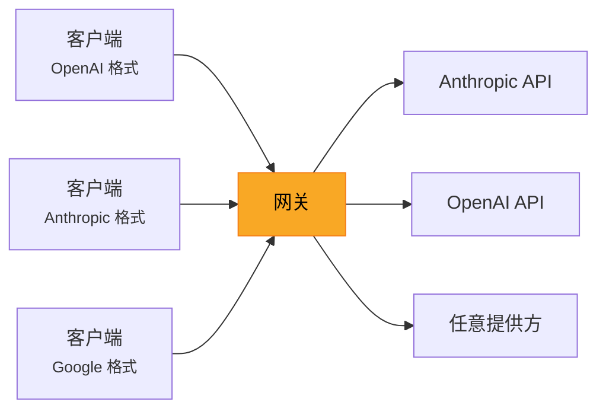
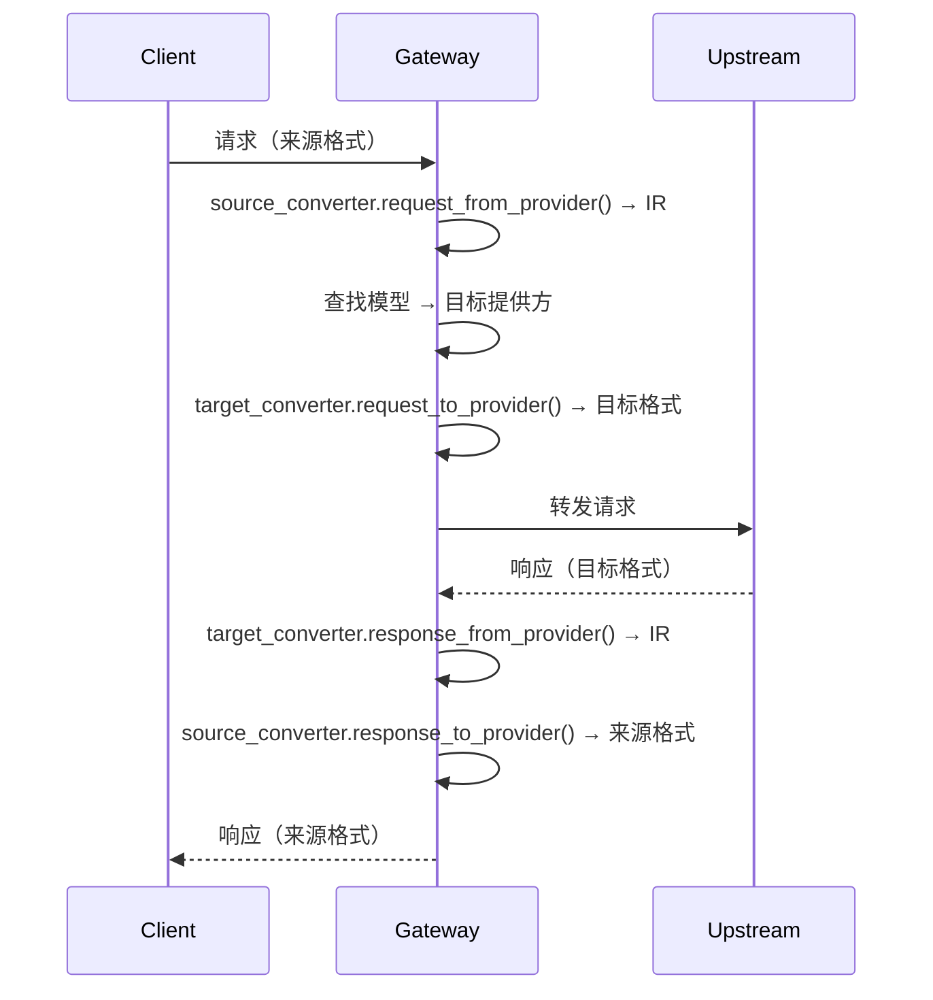

# 网关（Gateway）

LLM-Rosetta 网关是一个 HTTP 代理——你用任意支持的 API 格式发请求过来，它自动转成上游提供方的格式再转发。



初次使用？从[网关快速开始](../getting-started/gateway-quickstart.md)入手。

## 端点

| 路径 | 来源格式 | 说明 |
|------|---------|------|
| `POST /v1/chat/completions` | OpenAI Chat | 兼容 OpenAI SDK |
| `POST /v1/messages` | Anthropic | 兼容 Anthropic SDK |
| `POST /v1/responses` | OpenAI Responses | 兼容 OpenAI Responses SDK |
| `POST /v1/responses/compact` | OpenAI Responses | 上下文压缩，原样转发；需要 `open_responses` 上游（否则返回 `501`） |
| `POST /v1/messages/count_tokens` | Anthropic | 精确的输入 token 计数，委托给目标方自己的端点；需要 `messages` 上游（否则返回 `501`） |
| `POST /v1/embeddings` | OpenAI Embeddings | 通过 IR 跨格式转换（OpenAI、Cohere、Jina、Voyage） |
| `POST /v1/rerank` | Rerank（默认 Jina） | 通过 IR 跨格式转换（Jina、Cohere、Voyage） |
| `POST /v2/rerank` | Rerank（Cohere） | 自动检测 Cohere 格式；与 `/v1/rerank` 共用处理器 |
| `POST /v1beta/models/{model}:generateContent` | Google GenAI | 兼容 Google REST API |
| `POST /v1beta/models/{model}:streamGenerateContent` | Google GenAI（流式） | 兼容 Google 流式 API |
| `POST /v1beta/interactions` | Google Interactions | 兼容 Google Interactions API |
| `GET /v1/models` | OpenAI / Anthropic | 列出已配置模型，含 `api_standard` 和 `capabilities` |
| `GET /v1beta/models` | Google GenAI | 列出已配置模型（Google SDK 格式） |
| `GET /health` | — | 健康检查 |
| `GET /admin/` | — | [管理面板](admin-panel.md)（Web UI） |

来源格式由端点路径决定，不需要做自动检测。

## 流式传输

所有提供方组合都支持流式。用法和原生 API 一样：

```bash
curl http://localhost:8765/v1/chat/completions \
  -H "Content-Type: application/json" \
  -d '{
    "model": "claude-sonnet-4-20250514",
    "messages": [{"role": "user", "content": "Hello!"}],
    "stream": true
  }'
```

网关会实时转换 SSE 数据块。

## Token 计数 {: #token-counting }

`POST /v1/messages/count_tokens` 服务于在发送请求前先计数的 Anthropic 客户端（Claude Code 就是其中之一）。网关不做估算：它把请求体 —— 只把 `model` 改写为该路由的上游模型，其余字段不动 —— 转发到目标提供方自己的 `/count_tokens` 端点，再把应答原样返回（`x-rosetta-conversion: passthrough`）。

因此，只要目标实现 Messages 计数端点，计数就是精确的，与该提供方 SDK 报告的结果一致。委托而非估算带来两点限制：

- 请求体必须是合法的计数请求。Anthropic 在该端点拒绝仅用于生成的字段（`max_tokens`、`stream`），网关原样转发这个 `400`，不会替你删除字段。
- 模型被路由到不支持 Messages 的提供方时无法这样计数，该路由在 Messages 错误信封中返回 `501`。OpenAI Chat 与 OpenAI Responses 目标没有计数端点；Google 目标有 `:countTokens`，但它接受 Google 格式的请求并返回 `totalTokens`，本版本不用它服务 Messages 格式的计数。

该路由与其他路由一样记入请求日志与指标，token 用量记为空 —— 计数不消耗 token。

## 认证

API Key 通过**管理面板**（SQLite keystore）统一管理。
在 `/admin` 管理界面中生成 Key，然后按各 API 标准的原生方式传入
（Bearer token、`x-api-key` 头等）。

详见[网关 API Key](configuration.md#gateway-api-keys)。

## 工作原理

网关内部走 LLM-Rosetta 的转换器管道：



流式传输走同样的管道，只是在 SSE chunk 级别运作，用 `stream_response_from_provider()` 和 `stream_response_to_provider()` 配合 `StreamContext` 做有状态转换。
