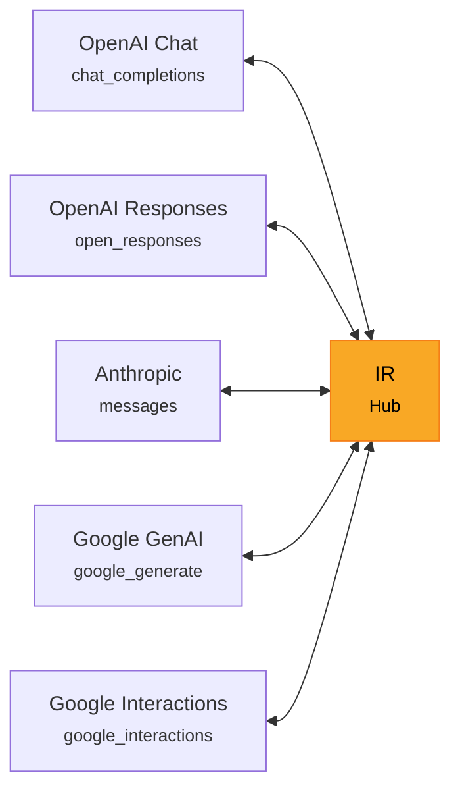

# Core Concepts

## The N² Problem

With N LLM providers, direct conversion between every pair requires N×(N-1) converters. For 4 providers, that's 12 converters to maintain.

## Hub-and-Spoke Solution

LLM-Rosetta introduces a central **Intermediate Representation (IR)** as the hub. Each provider only needs one converter to/from the IR, reducing the total to 2×N converters (8 for 4 providers).

## Four Levels of Control

The IR is the same at every level; only who calls the provider changes.

| | Functions | Raw converter | Pipeline | Gateway |
|---|---|---|---|---|
| **Use case** | Convert one IR value or tool | Translate one leg | Source → IR → target | HTTP proxy for any client |
| **Entry point** | `tool_ops`, `transforms`, `capabilities` | `ChatCompletionsConverter()` | `convert()` / `ConversionPipeline` | `llm-rosetta-gateway` |
| **Provider call** | You | You | You | The gateway |

Start at the level you need and move up without rewriting the translation.

## Converter Architecture

Each converter (e.g., `ChatCompletionsConverter`) is composed of four specialized operations classes:

| Component | Responsibility |
|-----------|---------------|
| `ContentOps` | Convert content parts (text, images, tool calls, etc.) |
| `MessageOps` | Convert complete messages (role + content) |
| `ToolOps` | Convert tool definitions, choices, calls, results, and configs |
| `ConfigOps` | Convert generation parameters (temperature, max_tokens, etc.) |

These compose into the 6 main converter interfaces:

- `request_to_provider()` / `request_from_provider()`
- `response_to_provider()` / `response_from_provider()`
- `messages_to_provider()` / `messages_from_provider()`

Plus 2 streaming interfaces:

- `stream_response_from_provider()` / `stream_response_to_provider()`

## Conversion Context

All converter methods accept an optional `ConversionContext` (non-streaming) or `StreamContext` (streaming) that threads shared state through the pipeline:

- **`warnings`** — accumulated conversion notes (e.g., unsupported features dropped)
- **`options`** — structured conversion options (e.g., `output_format`, `metadata_mode`)
- **`metadata`** — opaque store for provider-specific state

The `metadata_mode` option (`"strip"` or `"preserve"`) controls whether provider-specific fields survive the round-trip. See [Using Converters — Metadata Preservation](converters.md#metadata-preservation-lossless-round-trip) for details.

`StreamContext` extends `ConversionContext` with session-level metadata, tool call tracking, and lifecycle flags for stateful stream transformations. See the [Streaming](streaming.md) guide for full details.

!!! tip "Deep Dive"
    For details on the passthrough data model (`ProviderPassthroughEvent`, `ProviderPassthroughItem`), the three-layer preservation architecture, and converter dispatch internals, see the [Architecture Guide](../contributing/architecture.md).

## IR as the Application Payload

The IR is not only an intermediate step. Keep conversation history, routing
state or evaluation data in IR, and render it to a provider's dialect only at
the call boundary. Switching providers changes the renderer, not your
application's data model.

## IR Message Types

The IR defines four message roles:

- **SystemMessage** — system instructions
- **UserMessage** — user input (text, images, files)
- **AssistantMessage** — model responses (text, tool calls, reasoning)
- **ToolMessage** — tool execution results

Each message contains a list of typed **content parts** (TextPart, ImagePart, ToolCallPart, etc.).
