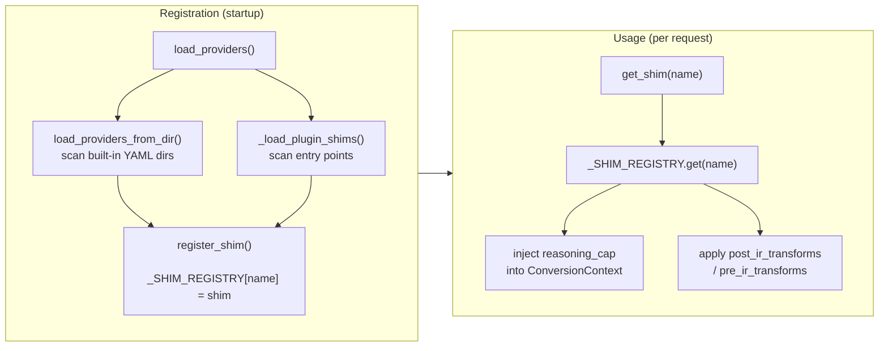
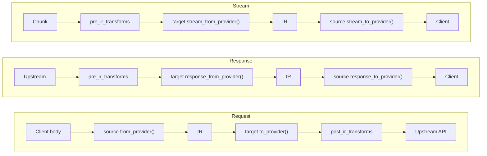

# Provider Shims

LLM-Rosetta uses only four **converters** — one per API standard (OpenAI Chat, OpenAI Responses, Anthropic, Google). But the LLM ecosystem has many more *providers* (DeepSeek, xAI, Qwen, Moonshot, …) that follow one of those standards with minor variations.

The **shim layer** bridges this gap. A shim is a lightweight identity card that declares which converter a provider uses, along with connection defaults and optional **transforms** that adapt request/response fields to match the provider's dialect.

## Architecture

```text
ProviderShim ("deepseek--chat_completions")
├── name: "deepseek--chat_completions"
├── model_type: "llm"                     → the capability category
├── format: "chat_completions"            → selects the converter
├── connection.base_url: "https://api.deepseek.com"
├── connection.api_key_env: "DEEPSEEK_API_KEY"
├── logo: "https://cdn.jsdelivr.net/..."
├── post_ir_transforms: (strip_fields("n", "logit_bias", "seed"),)
└── pre_ir_transforms: ()
```

- **ProviderShim** — provider identity: name, model type, wire format, default URL, default API key env var, logo URL, and optional transforms.
- **Transforms** — pure `dict → dict` functions applied around converters. `post_ir_transforms` adapt outgoing requests to the provider's dialect; `pre_ir_transforms` normalize incoming responses.

!!! note "The 0.13 spellings are removed"
    `ProviderShim(...)` raises a `TypeError` that names the replacement for `base`, `to_transforms`, `from_transforms` and the flat connection and tool keywords (`default_base_url`, `default_api_key_env`, `models_path`, `default_path`, `model_id_field`, `supports_custom_tools`, `max_tool_description_length`, `tool_search_mode`, `multimodal_tool_result`). A `provider.yaml` that declares `base:` or a flat connection or tool key, and a `transforms.py` that exports `to_transforms` or `from_transforms`, is refused at load with the same kind of message. See [Migrating to 0.14](migrating-to-0.14.md#removed-shim-declarations).

### Declarative Provider Directory

Built-in shims are defined as a directory structure under `shims/providers/`.
One shape covers every vendor; the three rules below are what the loader
accepts.

```text
<vendor>/
├── provider.yaml            # vendor manifest, never a leaf
├── auth.py                  # optional: the vendor's credential exchange
├── quota.py                 # optional: probes shared by every type
└── [<lane>/]                # optional: named instances of one vendor
    └── <type>/              # llm | embeddings | rerank | decisions
        └── [<format>/]      # only when the type holds more than one lane
            └── provider.yaml
```

1. **A lane level exists only for a vendor with several named instances** —
   ALCF's clusters (`alcf/metis/`, `alcf/minerva/`). The loader recurses into a
   directory that is neither a type directory nor a leaf, up to three levels,
   and still skips names that begin with `_` or `.`.
2. **`<type>/` is always present**, named the way the endpoint is spelled:
   `llm/`, `embeddings/`, `rerank/`, `decisions/`. The loader compares the
   directory with the shim's `model_type:` and refuses a shim filed under the
   wrong type. The category uses the directory's spelling (`embeddings`);
   the retired `embedding` spelling is refused in `model_type:` and as the
   per-type section name, with the replacement named in the error.
3. **`<format>/` appears only when that type holds more than one lane.** A chat
   vendor normally serves several dialects, so it keeps the format level; a
   vendor with one lane of a type puts `provider.yaml` directly in the type
   directory — `anthropic/llm/provider.yaml`. Add the second lane and the first
   moves down into its own format directory, which is what `shims migrate` does.

The built-in tree, in that shape:

```text
packages/llm-rosetta/src/llm_rosetta/shims/providers/
├── __init__.py
├── anthropic/
│   └── llm/provider.yaml        # one lane: the type directory holds the leaf
├── openai/
│   ├── provider.yaml            # vendor manifest: the shared credential
│   ├── quota.py                 # vendor-level probe, every type shares it
│   ├── llm/
│   │   ├── chat_completions/    # provider.yaml + transforms.py
│   │   └── open_responses/      # provider.yaml
│   ├── embeddings/provider.yaml
│   └── decisions/provider.yaml
├── openai_chatgpt/
│   ├── provider.yaml            # vendor manifest: comments only
│   ├── auth.py                  # vendor-level credential exchange
│   └── llm/open_responses/provider.yaml
├── antigravity/
│   ├── provider.yaml            # vendor manifest: keyless, the agent owns the token
│   └── llm/acp/provider.yaml    # transport: acp, argv ["agy", "acp"]
└── ...
```

**The file rule.** The gateway reads five names and nothing else:
`provider.yaml`, `auth.py`, `quota.py`, `transforms.py` inside a shim
directory, and `shims.yaml` at a package root. Everything else in the tree is
private to the package and is never imported — an `__init__.py` a package keeps
for its own imports is fine and stays unread. `auth.py` and `quota.py` execute
as flat modules, so they must be self-contained; `transforms.py` may use
relative imports.

**Check a tree, then move it.** `llm-rosetta-gateway shims check --root
<providers dir>` reports a tree the loader would misread — a leaf that is not
at a canonical path, a vendor directory used as a leaf, a type directory that
mixes the leaf and format levels, a file outside the allow-list — and exits
non-zero. `shims migrate --root <dir>` prints the moves that would put the tree
right and applies them with `--write`; it moves directories and rewrites
`shims.yaml` paths, but not relative imports, which the package's own tests
will catch. `shims new` scaffolds from the same template. The full contract,
with the scaffold's output and its placeholder list, is in
`llm_rosetta/shims/_shim_template/README_en.md`.

Each leaf directory contains:

- **`provider.yaml`** (required) — declares `name`, `model_type`, `format`, connection settings (`connection.base_url`, `connection.api_key_env`, `connection.auth_header`, `connection.keyless`, `connection.models_path`, `connection.default_path`, `connection.token_command`, and — for a lane whose upstream is not HTTP — `connection.transport` with `connection.acp_argv`), plus optional `logo`, `display_name`, `hint_msg`, and `free_source`.  The loader validates the `(model_type, format)` pair against the converter registry; both keys are required, and `base:` is refused.  A non-chat shim declares `connection.default_path` for the endpoint it serves (e.g. `/v1/embeddings`), and a provider can name it through `embeddings_shim` / `rerank_shim` / `decisions_shim` instead of a bare format.
- **`transforms.py`** (optional) — exports `post_ir_transforms` and/or `pre_ir_transforms` tuples (a module that exports the old names `to_transforms` / `from_transforms` is refused)

#### The vendor manifest (optional)

A `provider.yaml` at the vendor root — one
that declares no `name` and no `format` — is a *manifest*, not a shim: it holds
the `connection:` defaults every leaf below it inherits. Authentication is a
fact about the provider, not about each dialect it speaks, so that is where a
credential goes: one `api_key_env` for every OpenAI lane, one Globus
`token_command` for the three ALCF clusters, one `token_command_env` for the
four AskSage dialects.

```yaml
# alcf/provider.yaml
logo: https://cdn.jsdelivr.net/gh/Oaklight/llm-rosetta-shim-alcf@main/assets/alcf.svg
group: alcf            # one top-level group for three clusters
group_label: ALCF
connection:
  api_key_env: ALCF_API_KEY
  token_command: [python3, token.py]   # resolved against this file's directory
  token_refresh_interval: 3600
```

The merge is uniform: the manifest supplies the defaults, the leaf wins per
field, and `headers` merges per key. A vendor whose lanes genuinely differ keeps
the difference where it belongs — ALCF declares `base_url` per cluster, AskSage
keeps `auth_header: x-access-tokens` on its `google_generate` leaf only.

Besides `connection:`, a manifest may declare the three fields that describe the
*vendor* rather than one lane — `logo`, `group` and `group_label` — on the same
terms. They are worth hoisting because each is identical across a vendor's
leaves by construction: without `group`, the admin derives one from every shim
name, so ALCF's `alcf_metis` / `alcf_minerva` / `alcf_sophia` would render as
three top-level groups instead of one. A leaf may still state its own; anything
else (`name`, `format`, `tools`, …) is refused at load time, because it is a
shim's fact rather than the vendor's.

The manifest is optional and may declare any subset. Without one, a vendor keeps
declaring everything per leaf exactly as before, so an existing shim needs no
change. A leaf may also override a credential field for one lane; the built-in
tree keeps credentials in the manifest only, and a test enforces that so the
copies cannot come back.

A relative `token_command` argument resolves against the directory that
declared it — the vendor directory for a manifest command, the leaf directory
for an override — so `token.py` sits beside whichever file names it.

`auth.py` follows the same rule: beside the vendor manifest it is the vendor's
exchange, attached to every leaf; beside a leaf it belongs to that leaf. A
vendor declares one exchange, and one leaf declaring another is a load error.

**Scaffolding.** `llm-rosetta-gateway shims new` writes the files for a new
shim — the leaf, the vendor manifest when the vendor has none, the package's
`shims.yaml` entry when it ships one — and then loads the result through the real
loader, so a shape no gateway could use fails there instead of at startup. With
no flags on a terminal it asks for each field; **interactive is the default**,
and `--no-input` plus flags does the same in a script. Everything is written in
the contract shape: `--lane` puts a named instance between the vendor and its
type directory, `--auth` and `--quota` write the vendor-level stubs, `--package`
adds the external package shell, and `--transform` adds a `transforms.py` stub.
Inside a checkout, `scripts/dev/new_shim.py` is the same command with the
built-in tree as its default root. A logo URL is offered for saving into the
package's `assets/`, and what gets written is the jsDelivr URL of that file, so a
shipped mark never points at the vendor's host. The wire format is picked from
what the converter registry lists for the model type, and a pasted base URL is
normalised and then asked whether it answers — a negative answer is a warning,
not a refusal. An existing tree is read first, so the type's first lane lands in `<type>/`
and a vendor that already holds one gets `<type>/<format>/`; a vendor still
keeping format directories under itself is noted with the `shims check` command
rather than copied. A lane that would never load — below a directory that is
itself a shim, under a name another file already declares, or under a vendor
name the loader skips — is refused before anything is written. The mark is offered from the lobehub icon set on jsDelivr
when the vendor name matches one, and a URL already on jsDelivr is left alone
instead of being copied into `assets/`. Ctrl+C re-asks the current question once,
a second press cancels, and Ctrl+D cancels at once. See
[`shims new`](../gateway/cli.md#shims-new-vendor).

**Per-type parameter defaults.** A non-chat shim may declare the request fields its vendor differs on, in a section named after its own model type:

```yaml
# cohere/embeddings/provider.yaml
embeddings:
  task_type: retrieval_document
```

The keys are IR field names, so the converter writes them in the vendor's dialect; a declared value is a *default* — it fills a field the client omitted and never overrides one the client sent. The whitelist is the set of fields measured against the live endpoints: embedding `task_type`, `dimensions`, `encoding_format`, `truncation`; rerank `top_n`, `return_documents`, `max_tokens_per_doc`, `truncation`; decision none. A key outside the list, or a section for another model type, is refused at load time. `cohere--embedding` ships `task_type: retrieval_document` because Cohere rejects a `/v2/embed` request without `input_type`.

`connection.keyless` marks an upstream that accepts requests with no credential: the
provider sends no auth header while no `api_key` is configured, and falls back to the
base type's auth when one is supplied. `free_source: true` marks a shim whose gateway
serves a free model pool — the admin UI groups its keyless entry under a "Free
Resource" section and titles it `<display_name> (Free)`.

**A note in the provider form.** `hint_msg` is a line the admin panel shows under the
Base URL field when the shim is selected — the place to explain a configuration step
the connection defaults cannot express. Declare one string per language; a bare string
is stored as `en`:

```yaml
hint_msg:
  en: "Defaults to the Go lane. For the Zen lane set Base URL to https://opencode.ai/zen/v1."
  zh: "默认走 Go lane。Zen lane 请把 Base URL 改为 https://opencode.ai/zen/v1。"
```

The panel picks the current interface language, falls back to `en`, then to the first
declared language. The note is plain text (inserted as text, never HTML) and renders on
one line: a short note reads inline, a longer one truncates with an ellipsis and the full
text appears on hover. Nothing in the proxy path reads it.

**Credential exchange.** Some upstreams do not accept an account API key on their
inference endpoints — AskSage takes a short-lived access token minted from the
account key, ALCF a Globus bearer token that expires and has to be refreshed. The
exchange is a fact about the vendor, so the vendor manifest can declare it once
instead of leaving every operator — and every leaf — to write it:

```yaml
# <vendor>/provider.yaml — inherited by every leaf below it
connection:
  api_key_env: VENDOR_API_KEY
  token_command: [python3, token.py]
  token_refresh_interval: 7200
```

The gateway runs the command at startup, again every `token_refresh_interval`
seconds (`3600` when the shim and the provider both stay silent, minimum `60`),
and immediately after an upstream `401`; its stdout becomes the credential sent
upstream. A relative argument that names a file in the declaring directory is
resolved to its absolute path, so the vendor ships the script beside the
`provider.yaml` that names it — `python3` and any flag stay as written. A
provider that names its own `token_command` still wins, and while a command owns
the credential the shim's `api_key_env` is not used as a static key.

**An exchange that consumes the operator's key** declares the variable to hand
it over in:

```yaml
# <vendor>/provider.yaml
connection:
  api_key_env: VENDOR_API_KEY
  token_command: [python3, token.py]
  token_command_env: VENDOR_ACCOUNT_KEY
```

With `token_command_env` set, the key the operator configured (or `api_key_env`
supplied) is passed to the command under that name — never in argv, where the
process table would expose it — and the command's stdout, not the key, is what
goes upstream. It also lifts the `api_key`/`token_command` mutual exclusion for
this shim: the key is an *input*, not a second credential. Without it the
command runs with the gateway's environment and must find its own credentials,
which is the ALCF case (`~/.globus`).

**An exchange that needs code.** `token_command` describes an exchange that fits
in an argv. Sign in with ChatGPT does not: it has an interactive first run, a
refresh token that rotates on every use, and a credential record rather than one
string. A vendor in that position ships `auth.py` beside its `provider.yaml` —
the same trust level and loading path as `transforms.py` and `quota.py` — and
exports `EXCHANGE`:

```python
# auth.py
from llm_rosetta.contracts.auth import BaseAuthExchange


class Exchange(BaseAuthExchange):
    kind = "oauth"

    def needs_interactive_setup(self, ctx):
        return not (ctx.state_dir and os.path.exists(_record_path(ctx)))

    async def credential(self, ctx):
        return await _refresh_or_load(ctx)  # raise InteractiveSetupRequired

    def account_id(self, ctx):
        return _subject(ctx)  # opaque; the gateway hashes it


EXCHANGE = Exchange()
```

| Member | Called | Must |
|--------|--------|------|
| `credential(ctx)` | startup seed, scheduled refresh, once after an upstream `401` | return the string to send upstream; `await` network I/O |
| `needs_interactive_setup(ctx)` | config build, before any request | read local state only |
| `account_id(ctx)` | config build | return an opaque account identity, or `None` |
| `kind` | reporting | be a short label such as `"oauth"` |
| `consumes_key` | config build | say whether `ctx.input_key` is an input |
| `login(ctx)` | the CLI, on a machine with a browser | run the interactive sign-in and return the record; blocking, never called by the gateway |
| `install(ctx, record)` | `PUT …/credential` | validate what it is handed and store it; return a summary, never a token |
| `describe(ctx)` | `GET …/credential` | return the token-free summary, or `None` |
| `revoke(ctx)` | `DELETE …/credential` | remove the record, revoking upstream when the vendor allows it |

`login`, `install`, `describe` and `revoke` are optional. Each exists on
`BaseAuthExchange` and raises, so "has the attribute" is never the question: an
exchange says what it implements through `can_install()`, `can_login()` and
`can_revoke()` (all default to `False`), and the gateway refuses that operation
rather than calling a stub: a provider that cannot install answers `501` to the
`PUT`, and one that cannot sign out answers `501` to the `DELETE` rather than a
`200` that changed nothing. `describe()` is the exception — it returns `None`
rather than raising, and `None` is exactly what "nothing to say" means.

`ctx` carries the provider's config key (`ctx.provider`), the credential record's
directory (`ctx.state_dir` — `server.data_dir` resolved against the config file,
then `/shim-auth/<provider>`; `None` only when a programmatic caller supplies no
data directory), and
the operator's key (`ctx.input_key`) when `consumes_key` is set. Two providers of
one shim are two accounts, so an exchange that picks its own default for
`state_dir` must namespace it by `ctx.provider`; that directory is the only thing
keeping their records apart. There is one
`credential()` rather than a separate seed and refresh because the gateway never
distinguishes the two: a credential is usable now or it is not.

The gateway drives the same machinery for both forms — startup seeding under
`/health/ready`, the background refresher, and the reactive `401` retry — so an
exchange needs no scheduling of its own. When `credential()` raises
`InteractiveSetupRequired`, the provider is reported as needing a sign-in
instead of failing upstream on every request, and it is not retried on the seed
pass.

The shipped reference implementation is the OpenAI plan route's
`openai_chatgpt/auth.py` (issue
[#1057](https://github.com/Oaklight/llm-rosetta/issues/1057)): dynamic client
registration, PKCE, a loopback callback, ID-token verification against the
discovery JWKS, a `0600` credential record written atomically under an exclusive
lock, rotating refresh tokens, and a host id that survives re-signing in. It is
standard library only — RS256 is verified with `hashlib` and integer `pow`, and
HTTP is `urllib` on a worker thread — which is the shape a shim module has to
keep to, since the shim layer loads before the gateway and core has no
dependencies.

A record can also be installed after the fact: `llm-rosetta-gateway credential
<name>` runs `login()` on a machine that has a browser, and `PUT
/admin/api/config/providers/<name>/credential` hands the exchange the record it
printed — which is how a remote gateway gets one without binding its own
loopback.  The command never contacts the gateway; the record is the whole
handover. The exchange validates it — the OpenAI
module verifies the ID token and takes the subject from the verified claims —
and stores it where its own `credential()` will look. Paste the record promptly:
verification happens on arrival, so a record left lying around overnight is
refused and the sign-in has to be repeated.

A vendor declares one form or the other: `auth.py` and `connection.token_command`
together is a load error. A provider's own `token_command` still wins, and an
`api_key` beside an exchange that does not declare `consumes_key` is rejected —
the two are alternative sources for one credential.

#### Declaring the credential's inputs

An exchange that needs more than the key — AskSage needs the account email the
key was issued to — declares those inputs as data, in the same vendor manifest:

```yaml
# <vendor>/provider.yaml
fields:
  - key: email
    label: Account email
    placeholder: you@example.gov
    help: The address the AskSage account key was issued to.
```

Each entry becomes one input beside the key in the provider drawer's Auth pane,
and one **Save** writes the key and the values into the provider entry under
`auth_fields`, which is where the exchange reads them. A leaf may add a key or
reword an entry; the merge is attribute by attribute, so a leaf that changes
only `label` keeps the vendor's `help` and `required`.

| Key | Required | Meaning |
|-----|----------|---------|
| `key` | yes | The entry key the value is stored under. Letters, digits, `_`, `.`, `-`, at most 64 characters — it is also the input's element id. |
| `label` | yes | What the operator sees. |
| `placeholder` | no | An example, never a secret. |
| `help` | no | One sentence under the input. |
| `required` | no | `true` refuses a save that leaves the input empty — while the shim's own sign-in is the credential source, because a static key or a command reads none of these values. |

The declaration is validated at load, before an operator ever sees it: a block
that is not a list of mappings, an entry without a usable `key` or `label`, a key
declared twice, a key or description longer than 200 characters, more than eight
entries, or a key the schema does not define (`secret`, `type`, …) is a load error
naming the file. None of these values is a secret: they are stored verbatim in the
provider entry and printed back in the panel, so the credential itself still
belongs in `api_key`, `token_command`, or the exchange's own record.

A shim that ships an exchange may also declare the same inputs in code, from
`AuthExchange.fields()`; the YAML wins per key, and an entry declared only in
code is appended after the YAML ones. The shipped reference is the AskSage
shim: four lanes, one `email` in its vendor manifest, no form code in `auth.py`.

**How the admin panel groups shims.** The provider-type picker has two levels: a
top level (the *group*) and one row per shim under it. Both strings can be
declared, because they are not always derivable from the name:

| Field | Meaning | Default |
|-------|---------|---------|
| `display_name` | This shim's own label, shown in the second column — for a shim that also declares `group` or `group_label` | the name segment after `--` |
| `group` | The top-level key this shim is filed under | the name segment before `--` |
| `group_label` | Title of that top level | the group key |

The defaults are the old behaviour — the shim name split on its first `--` — so a
shim that declares none of these renders exactly as it always has, and neither
third-party nor external shims need to change. Declaring `group` is what lets one
vendor own several clusters × several formats: ALCF's three clusters each declare
`group: alcf` and `display_name: metis` / `minerva` / `sophia`, and the picker shows
one `alcf` top level whose rows read `metis · chat_completions`.

A row that shows `label · base` is the picker saying the shim's label is not its
base format — an affordance any shim can use, not a special case for one family.

`display_name` did not always mean this. Before `group` existed it named the
shim's **top level** — the vendor — and a shim written against that older schema
still says so. Which reading applies is decided by whether the shim declares a
grouping field: declaring neither `group` nor `group_label` keeps the older
meaning, so such a shim renders exactly as it did before (`display_name` titles
the group, and the row label still comes from the name). Declaring either makes
`display_name` this shim's own row label. Without that split, an older shim's
vendor name would be printed twice — once as the group title and again on its
only row. The related consequence: the group title is also the brand shown on
free-source buttons (`<Brand> (Free)`), so a grouped vendor that wants more than
its capitalized group key there declares `group_label`.

Example `provider.yaml`:

```yaml
name: deepseek
model_type: llm
format: chat_completions
logo: https://cdn.jsdelivr.net/npm/@lobehub/icons-static-svg@latest/icons/deepseek.svg

connection:
  base_url: https://api.deepseek.com
  api_key_env: DEEPSEEK_API_KEY
```

Example `transforms.py`:

```python
from llm_rosetta.contracts.transform import strip_fields

# DeepSeek does not support n, logit_bias, or seed
post_ir_transforms = (strip_fields("n", "logit_bias", "seed"),)
pre_ir_transforms = ()
```

At import time, `shims/__init__.py` scans all provider directories and registers them automatically, then discovers any plugin shims via entry points.

### What a shim may import {#what-a-shim-may-import}

A shim's sidecars (`transforms.py`, `auth.py`, `quota.py` and any helper module beside them) and the `register_shims` entry point of a shim package import `llm_rosetta` only through `llm_rosetta.contracts` and its submodules:

| Need | Import from |
| --- | --- |
| `ProviderShim`, `ConnectionConfig`, `load_providers_from_dir` | `llm_rosetta.contracts.shim` |
| Transform primitives and the hook types | `llm_rosetta.contracts.transform` |
| The credential exchange of `auth.py` | `llm_rosetta.contracts.auth` |
| The allowance probe of `quota.py` | `llm_rosetta.contracts.quota` |
| The sidecar hook names (`PRE_IR_TRANSFORMS`, `QUOTA_PROBES`, …) | `llm_rosetta.contracts` |

Not `llm_rosetta.api`, and no internal module. The loader runs plugin entry points and sidecars while `import llm_rosetta` is still in progress. `llm_rosetta.api` needs the finished package, so it cannot load at that point; the contract modules can. The contracts are also the stable part: within a minor release they only gain names, and an internal module may move in any release. A vendor directory does not import another vendor's directory either, so that each one can move out of core on its own.

For the built-in shims, `tests/test_shim_sidecar_boundary.py` enforces the rule over every `.py` file under `shims/providers/<vendor>/`, over the scaffold templates and over what the scaffolder writes. See [The core surface](../api/index.md#the-core-surface) for the tiers.

## Shim Lifecycle



- **Registration** happens once at import time. `load_providers()` scans the built-in `providers/` directory, then discovers `llm_rosetta.shim_providers` entry points to load plugin shims.
- **Usage** happens per request. `get_shim(name)` looks up the registry; the gateway injects reasoning config and applies transforms around the converter.

## Plugin Shims

Downstream packages can register their own shims without modifying llm-rosetta. Two approaches:

### Entry Point (recommended)

Declare an entry point in your `pyproject.toml`:

```toml
[project.entry-points."llm_rosetta.shim_providers"]
my_provider = "my_package.shims:register_shims"
```

The callable scans a local YAML directory and returns the registered shims:

```python
# my_package/shims/__init__.py
from pathlib import Path
from llm_rosetta.contracts.shim import load_providers_from_dir

def register_shims():
    return load_providers_from_dir(Path(__file__).parent / "providers")
```

### Conditional Registration

For advanced use cases (environment-specific shims, dynamic config), call `register_shim()` directly:

```python
import os
from llm_rosetta.shims import ConnectionConfig, register_shim, ProviderShim

def register_shims():
    if os.getenv("MY_INTERNAL_PROVIDER"):
        register_shim(ProviderShim(
            name="my-internal",
            format="chat_completions",
            connection=ConnectionConfig(base_url="http://internal:8080/v1"),
        ))
```

!!! note
    When a plugin registers a shim with the same name as a built-in, the built-in is silently overridden (INFO log emitted). This is intentional — it allows plugins to customize built-in provider behavior.

### Config-declared directories and remotes

A shim set can also be consumed **without installing a plugin**. The gateway's
top-level `shims` config section scans extra directories and fetches remote
archives into a local cache — useful when the official image is used as-is (it
ships no `pip` and no `git`) and the shims live in their own repository:

```jsonc
"shims": {
  "presets": ["alcf"],                            // shorthand for the catalog remote below
  "paths": ["/config/shims"],                     // dirs holding <vendor>/<type>/provider.yaml (or the older flat/grouped shapes)
  "remotes": [
    {
      "url": "https://github.com/Oaklight/llm-rosetta-shim-alcf",
      // "ref": "v0.1.0",                          // pin once the repo is tagged; omit => HEAD, pinned on first fetch
      "path": "src/llm_rosetta_shim_alcf/providers",
      "token_env": "GITHUB_TOKEN"                  // optional; private shim repository only
    }
  ]
}
```

A `presets` entry names a package from the source catalog (ALCF, Argo,
AskSage, Free Endpoints, Open Design) and installs it from its manifest source
(see [Manifest sources](#manifest-sources)); an explicit remote for the
package's repository keeps it on the remote shown below, merged onto the
catalog entry (explicit keys win). A remote `path` is the directory inside the archive that holds
the provider directories (for the `llm-rosetta-shim-*` packages that is
`src/<package>/providers`). See
[Gateway → External Shim Sources](../gateway/configuration.md#external-shim-sources)
for the full field list, caching and refresh behaviour, precedence, and the
security note. Programmatically, use `llm_rosetta.shims.rebuild_shims()` (no
config file needed) or `llm_rosetta_gateway.apply_shim_sources(raw, config_path)`.

An unknown preset is skipped with a warning unless `shims.strict` is `true`,
which refuses it, so a config written by a newer build still starts on an
older one. A malformed section (a `presets` string, say) is refused when the
config loads rather than at startup.

### Manifest sources { #manifest-sources }

Since 0.14.0 the standalone packages are published from two curated source
repositories, each with a versioned `manifest.json` on its `dist` branch:
[llm-rosetta-shim-argonne](https://github.com/Oaklight/llm-rosetta-shim-argonne)
(`alcf`, `argo`, `asksage`) and
[llm-rosetta-shim-contrib](https://github.com/Oaklight/llm-rosetta-shim-contrib)
(the free endpoints and `opendesign`). The manifest has one record per released
vendor version: its shims, tags, maturity, the archive and its sha256, and the
core it needs (`requires: {surface, ir}`). The format is
`llm_rosetta.contracts.shim_manifest` and its schema ships with core.

```jsonc
"shims": {
  "sources": ["contrib", "argonne"],               // catalogue ids or manifest URLs
  "install": ["opendesign", "tag:tier:free", "argonne:*"]
}
```

`install` entries:

| Entry | Selects |
|-------|---------|
| `opendesign` | the vendor of that name, in every source |
| `tag:tier:free` | every vendor whose newest record carries that tag; tags are matched whole (`tier:free`, `tier:subscription`, `auth:oauth`, `org:argonne`) |
| `*` | every vendor |
| `argonne:*`, `argonne:alcf`, `contrib:tag:tier:free` | any of the above, limited to one source |

`install` without `sources` reads `contrib` and `argonne`. A source may also be
a manifest URL, or an object `{"url": …, "fallback": …, "token_env": …}`.

For each selected vendor the gateway installs the newest **stable** version
whose `requires` this core satisfies — `surface` equal to
`llm_rosetta.contracts.SURFACE_VERSION` and `ir` not above `IR_VERSION` — and
logs a WARNING for each newer incompatible version it passed over, with the
reason. A pre-release (`0.5.0-rc.1`) is installed only when no stable version
is installable, so one pre-release on `dist` does not upgrade every gateway.
Versions are `MAJOR.MINOR.PATCH` with an optional pre-release and no build
metadata (`+build` makes the manifest invalid). A tag selector reads the tags
of the vendor's newest installable record. The
archive is checked against the record's sha256 before it is installed into the
shim cache. The release record is authoritative for what registers: an
archive without a `shims.yaml` loads only the shim names its record lists, and
any other name is refused with a WARNING. The installed version is kept until
a newer *installable* version appears; re-reading the manifest never
downgrades it, and an installed version the manifest no longer lists is kept
with a WARNING. The manifest is read from
jsDelivr (`…@dist/manifest.json`), with `raw.githubusercontent.com` as the
fallback, and reused for `remote_ttl`; **Refetch** reads it at once. When the
source cannot be reached the cached manifest and the last good install are used,
and a digest mismatch never installs (the previous version stays, marked
stale).

**Core wins, per shim.** A shim name core already registers is not loaded
from the source, and the log names the source, the vendor and the ignored
names; the vendor's other shims still install (a vendor all of whose shims core
registers is skipped). `promoted_to: core@X` is read from the record that
would be installed, so a later release without it un-promotes the vendor. The
claim is honoured only when the running core is at `X` or later — a dev or
pre-release of `X` (`0.14.0.dev35`) is before `X` — and core registers the
record's shims; a claim that is due but not borne out is logged and the vendor
installs normally. A manifest install loads before
`paths` and `remotes`, so an explicit source still overrides it.

**Legacy presets keep working.** `shims.presets` needs no edit: `alcf`,
`argo` and `asksage` map to `argonne:<vendor>`, `free` to
`contrib:tag:tier:free`, and `opendesign` to `contrib:opendesign`; a
`shims.include` / `shims.exclude` entry keyed by the preset travels with it. Two
cases stay on the old remote path: a package an explicit `shims.remotes` entry
names (by its current or its old repository URL — `llm-rosetta-shim-argo` is now
`-argonne` and `llm-rosetta-shim-free` is now `-contrib`), and, with a WARNING,
a mapped preset whose source has never answered (no manifest fetched or cached
yet). When the source answers but carries no matching vendor (a staged
publish, a renamed tag), the old remote is **not** loaded — it carries code
built for an older core — and the gateway logs a WARNING and reports the
selector as a source row marked *not in the manifest*, so the loss is visible
in the log and on the Shims page. The same holds for any `install` entry that
matches nothing.

#### Selecting part of a package { #selection }

A package is loaded whole by default. Two optional maps narrow that without
touching the package, keyed by preset:

```jsonc
"shims": {
  "presets": ["free"],
  "include": { "free": ["llm7--chat_completions"] },
  "exclude": { "alcf": ["alcf_sophia--chat_completions"] }
}
```

Entries are shim names or `*` patterns (`asksage--*`). An empty `include` means
"no restriction", not "nothing"; `exclude` wins over `include`. An explicit
`remotes[]` entry may carry `include` / `exclude` inline. Selection is applied
after a leaf's `provider.yaml` is parsed and before its `transforms.py` is
imported, so a declined shim costs neither its module nor its registration.

An `include` that matches nothing warns at startup, naming what the source did
load, and fails only under `shims.strict: true`. An `exclude` that matches
nothing the source ships warns too, and never fails a load: the patterns match
shim names, so a directory name read off the tree (`drop`) declines nothing, and
the warning says so. An `include` whose every hit the `exclude` then drops warns
as well, and fails under `shims.strict: true`, because every pattern matched and
the source still ends up empty. These warnings are startup log lines; the same
facts ride the reload report — `unmatched`, `unmatched_excludes`,
`emptied_includes` and `declined` — beside each source. A provider that needs a
declined shim fails with the usual unknown-shim error, so the failure lands on
whatever needed it.

Selection is name-based, so it needs the names. A package can declare them with
a `shims.yaml` at the root of the directory its `path` names:

```yaml
version: 1
shims:
  - name: llm7--chat_completions
    path: providers/llm7
  - name: ovhcloud--chat_completions
    path: providers/ovhcloud
```

A manifest that is present is authoritative: only what it lists is loaded, and
an unlisted directory is never read — so an author who does not maintain it
loses only their own new shims. Its paths are relative to the scan root and
cannot escape it, and it carries no URLs, so it cannot point the loader at
another origin. A manifest that exists but cannot be honoured fails its source
rather than falling back to scanning, because the fallback would parse exactly
the tree the manifest bounded. A package without one is scanned as before, and
selection still applies, by name.

Built-in shims ship no manifest, and `include` / `exclude` do not reach them:
the wheel fixes their set, so there is no external author whose edit a manifest
would bound. `shims.disabled` — each row's switch in the panel — is the one that
narrows them, and it also drops a declined shim from the registry at startup.

#### Mirrors { #mirrors }

A remote source dies wherever its host is unreachable: `github.com` behind a
firewall, a forge under maintenance, a DNS name that does not resolve from this
network. A `mirror` gives the same archive a second URL, tried when the primary
cannot be connected to:

```jsonc
"remotes": [
  {
    "url": "https://github.com/Oaklight/llm-rosetta-shim-alcf",
    "ref": "v0.1.0",
    "sha256": "0123…abcd",
    "mirror": {
      "url_template": "https://cdn.jsdelivr.net/gh/Oaklight/llm-rosetta-shim-alcf@dist/{ref}/alcf.tar.gz",
      "sha256": "89ab…cdef",
      "path": "providers"
    }
  }
]
```

The two situations it is meant for are a public CDN in front of the forge — the
`dist` archive the standalone packages publish, which jsDelivr serves — and an
internal mirror on the network the gateway runs in. The template takes the
source's declared `ref` — not the commit a GitHub primary resolved it to, so a
mirror published one directory per release keeps working even when the forge's
API is rate-limited or unreachable — and the mirror pins its **own** `sha256`:
the bytes a CDN serves are not the forge's repository tarball. Declaring a
mirror beside a primary that pins `sha256` without pinning the mirror is
refused when the config loads, because the mirror is the path an on-path
attacker can force.

What falls back to what. The rule first: **a warm cache covers every failure
except the source's verdict on its own bytes.** The fetch is served from the
cache and reported as `stale` after a transport failure on every leg, an HTTP
error from a leg, a disk that cannot be written (`ENOSPC`, `EPERM`, a read-only
tree) and a `token_env` variable that is not set. It is **not** used for the two
failures that say the bytes are wrong: a `sha256` mismatch, and a body that is
not an installable archive — a page served in place of the archive, a truncated
archive, an unsafe member, or more bytes than the download cap allows, whichever
check notices it first. Every other failure is one the cache covers. With
nothing cached, every one of them fails the source.

The mirror is asked only when the primary could not be connected to. One
exception: the leg that served last is tried first, so once a mirror has taken
over it is asked before the primary, and a failure of the mirror then moves on
to the primary instead. The table holds for the state a fresh process starts in,
with the primary first:

| What the primary did | Mirror tried? | With a warm cache |
|:---|:---|:---|
| could not be connected to (refused, DNS, timeout) | **yes** — the one case a mirror exists for | the stale copy is used if no leg serves |
| answered with an HTTP error (`403`, `404`, `5xx`) | no — the source's own verdict | the stale copy is used, `stale: true` |
| could not be reached with its credential (`token_env` unset) | no | the stale copy is used, `stale: true` |
| sent a body that is not an installable archive (a page served instead of it, a truncated archive, an unsafe member) | no | not masked; the source fails |
| sent bytes that do not match its `sha256` | no | not masked; the source fails |
| sent more bytes than the download cap allows | no | not masked; the source fails |
| could not be written to disk (full disk, permissions) | not retried — the other leg needs the same disk | the stale copy is used, `stale: true` |

The mirror is a stand-in, not an authority: a failure of the mirror itself — a
transport error, an HTTP error, an unusable body — moves on to the other leg
rather than deciding for the primary, because a CDN that has not got the version
yet says nothing about the forge. A mirror that *pins* its bytes is the
operator's declaration, though: an unusable body or a mismatch there is final,
while a transport or HTTP failure still moves on. The leg that last served is
remembered for the process lifetime, so a working mirror costs one failed
connect, not one per fetch, and a restart costs one. The startup log says which
leg each source loaded from (`loaded via mirror`); the `leg` and the expanded
`archive_url` are also part of the source status the admin API returns.

A preset pins no `ref`, so it tracks the repository's branch: each fetch
resolves the branch to a commit and records that commit in the cache stamp.
That is what a shim change no longer has to wait for a release to travel.

A preset carries a **commit-addressed mirror**: the `dist` archive on jsDelivr
with `{ref}` in the template, and `path: "providers"` for that archive's layout
(a name, not `"."`, so an archive that wraps the tree in one more directory
still loads). Each package's publish job builds one immutable
`dist/<commit>/<name>.tar.gz` directory per push, and the loader fills `{ref}`
with the commit it resolved the branch to — so the archive the preset names and
the commit it records describe one tree, which is what a `ref` plus `sha256`
pair used to guarantee, without a release in the loop.

One limitation worth knowing: the address is a commit, and a gateway that has
never resolved the branch — a cold cache during a forge outage — has no commit
to fill in. Its first fetch still fails; the mirror helps from the second fetch
on, when the cache stamp carries the commit it resolved. That is deliberate: a
leg that answers rather than guessing a tree is the right outcome, and a guess
there would load the wrong shims quietly.

The address has to be exactly what the packages publish. A mirror answers `404`
as a final verdict, and the leg is only asked when the forge cannot be connected
to, so a template that names a directory nobody writes fails precisely where the
mirror is the only remaining option. `scripts/dev/check_shim_workflow.py` in the
core repository guards the other half: the five packages' copies of the publish
job must stay identical to the master copy, or one of them silently stops
writing the directory this template names.

The `mirror` field itself is unchanged and an explicit remote may still carry
one. Replacing the CDN with an internal mirror is a matter of writing the
remote out, and an explicit remote with the same URL is merged onto its preset
(explicit keys win).

!!! warning
    A declared source may ship a `transforms.py` that is executed on load — the
    same trust level as installing a plugin package. Pin a ref and only add
    sources you trust.

## Built-in Shims

LLM-Rosetta ships with 49 built-in provider shims, one directory per shim under
`packages/llm-rosetta/src/llm_rosetta/shims/providers/<vendor>/<model-type>/`. `list_shims()` prints the live set; this is
that set. The ALCF, AskSage, Argo, Open Design and keyless free-endpoint shims
ship as standalone packages — see
[Standalone shim packages](#standalone-shim-packages).

| Name | Format | Default Base URL | API Key Env | Transforms |
|------|--------|-----------------|-------------|------------|
| `anthropic--messages` | `messages` | `https://api.anthropic.com` | `ANTHROPIC_API_KEY` | — |
| `cohere--chat_completions` | `chat_completions` | `https://api.cohere.com/compatibility/v1` | `COHERE_API_KEY` | — |
| `cohere--embedding` | `cohere` | `https://api.cohere.com` | `COHERE_API_KEY` | — |
| `cohere--rerank` | `cohere` | `https://api.cohere.com` | `COHERE_API_KEY` | — |
| `deepseek--chat_completions` | `chat_completions` | `https://api.deepseek.com` | `DEEPSEEK_API_KEY` | strips `n`, `logit_bias`, `seed`, penalties; declares reasoning replay (`replay_missing`) |
| `deepseek--open_responses` | `open_responses` | `https://api.deepseek.com` | `DEEPSEEK_API_KEY` | strips `n`, `logit_bias`, `seed` |
| `google--embedding` | `google_generate` | `https://generativelanguage.googleapis.com` | `GOOGLE_API_KEY` | — |
| `google--google_generate` | `google_generate` | `https://generativelanguage.googleapis.com` | `GOOGLE_API_KEY` | — |
| `google--google_interactions` | `google_interactions` | `https://generativelanguage.googleapis.com` | `GOOGLE_API_KEY` | — |
| `groq--chat_completions` | `chat_completions` | `https://api.groq.com/openai/v1` | `GROQ_API_KEY` | renames `reasoning` → `reasoning_content` |
| `jina--embedding` | `jina` | `https://api.jina.ai` | `JINA_API_KEY` | — |
| `jina--rerank` | `jina` | `https://api.jina.ai` | `JINA_API_KEY` | — |
| `kilo--chat_completions` | `chat_completions` | `https://api.kilo.ai/api/gateway` | `KILO_API_KEY` | — |
| `minimax--chat_completions` | `chat_completions` | `https://api.minimaxi.com/v1` | `MINIMAX_API_KEY` | strips `logprobs`, `top_logprobs`, `seed`, `stop`; injects `reasoning_split`; parses `think` tags |
| `minimax--embedding` | `minimax` | `https://api.minimaxi.com` | `MINIMAX_API_KEY` | — |
| `minimax--messages` | `messages` | `https://api.minimaxi.com/anthropic` | `MINIMAX_API_KEY` | — |
| `moonshot` | `chat_completions` | `https://api.moonshot.cn/v1` | `MOONSHOT_API_KEY` | strips `logprobs`, `top_logprobs`, `logit_bias`, `seed` |
| `modelscope--chat_completions` | `chat_completions` | `https://api-inference.modelscope.cn/v1` | `MODELSCOPE_API_KEY` | — |
| `nvidia--chat_completions` | `chat_completions` | `https://integrate.api.nvidia.com/v1` | `NVIDIA_API_KEY` | — |
| `openai--chat_completions` | `chat_completions` | `https://api.openai.com/v1` | `OPENAI_API_KEY` | — |
| `openai--embedding` | `openai` | `https://api.openai.com/v1` | `OPENAI_API_KEY` | — |
| `openai--open_responses` | `open_responses` | `https://api.openai.com/v1` | `OPENAI_API_KEY` | — |
| `openai--openai_decisions` | `openai_decisions` | `https://api.openai.com` | `OPENAI_API_KEY` | — |
| `opencode--chat_completions` | `chat_completions` | `https://opencode.ai/zen/go/v1` | `OPENCODE_API_KEY` | — |
| `opencode--messages` | `messages` | `https://opencode.ai/zen/go/v1` | `OPENCODE_API_KEY` | — |
| `opencode--open_responses` | `open_responses` | `https://opencode.ai/zen/go/v1` | `OPENCODE_API_KEY` | — |
| `openrouter--chat_completions` | `chat_completions` | `https://openrouter.ai/api/v1` | `OPENROUTER_API_KEY` | renames `reasoning` → `reasoning_content` |
| `openrouter--messages` | `messages` | `https://openrouter.ai/api` | `OPENROUTER_API_KEY` | — |
| `openrouter--open_responses` | `open_responses` | `https://openrouter.ai/api/v1` | `OPENROUTER_API_KEY` | — |
| `openrouter--rerank` | `cohere` | `https://openrouter.ai/api/v1` | `OPENROUTER_API_KEY` | — |
| `qwen` | `chat_completions` | `https://dashscope.aliyuncs.com/compatible-mode/v1` | `DASHSCOPE_API_KEY` | strips `frequency_penalty`, `logit_bias` |
| `siliconflow--chat_completions` | `chat_completions` | `https://api.siliconflow.cn/v1` | `SILICONFLOW_API_KEY` | typed catalogue; keeps active `subType: chat` |
| `siliconflow--embedding` | `openai` | `https://api.siliconflow.cn/v1` | `SILICONFLOW_API_KEY` | typed catalogue; keeps active `subType: embedding` |
| `siliconflow--rerank` | `cohere` | `https://api.siliconflow.cn/v1` | `SILICONFLOW_API_KEY` | typed catalogue; keeps active `subType: reranker` |
| `typesafe--systemone` | `systemone` | `https://api.typesafe.ai` | `TYPESAFE_API_KEY` | — |
| `volcengine--chat_completions` | `chat_completions` | `https://ark.cn-beijing.volces.com/api/v3` | `ARK_API_KEY` | strips `logprobs`, `top_logprobs` |
| `volcengine--embedding` | `openai` | `https://ark.cn-beijing.volces.com/api/v3` | `ARK_API_KEY` | — |
| `volcengine--open_responses` | `open_responses` | `https://ark.cn-beijing.volces.com/api/v3` | `ARK_API_KEY` | — |
| `voyage--embedding` | `voyage` | `https://api.voyageai.com` | `VOYAGE_API_KEY` | — |
| `voyage--rerank` | `voyage` | `https://api.voyageai.com` | `VOYAGE_API_KEY` | — |
| `xai` | `chat_completions` | `https://api.x.ai/v1` | `XAI_API_KEY` | strips `logit_bias` |
| `zai--chat_completions` | `chat_completions` | `https://api.z.ai/api/paas/v4` | `ZAI_API_KEY` | clamps `temperature` to [0, 1] |
| `zai--embedding` | `openai` | `https://api.z.ai/api/paas/v4` | `ZAI_API_KEY` | — |
| `zai--messages` | `messages` | `https://api.z.ai/api/anthropic` | `ZAI_API_KEY` | — |
| `zai--rerank` | `cohere` | `https://api.z.ai/api/paas/v4` | `ZAI_API_KEY` | — |
| `zhipu` | `chat_completions` | `https://open.bigmodel.cn/api/paas/v4` | `ZHIPU_API_KEY` | strips `n`, penalties, `logprobs`, `logit_bias`, `seed` |
| `zhipu--embedding` | `openai` | `https://open.bigmodel.cn/api/paas/v4` | `ZHIPU_API_KEY` | — |
| `zhipu--rerank` | `cohere` | `https://open.bigmodel.cn/api/paas/v4` | `ZHIPU_API_KEY` | — |

The column lists field-level transforms. `hoist_late_system_messages()`, which
rewrites mid-conversation system/developer messages so the prompt-cache prefix
stays stable, is declared by most `chat_completions` shims and is not repeated
here; every shim's full declaration is in its own `transforms.py`.

### Standalone shim packages

Five shim sets live in their own repositories rather than in core:

| Package | Shim names | Repository |
|---------|------------|------------|
| ALCF | `alcf_metis--chat_completions`, `alcf_minerva--chat_completions`, `alcf_sophia--chat_completions` | [llm-rosetta-shim-alcf](https://github.com/Oaklight/llm-rosetta-shim-alcf) |
| Argo | `argo--chat_completions`, `argo--messages`, `argo--open_responses` | [llm-rosetta-shim-argonne](https://github.com/Oaklight/llm-rosetta-shim-argonne) (formerly `-argo`) |
| AskSage | `asksage--chat_completions`, `asksage--messages`, `asksage--open_responses`, `asksage--google_generate` | [llm-rosetta-shim-asksage](https://github.com/Oaklight/llm-rosetta-shim-asksage) |
| Open Design | `opendesign--chat_completions`, `opendesign--open_responses`, `opendesign--messages` | [llm-rosetta-shim-opendesign](https://github.com/Oaklight/llm-rosetta-shim-opendesign) |
| Free Endpoints | `kilo_free--chat_completions`, `llm7--chat_completions`, `opencode_zen_free--chat_completions`, `ovhcloud--chat_completions` | [llm-rosetta-shim-contrib](https://github.com/Oaklight/llm-rosetta-shim-contrib) (formerly `-free`) |

ALCF and AskSage were introduced during the 0.14.0 development cycle and never
appeared in a stable release's built-in set; Argo had shipped built in since
v0.6.3. All three left core in 0.14.0. The OpenCode free lane left core after
0.14 because the upstream gate changes independently of a release cycle — see
[OpenCode](providers/opencode.md#public-free-lane) for its measured status; it
now ships in the keyless free-endpoint package, under an unchanged shim name.
Their packages register the same canonical shim names, so a provider's `shim`
value does not change — only the source declaration is new.

**Install a package from its card.** **Gateway → Shims → Available** shows one
card per known standalone package, each with a tier chip — **free**, **paid**
or **subscription** — its shim count and the repository on hover. Free
resources sort above the rest, and the toolbar's tier dropdown narrows the grid
to one tier. Ticking shims on a card and pressing **Install** adds the key to
`shims.presets` and writes the selection beside it; a card that is already
installed shows *loaded* / *not loaded* per shim and offers **Save
selection**, **Add provider** and **Remove**. Cards are closed by default and
carry the vendors' marks on their head, so the package is recognisable before
its rows are opened; a keyless pool shows one **FREE** plate instead of its
four vendors' marks.

**Upgrading is separate from saving.** An installed card states the commit its
source was fetched at (`installed <sha>`) and the commit the last check read
(`latest <sha>`). **Upgrade** appears only when the two differ, and the server
re-derives the verdict before it acts: a call made while they agree writes
nothing and refetches nothing, so a stale page or a hand-built request cannot
move a source that is already current. The check itself is the same one the
Sources view runs, cached for five minutes. A key the running catalog does not know has no
card, but it stays in the declaration and the startup warning still names it,
so a config written against a newer catalog is not silently rewritten.

**Check whether a remote has moved.** A remote source is fetched once and
pinned to the commit it came from, so a later run reuses that commit even when
the repository has advanced. The inventory shows the verdict on the source's
row: *Up to date*, *Update `<old>` → `<new>`* (click it to refetch every remote
source), or *Check failed* with the reason on hover. **Check now**
asks again immediately; otherwise the answer is cached for five minutes.

A pin can also be missing: if the commit could not be resolved when the source
was fetched — the API was rate-limited or unreachable — the stamp keeps the
declared ref instead of a commit, and the source is re-pinned on the next fetch
that `refresh` allows. Until then its badge reads *Check failed* with
"refetch to re-pin". **Refetch** re-pins at once, and `refresh: "never"` does
not stand in its way: an explicit refetch is not the schedule that setting
governs.

Each package now installs from its manifest source (see
[Manifest sources](#manifest-sources)); the card shows the installed version
and the vendors' maturity. `shims.presets` still names a package by its key,
and an explicit remote for its repository pins it to the branch-archive path
below:

```jsonc
"shims": {
  "presets": ["argo"]
}
```

```jsonc
// equivalent explicit remote
"shims": {
  "remotes": [
    {
      "url": "https://github.com/Oaklight/llm-rosetta-shim-argonne",
      "path": "src/llm_rosetta_shim_argo/providers"
    }
  ]
}
```

Presets are applied before explicit remotes, and an explicit remote with the
same URL is merged onto its preset (explicit keys win), so a `ref` can be pinned
without restating the `path`. The repositories are public, so a preset carries
no `token_env`; add one for a private shim repository. A preset pins no `ref` on
purpose: it follows the branch its package publishes from, which is what keeps
the catalogue and the package from waiting on each other for a release. A pin
that names a tag still works — an explicit remote with the package's URL and a
`ref` is merged onto the preset — and it is the right choice for a deployment
that must not move. See
[Ref resolution](../gateway/configuration.md#external-shim-sources).

**Gateway → Shims → Available** offers every catalog package as a card, free
resources first, and installing one writes `presets` plus the selection to the
config. A config that still names one of these shims without a
declared source gets a startup error naming the package, the preset and the
expanded remote; once the source loads, the error goes away.

**CI keeps the catalog in step.** `scripts/dev/check_shim_catalog.py` lists the
`llm-rosetta-shim-*` and `llm-rosetta-shims-*` repositories the account
publishes, compares them with `SHIM_SOURCE_PACKAGES`, and prints the entry to
paste when a package is missing or its `repo` has moved. It runs in the
`shim-catalog` CI job on every push (with a token, so a private repository is
seen too) and exits non-zero on drift, so a published package cannot go
unlisted for a release.

Legacy spellings do **not** resolve to a shim any more: `argo--openai_chat`,
`argo--anthropic` and `argo--openai_responses` were aliases of the built-in
shims, and the standalone packages register canonical names only. A config
that still spells one fails at load with the retired-names error, which names
the canonical shim, the `shims.presets` entry to declare and the
`llm-rosetta-migrate` command that rewrites the config; see
[Migrating to 0.14](migrating-to-0.14.md#retired-names).

A CI check (`scripts/check_shim_removals.py`, `make check-shim-removals`) still
guards future removals: it reads `SHIM_REMOVALS`, fails if a shim disappears
before its `removed_in` release, and once the version reaches that release it
fails while the shim is still registered or still named by an example, a Docker
file, the docs or the source. No built-in removal is scheduled today.

## Argo Shims

`argo--chat_completions`, `argo--messages` and `argo--open_responses` target the **Argo gateway** — a proxy layer used at certain institutions (such as Argonne National Laboratory) that fronts multiple upstream LLM providers behind a single endpoint.

They are **not built in**. Declare the standalone package first:

```jsonc
{
  "shims": { "presets": ["argo"] }
}
```

All three shims declare `connection.model_id_field: internal_id` — the model identifier is sent as `internal_id` instead of `model`.

### `argo--chat_completions`

OpenAI-compatible shim with one transform: `max_tokens` → `max_completion_tokens` (newer OpenAI models reject the deprecated name).

### `argo--messages`

- **Model-level `thinking_type` override**: `thinking_type: enabled` by default, with `model_overrides` for `claudeopus47: thinking_type: adaptive` (Vertex AI backend). Handled declaratively via reasoning config.
- **`unsigned_reasoning_blocks: preserve`**: Prior thinking blocks without valid signatures are preserved in metadata instead of being forwarded (avoids Argo 400 errors).
- **`pre_ir_transforms` — OpenAI response normalization**: Argo may return OpenAI Chat format from `/v1/messages`. The transform converts it to Anthropic format before the converter sees it.

### `argo--open_responses`

The Responses-format lane, with per-model temperature stripping for the GPT/o-series models that reject it.

### Configuration

Override the shim's `connection.base_url` in your gateway config:

```jsonc
{
  "providers": {
    "argo": {
      "shim": "argo--messages",
      "base_url": "https://your-argo-instance.example.com/",
      "api_key": "${ARGO_API_KEY}"
    }
  }
}
```

!!! note
    The default URL (`https://apps.inside.anl.gov/argoapi/`) is only reachable from within the ANL network. The three Argo shims ship in the standalone [`llm-rosetta-shim-argonne`](https://github.com/Oaklight/llm-rosetta-shim-argonne) source (formerly `llm-rosetta-shim-argo`) — declare `"shims": {"presets": ["argo"]}` and the names in your config keep working. **Gateway → Shims → Available** offers that package as a card.

## Reasoning Configuration

Since v0.6.8, provider shims can declare how they handle reasoning effort and disabled state via the `reasoning` section in `provider.yaml`. This replaces the previously hardcoded effort mapping branches in each converter.

### `ReasoningCapability` Fields

| Field | Type | Default | Description |
|-------|------|---------|-------------|
| `disabled` | `"omit"` \| `"thinking_disabled"` | `"omit"` | How to serialize `mode: "disabled"` — omit the field entirely, or emit a provider-specific disabled marker |
| `effort_field` | `"reasoning_effort"` \| `"output_config.effort"` \| ... | `"reasoning_effort"` | Where the provider expects the effort value in the request body |
| `thinking_type` | `"enabled"` \| `"adaptive"` \| `null` | `null` | Force `thinking.type` to this value; `null` means no override |
| `max_effort` | effort level or `null` | `null` | Highest effort level this shim should emit; higher values are clamped |
| `effort_map` | `{IR_level: provider_string}` | identity | Mapping from IR effort levels to provider-specific effort strings |

### Example: Declaring Reasoning in `provider.yaml`

```yaml
name: anthropic--messages
model_type: llm
format: messages
connection:
  base_url: https://api.anthropic.com
  api_key_env: ANTHROPIC_API_KEY
reasoning:
  disabled: thinking_disabled
  effort_field: output_config.effort
  effort_map:
    minimal: low
    low: low
    medium: medium
    high: high
    xhigh: xhigh
    max: max
```

```yaml
name: openai--chat_completions
model_type: llm
format: chat_completions
connection:
  base_url: https://api.openai.com/v1
  api_key_env: OPENAI_API_KEY
reasoning:
  disabled: omit
  effort_field: reasoning_effort
  max_effort: high
  effort_map:
    minimal: low
    low: low
    medium: medium
    high: high
    xhigh: high
    max: high
```

### Per-Model Overrides (`model_overrides`)

When models under the same provider have different reasoning capabilities, use `model_overrides` to declare per-model config. Each override inherits provider-level defaults for unset fields, keyed by **upstream model ID** (post-alias):

```yaml
name: argo--messages
model_type: llm
format: messages
reasoning:
  thinking_type: enabled       # default for most models
  effort_map: { ... }
  model_overrides:
    claudeopus47:
      thinking_type: adaptive  # Vertex AI requires adaptive
```

The gateway resolves the upstream model ID after alias resolution (e.g. `argo:claude-opus-4.7` → `claudeopus47`) and applies the matching override if found.

### How It Works

1. The gateway injects the shim's `ReasoningCapability` into `ConversionContext` before conversion. If the upstream model has a `model_overrides` entry, that override takes precedence
2. All four converters call the shared `apply_reasoning_config()` helper, which:
    - Looks up the IR effort in the shim's `effort_map`
    - Clamps to `max_effort` if set
    - Serializes `mode: "disabled"` according to the `disabled` strategy
    - Places the effort value in the correct field via `effort_field`
    - Applies `thinking_type` override if set (e.g. forces `enabled` → `adaptive` for Vertex AI models)
3. Input normalization (`normalize_reasoning_input()`) converts provider-native values like `"none"`, `"xhigh"`, `"max"` to IR-canonical form before conversion begins

!!! note "Safety: `thinking_type: enabled` without `budget_tokens`"
    Anthropic requires `budget_tokens` when `thinking.type = "enabled"`. If a `thinking_type: enabled` override is applied but the request has no `budget_tokens`, the helper automatically falls back to `"adaptive"` to avoid an invalid payload.

If a shim does not declare a `reasoning` section, default behavior is used (effort passed through as-is, disabled → omitted).

For full details on the IR effort ladder and per-provider mapping tables, see [Reasoning / Thinking Parameters](reasoning.md).

## Capability Flags

Beyond reasoning, shims can declare provider-level capability flags that control converter behavior:

| Field | Type | Default | Description |
|-------|------|---------|-------------|
| `tools.custom_tools` | `bool` | `False` | Whether the provider's API natively accepts `{type: "custom"}` tool definitions. When `False`, custom tools are downgraded to function wrappers with a synthesized JSON schema. |
| `hoist_system_messages` | `bool` | `True` | Rewrite mid-conversation system/developer messages as user-role `[System: ...]` envelopes to preserve prompt cache prefix stability. |
| `tools.multimodal_result` | `bool \| None` | `None` | Whether the provider supports multimodal content (images, files) in tool results natively. `None` defers to the converter's class-level default. `True` forces native pass-through; `False` forces dual-encoding (text fallback + synthetic user message). |

Example in `provider.yaml`:

```yaml
name: my-provider
model_type: llm
format: chat_completions
tools:
  custom_tools: true
  multimodal_result: false
hoist_system_messages: true
```

These flags are injected into `ConversionContext.options` at conversion time, so converters can query them without knowing which shim is active.

## Request Constraints

Three different things can be true of a request field, and until #1460 only
one of them had a home:

| What the upstream says | Where it is declared | Example |
| --- | --- | --- |
| it **refuses** the field | a transform (`strip_fields`, `drop_refused_fields`) | the ChatGPT plan route drops `temperature` |
| it **requires** the field and has no default of its own | `request_constraints` on the converter, overridable per shim | the Messages API requires `max_tokens` |
| it **restricts** the value | `request_constraints` (`ranges`) | zhipu accepts `temperature` up to 1.0, not 2.0 |

The dialect's requirement lives on the converter
(`MessagesConverter.request_constraints`), because every shim that speaks that
format — including shims shipped outside this repository — needs the same
value. A vendor speaks for its own upstream, so a shim's `request:` section
overrides the dialect per path:

```yaml
request:
  # IR path → the value written when the client names none
  defaults:
    generation.max_tokens: 2048   # this vendor caps lower than the dialect's 4096
  # IR path → the range this upstream accepts
  ranges:
    generation.temperature: { min: 0.0, max: 1.0, on_out_of_range: clamp }
```

- Keys are **IR paths** (`generation.max_tokens`), not wire field names: the
  constraint is applied to the IR before a dialect writes it, so one entry
  covers every chat format, and a conversion warning files the change under
  that path.
- An explicit `null` counts as "the client named no value", for every field of
  the IR generation config. It is removed before the defaults apply, so a
  `null` never reaches a writer (#1459).
- `on_out_of_range` is `clamp` (write the nearest bound), `drop` (remove the
  field so the upstream default applies) or `reject` (fail the conversion).
  Each is reported — a clamp is otherwise invisible. The key is **required**
  in `provider.yaml`: a range without a policy fails to load, because a
  default policy would change a value the client sent without the declaration
  saying so. (A programmatically built `Range` still defaults to `clamp`.)
- A path that does not name a real IR field is refused when the shim loads: a
  declaration that silently matches nothing is worse than one that fails.
- An absent or empty declaration leaves the dialect's value in place, so a shim
  with no `request:` section produces exactly the body it did before.

The target converter applies the constraints to the request it is about to
write — its own dialect's when used directly, and the merged dialect-plus-shim
declaration when the conversion pipeline hands one over. The pipeline's own IR
keeps what the source request carried, so an injected default is recorded in
the request log's `injected` field rather than read back as a client value.

zhipu is the first shim to declare a range: that lane accepts `temperature` up
to 1.0 (OpenAI allows 2.0) and `top_p` within `[0.01, 1.0]`, so an out-of-range
value is clamped and reported instead of reaching an upstream that would reject
it or read a different value than the client asked for.

## Transforms

Transforms are pure `dict → dict` functions that bridge the gap between a provider's actual API dialect and the "ideal" standard that the corresponding base converter expects. They handle field-level quirks (strip unsupported fields, rename parameters, inject defaults) — **not** semantic API-standard translation, which is the converter's job.

### Built-in Transform Primitives

| Primitive | Description | Example |
|-----------|-------------|---------|
| `strip_fields(*keys)` | Remove unsupported fields from the body | `strip_fields("logprobs", "top_logprobs")` |
| `rename_field(old, new)` | Rename a top-level field | `rename_field("max_tokens", "max_length")` |
| `set_defaults(**kv)` | Set fields only when absent (idempotent) | `set_defaults(temperature=0.7)` |
| `force_fields(**kv)` | Set fields unconditionally — for a value the upstream refuses | `force_fields(store=False)` |
| `default_tool_description(text)` | Inject a placeholder description for tools with empty descriptions | `default_tool_description("No description provided")` |

### Response Body Transforms

In addition to request transforms (`post_ir_transforms` / `pre_ir_transforms`), shims can declare `response_body_transforms` — pure `dict → dict` functions applied to the raw upstream response body before any IR conversion. This is useful for fixing malformed responses from non-standard endpoints.

```yaml
# provider.yaml — declare that response transforms exist
response_body_transforms: true
```

```python
# transforms.py
from llm_rosetta.contracts.transform import rewrite_harmony_tool_calls

response_body_transforms = (rewrite_harmony_tool_calls(),)
```

Built-in response transform: `rewrite_harmony_tool_calls()` rewrites the raw harmony tool-call token that some vLLM-served models emit in the message content into a proper `tool_calls` field.

### How Transforms Apply

Transforms are applied at two levels:

**1. `convert()` public API** — automatically via `resolve_transforms()`:

```python
from llm_rosetta import convert

# Transforms are applied automatically when source/target is a shim name
result = convert(request_body, source="chat_completions", target="volcengine--chat_completions")
# → logprobs and top_logprobs stripped from the output
```

**2. Gateway proxy pipeline** — applied around the converter:



### Design Principles

- **Idempotent**: applying the same transform twice is harmless
- **Non-overlapping**: transforms should operate on different fields by convention
- **Composable**: multiple transforms are applied sequentially via `apply_transforms()`

## Using Shims

### Resolving a Converter by Shim Name

`get_converter_for_provider()` accepts both base converter type strings and shim names:

```python
from llm_rosetta import get_converter_for_provider

# Base type — works as before
converter = get_converter_for_provider("chat_completions")

# Shim name — resolved to "chat_completions" via the registry
converter = get_converter_for_provider("deepseek--chat_completions")
```

### Resolving the Format and the Model Type

Use `resolve_format()` to map a shim name to its wire format, and
`resolve_model_type()` to get its capability category:

```python
from llm_rosetta import resolve_format, resolve_model_type

resolve_format("deepseek--chat_completions")  # → "chat_completions"
resolve_format("chat_completions")            # → "chat_completions" (pass-through)
resolve_format("unknown")                     # → "unknown" (pass-through)

resolve_model_type("deepseek--chat_completions")  # → "llm"
resolve_model_type("typesafe--systemone")         # → "decisions"
resolve_model_type("embeddings")                  # → "embeddings"
resolve_model_type("openai")                      # → None (ambiguous: vendor and embeddings format)
resolve_model_type("embedding")                   # raises ValueError (retired spelling; names 'embeddings')
```

`resolve_base()` was removed in 0.14.0; call `resolve_format()`.

## Registering Custom Shims

### Programmatic Registration

Register a custom provider shim for any OpenAI-compatible service:

```python
from llm_rosetta import ConnectionConfig, ProviderShim, register_shim
from llm_rosetta.contracts.transform import strip_fields

my_shim = ProviderShim(
    name="my-provider",
    format="chat_completions",
    connection=ConnectionConfig(
        base_url="https://api.my-provider.com/v1",
        api_key_env="MY_PROVIDER_API_KEY",
    ),
    post_ir_transforms=(strip_fields("logprobs", "seed"),),
)
register_shim(my_shim)
```

After registration the shim name works everywhere — `get_converter_for_provider()`, `resolve_format()`, `convert()`, and gateway config.

### Adding a YAML-based Provider

To add a new provider to the built-in registry:

1. Create the leaf at `packages/llm-rosetta/src/llm_rosetta/shims/providers/<vendor>/<type>/provider.yaml`, where `<type>` is the format's model type (`llm`, `embeddings`, `rerank`, `decisions`). A `<format>/` level appears below it only when the type holds a second lane, so a vendor serving `chat_completions` and `messages` keeps both under `llm/`; a vendor with several named instances puts a lane directory above the type (`<vendor>/<lane>/<type>/`). `llm-rosetta-gateway shims new` writes this shape, and `shims check` reports a tree that departs from it.
2. If the vendor's leaves share connection facts — the credential, usually — add `<vendor>/provider.yaml` with no `name`: it is the vendor manifest, and every leaf inherits it.

    ```yaml
    # <vendor>/provider.yaml
    connection:
      api_key_env: MY_PROVIDER_API_KEY
    ```

3. Add a `provider.yaml` per leaf with required fields:

    ```yaml
    name: my-provider
    model_type: llm
    format: chat_completions
    logo: https://example.com/logo.svg

    connection:
      base_url: https://api.my-provider.com/v1
    ```

4. Optionally add a `transforms.py` if the provider has field-level quirks:

    ```python
    from llm_rosetta.contracts.transform import strip_fields

    post_ir_transforms = (strip_fields("unsupported_field"),)
    pre_ir_transforms = ()
    ```

The provider is automatically discovered and registered at import time.

### Listing and Removing Shims

```python
from llm_rosetta import list_shims, unregister_shim

# List all registered shims
for shim in list_shims():
    print(f"{shim.name} → {shim.format}")

# Remove a shim
unregister_shim("my-provider")
```

## Gateway Integration

In a gateway configuration file, use the `"shim"` field to reference a registered shim instead of specifying `"type"` directly:

```jsonc
{
  "providers": {
    "my-deepseek": {
      "shim": "deepseek--chat_completions",
      "api_key": "${DEEPSEEK_API_KEY}"
      // base_url defaults to the shim's connection.base_url
    }
  },
  "models": {
    "deepseek-chat": "my-deepseek"
  }
}
```

Resolution order for provider type:

1. `"shim"` field — resolved via the shim registry to a base converter type
2. `"type"` field — used directly as the converter type
3. Provider config key name — used as fallback

When a shim is found:

- `connection.base_url` and `connection.api_key_env` serve as fallbacks if not set in config
- `post_ir_transforms` are applied to outgoing requests before sending to the upstream provider
- `pre_ir_transforms` are applied to incoming responses/stream chunks before conversion
