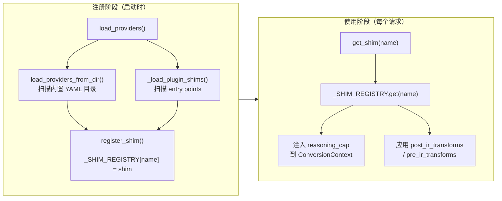
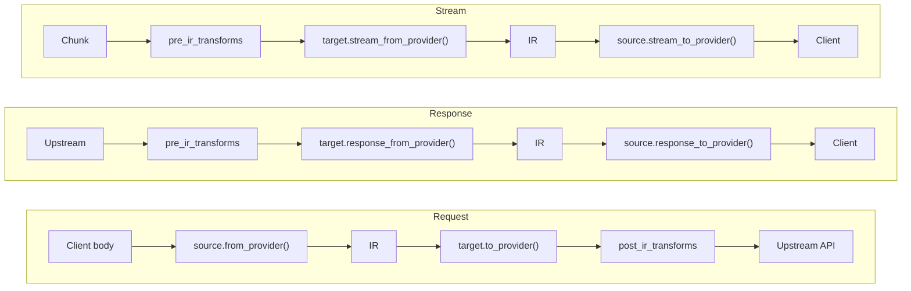

# 提供方 Shim

LLM-Rosetta 只有四个**转换器**——每种 API 标准一个（OpenAI Chat、OpenAI Responses、Anthropic、Google）。但实际的 LLM 提供方远不止这四家（DeepSeek、xAI、Qwen、Moonshot……），它们大多跟着某一标准走，只有一些字段级别的差异。

**Shim 层**就是用来处理这些差异的。一个 shim 本质上是一张身份卡：声明这个提供方用哪个转换器、默认连接到哪里，以及需要做哪些字段级的**转换规则（transforms）**。

## 架构

```text
ProviderShim ("deepseek--chat_completions")
├── name: "deepseek--chat_completions"
├── model_type: "llm"                     → 能力类别
├── format: "chat_completions"            → 选择转换器
├── connection.base_url: "https://api.deepseek.com"
├── connection.api_key_env: "DEEPSEEK_API_KEY"
├── logo: "https://cdn.jsdelivr.net/..."
├── post_ir_transforms: (strip_fields("n", "logit_bias", "seed"),)
└── pre_ir_transforms: ()
```

- **ProviderShim** — 提供方身份信息：名称、模型类型、wire format、默认 URL、API 密钥环境变量、Logo，以及转换规则。
- **Transforms** — 纯 `dict → dict` 函数，在转换器前后执行。`post_ir_transforms` 把输出请求调整成提供方的方言；`pre_ir_transforms` 把输入响应归一化回标准格式。

!!! note "0.13 的旧写法已移除"
    对于 `base`、`to_transforms`、`from_transforms` 以及扁平的连接与工具关键字（`default_base_url`、`default_api_key_env`、`models_path`、`default_path`、`model_id_field`、`supports_custom_tools`、`max_tool_description_length`、`tool_search_mode`、`multimodal_tool_result`），`ProviderShim(...)` 会抛出 `TypeError` 并写出替代写法。声明了 `base:` 或扁平连接/工具键的 `provider.yaml`，以及导出 `to_transforms` 或 `from_transforms` 的 `transforms.py`，在加载时同样被拒绝。参见 [迁移到 0.14](migrating-to-0.14.md#removed-shim-declarations)。

### 声明式提供方目录

内置 shim 以目录结构定义在 `shims/builtin/` 下。所有服务方共用同一种形状，下面的三条规则
就是 loader 接受的形状。

```text
<vendor>/
├── provider.yaml            # 服务方清单，永远不是叶子
├── auth.py                  # 可选：服务方的凭据交换
├── quota.py                 # 可选：该服务方各类共用的探针
└── [<lane>/]                # 可选：同一服务方的多个具名实例
    └── <type>/              # llm | embeddings | rerank | decisions
        └── [<format>/]      # 仅当该类型下有多条 lane
            └── provider.yaml
```

1. **只有存在多个具名实例的服务方才有 lane 层** —— ALCF 的集群（`alcf/metis/`、
   `alcf/minerva/`）。loader 会递归进入既不是类型目录、也不是叶子的目录，最多三层，
   仍然跳过以 `_` 或 `.` 开头的名字。
2. **`<type>/` 永远存在**，按端点的拼写命名：`llm/`、`embeddings/`、`rerank/`、
   `decisions/`。loader 会把目录名与 shim 的 `model_type:` 对照，放错类型的 shim 会被
   拒绝。类别名与目录拼写一致（`embeddings`）；已退役的 `embedding` 拼写在
   `model_type:` 与按类型段名中会被拒绝，错误信息会写出替代名称。
3. **`<format>/` 仅当该类型下有多条 lane 时才出现。** chat 服务方通常会提供多种方言，
   因此保留格式层；某类型只有一条 lane 的服务方把 `provider.yaml` 直接放在类型目录里 ——
   `anthropic/llm/provider.yaml`。加第二条 lane 时，第一条会下沉到它自己的格式目录，
   这正是 `shims migrate` 做的事。

内置树按这个形状排列：

```text
packages/llm-rosetta/src/llm_rosetta/shims/builtin/
├── __init__.py
├── anthropic/
│   └── llm/provider.yaml        # 单条 lane：类型目录直接放叶子
├── deepseek/
│   ├── provider.yaml            # 服务方清单：共用的凭据
│   ├── quota.py                 # 服务方级探针，该服务方各类共用
│   └── llm/
│       ├── chat_completions/    # provider.yaml + transforms.py
│       └── open_responses/      # provider.yaml + transforms.py
├── openai/
│   ├── provider.yaml            # 服务方清单：共用的凭据
│   ├── llm/
│   │   ├── chat_completions/    # provider.yaml + transforms.py
│   │   └── open_responses/      # provider.yaml + transforms.py
│   ├── embeddings/provider.yaml
│   └── decisions/provider.yaml
└── ...
```

**文件规则。** gateway 只读五个名字，别的一概不读：shim 目录内的 `provider.yaml`、
`auth.py`、`quota.py`、`transforms.py`，以及包根部的 `shims.yaml`。树里其余文件都只属于
该包，永远不会被导入 —— 包为自己的导入保留 `__init__.py` 没有问题，它不会被读取。
`auth.py` 与 `quota.py` 以扁平模块执行，因此必须自包含；`transforms.py` 可以使用相对导入。

**先检查，再迁移。** `llm-rosetta-gateway shims check --root <providers 目录>` 报告
loader 会读错的树 —— 叶子不在规范路径上、把服务方目录当叶子用、类型目录同时混有叶子层和
格式层、文件不在允许清单内 —— 并以非零退出。`shims migrate --root <目录>` 打印让它归位的
移动，加 `--write` 才执行；它只移动目录并改写 `shims.yaml` 路径，不重写相对导入，那部分由
包自己的测试兜住。`shims new` 用同一份模板生成骨架。完整约定、骨架的输出与占位符清单见
`llm_rosetta/devtools/_shim_template/README_zh.md`。

每个叶子目录包含：

- **`provider.yaml`**（必需）—— 声明 `name`、`model_type`、`format`、连接设置（`connection.base_url`、`connection.api_key_env`、`connection.auth_header`、`connection.keyless`、`connection.models_path`、`connection.default_path`、`connection.token_command`，以及上游不是 HTTP 的通道所需的 `connection.transport`、`connection.acp_argv` 与可选的 `connection.acp_env`），以及可选的 `logo`、`display_name`、`hint_msg`、`free_source`。`connection.acp_env` 把环境变量名映射到字符串，在启动 agent 时叠加到网关自身的环境之上；提供方条目自己的 `acp_env` 再合并到最上层，因此操作者的值优先。loader 会校验 `(model_type, format)` 对；两个键都必须声明，`base:` 会被拒绝。非 chat shim 用 `connection.default_path` 声明它服务的端点（例如 `/v1/embeddings`），提供方可以通过 `embeddings_shim` / `rerank_shim` / `decisions_shim` 指向它，而不必写裸格式。
- **`transforms.py`**（可选）—— 导出 `post_ir_transforms` 和/或 `pre_ir_transforms` 元组（导出旧名 `to_transforms` / `from_transforms` 的模块会被拒绝）

#### 服务方清单（可选）

放在服务方根目录、不声明 `name` 也不声明 `format` 的
`provider.yaml` 是**清单**而不是 shim：它保存下面每个叶子都继承的 `connection:` 默认值。
认证是提供方的事实，而不是它说多少种方言的事实，所以凭据放在这里：OpenAI 各条 lane
共用一份 `api_key_env`，ALCF 三个集群共用一条 Globus `token_command`，AskSage 四种
方言共用一份 `token_command_env`。

```yaml
# alcf/provider.yaml
logo: https://cdn.jsdelivr.net/gh/Oaklight/llm-rosetta-shim-alcf@main/assets/alcf.svg
group: alcf            # 三个集群共用一个顶层分组
group_label: ALCF
connection:
  api_key_env: ALCF_API_KEY
  token_command: [python3, token.py]   # 相对路径按本文件所在目录解析
  token_refresh_interval: 3600
```

合并规则统一：清单提供默认值，叶子逐字段覆盖，`headers` 按 key 合并。lane 之间确实不同
的服务方把差异留在该留的地方 —— ALCF 每个集群各自声明 `base_url`，AskSage 只在
`google_generate` 叶子上保留 `auth_header: x-access-tokens`。

除 `connection:` 之外，清单还可以声明三个描述**服务方**而非某条 lane 的字段 —— `logo`、
`group`、`group_label` —— 合并规则相同。它们值得上移，因为按构造它们在一个服务方的所有叶子上
必然相同：没有 `group` 时，admin 会从每个 shim 名字推导一个，于是 ALCF 的 `alcf_metis` /
`alcf_minerva` / `alcf_sophia` 会渲染成三个顶层分组而不是一个。叶子仍然可以声明自己的值；
其它字段（`name`、`format`、`tools` 等）在加载时会被拒绝，因为它们属于某个 shim 而不是服务方。

清单是可选的，也可以只声明一部分。没有清单时，服务方照旧在每个叶子里声明全部内容，已有的
shim 不需要任何改动。叶子也可以为某条 lane 覆盖凭据字段；内置树只把凭据放在清单里，并有
测试守卫，防止副本重新出现。

`token_command` 的相对参数按**声明它的目录**解析 —— 清单里的命令按服务方目录，叶子覆盖的
命令按叶子目录 —— 所以 `token.py` 与声明它的文件放在一起。

`auth.py` 遵循同样的规则：与服务方清单放在一起时它是服务方的交换，附加到每个叶子；放在叶子里
时它属于该叶子。一个服务方只声明一个交换，某个叶子再声明一个会加载失败。

**脚手架。** `llm-rosetta-gateway shims new` 写出新 shim 所需的文件 —— 叶子、服务方还没有清单
时的服务方清单、包提供 `shims.yaml` 时的那条登记 —— 然后用真实的 loader 装载一遍，所以网关
用不了的形状在这里失败，而不是等到启动。在终端上不带 flag 时它逐项询问；**交互是默认
模式**，`--no-input` 加 flag 则是脚本里的同一件事。一切都按约定形状写出：`--lane`
把具名实例写在服务方与类型目录之间，`--auth`、`--quota` 写出服务方级桩，`--package`
补上外部包外壳，`--transform` 追加 `transforms.py` 桩。在仓库检出里，
`scripts/dev/new_shim.py` 就是同一条命令，只是默认根指向内置树。给出 logo URL 时它会问是否
存进包的 `assets/`，写进配置的是该文件的 jsDelivr URL，因此发布出去的标志图不指向服务方主机。
线上格式从 converter registry 为该模型类型列出的格式中挑选；粘贴进来的 base URL 会先规范化，
再检查是否可达 —— 不可达只是警告，不是拒绝。已有的树会被先读一遍，因此某类型的第一条 lane 落在 `<type>/` 里，已有 lane
的服务方得到 `<type>/<format>/`；仍把格式目录放在服务方目录下的只给出提示并附上 `shims check`
命令，而不是照抄。永远不会被加载的 lane —— 位于本身就是一个 shim 的目录之下、名字已被别的
文件声明、或服务方名会被 loader 跳过 —— 在写任何文件之前就拒绝。标志图会从 jsDelivr 上的 lobehub 图标集里按服务方名查找并
作为默认值；已经在 jsDelivr 上的 URL 原样保留，不再复制进 `assets/`。按一次 Ctrl+C 重新询问
当前问题，再按一次取消，Ctrl+D 立即取消。详见 [`shims new`](../gateway/cli.md#shims-new-vendor)。

**按类型声明的参数默认值。** 非 chat shim 可以在以自身模型类型命名的段里，声明该 vendor 真正有差异的请求字段：

```yaml
# cohere/embeddings/provider.yaml
embeddings:
  task_type: retrieval_document
```

键是 IR 字段名，因此转换器会按 vendor 的方言写出；声明的值是**默认值** —— 只填补客户端省略的字段，绝不覆盖客户端给出的值。白名单是逐一在真实端点上测量过的字段：embedding 为 `task_type`、`dimensions`、`encoding_format`、`truncation`；rerank 为 `top_n`、`return_documents`、`max_tokens_per_doc`、`truncation`；decision 没有。白名单之外的键、或属于另一模型类型的段，会在加载时被拒绝。`cohere--embedding` 声明 `task_type: retrieval_document`，因为 Cohere 会拒绝缺少 `input_type` 的 `/v2/embed` 请求。

`connection.keyless` 表示该上游无需凭据即可访问：未配置 `api_key` 时不发送任何鉴权头，
配置了则回退到基础类型的鉴权方式。`free_source: true` 表示该 shim 的网关提供免费模型池
—— 管理台会把它的 keyless 条目归入 "Free Resource" 分区，并命名为
`<display_name> (Free)`。

**提供方表单里的一条提示。** `hint_msg` 是管理台在选中该 shim 时、Base URL 一行下面
显示的一句话 —— 用它说明连接默认值表达不了的配置步骤。按语言各写一条；只写一个字符串
时按 `en` 保存：

```yaml
hint_msg:
  en: "Defaults to the Go lane. For the Zen lane set Base URL to https://opencode.ai/zen/v1."
  zh: "默认走 Go lane。Zen lane 请把 Base URL 改为 https://opencode.ai/zen/v1。"
```

面板取当前界面语言，缺失时回退到 `en`，再回退到第一条声明。提示是纯文本（按文本插入，
不当作 HTML），只占一行：短的直接内联显示，长的以省略号截断，鼠标悬停显示全文。代理路径
不读取这个字段。

**凭据交换（Credential exchange）。** 有些上游的推理端点不接受账号 API key —— AskSage
接受由账号 key 换来的短期 access token，ALCF 接受会过期的 Globus bearer token 并需要
定时刷新。这个交换是服务方的事实，因此可以由服务方清单声明一次，而不是让每个运维、每个叶子
各写一遍：

```yaml
# <vendor>/provider.yaml —— 下面每个叶子都继承
connection:
  api_key_env: VENDOR_API_KEY
  token_command: [python3, token.py]
  token_refresh_interval: 7200
```

网关在启动时运行该命令，之后每 `token_refresh_interval` 秒再运行一次（shim 与提供方都
未声明时为 `3600`，最小 `60`），并在上游返回 `401` 后立即重跑；命令的 stdout 就是发往
上游的凭据。参数中指向**声明目录**内文件的相对路径会被解析为绝对路径，因此服务方可以把
脚本与声明它的 `provider.yaml` 放在一起；`python3` 之类的裸命令名与各种参数保持原样。
提供方自己声明的 `token_command` 仍然优先；当命令掌管凭据时，shim 的 `api_key_env`
不会被当作静态密钥使用。

**需要读取运维所填 key 的交换**再声明一个变量名，网关据此把 key 递进去：

```yaml
# <vendor>/provider.yaml
connection:
  api_key_env: VENDOR_API_KEY
  token_command: [python3, token.py]
  token_command_env: VENDOR_ACCOUNT_KEY
```

设置 `token_command_env` 后，运维配置的 key（或由 `api_key_env` 提供的那份）会以该变量名
传给命令 —— 绝不放进 argv，因为进程表会把它暴露给机器上的其他进程 —— 而发往上游的是命令的
stdout，不是这个 key。它同时解除了该 shim 上 `api_key` 与 `token_command` 的互斥：这里的 key
是**输入**，不是第二个凭据。不声明它时，命令在网关自身的环境中运行、自行取得凭据，这正是
ALCF 的情形（`~/.globus`）。

**需要写代码的交换。** `token_command` 描述的是能用一条命令表达的交换。Sign in with
ChatGPT 不行：它有交互式首次登录、每次使用都会轮换的 refresh token，保存下来的是一个凭据
记录而不是一个字符串。这类服务方把 `auth.py` 放在 `provider.yaml`（服务方清单）旁边 —— 与
`transforms.py`、`quota.py` 同级同信任，走同一条加载路径 —— 并导出 `EXCHANGE`：

```python
# auth.py
from llm_rosetta.contracts.auth import BaseAuthExchange


class Exchange(BaseAuthExchange):
    kind = "oauth"

    def needs_interactive_setup(self, ctx):
        return not (ctx.state_dir and os.path.exists(_record_path(ctx)))

    async def credential(self, ctx):
        return await _refresh_or_load(ctx)  # 需要登录时抛 InteractiveSetupRequired

    def account_id(self, ctx):
        return _subject(ctx)  # 不透明；网关会做哈希


EXCHANGE = Exchange()
```

| 成员 | 调用时机 | 要求 |
|------|----------|------|
| `credential(ctx)` | 启动填充、定时刷新、上游 `401` 后各一次 | 返回发往上游的字符串；网络 I/O 可以 `await` |
| `needs_interactive_setup(ctx)` | 构建配置时、任何请求之前 | 只读本地状态 |
| `account_id(ctx)` | 构建配置时 | 返回不透明的账号身份，或 `None` |
| `kind` | 报告用途 | 短标签，例如 `"oauth"` |
| `consumes_key` | 构建配置时 | 说明 `ctx.input_key` 是否为输入 |
| `login(ctx)` | CLI，在有浏览器的一侧 | 运行交互式登录并返回记录；阻塞调用，网关从不调用它 |
| `install(ctx, record)` | `PUT …/credential` | 校验交来的记录并存储；返回摘要，绝不返回令牌 |
| `describe(ctx)` | `GET …/credential` | 返回不含令牌的摘要，或 `None` |
| `revoke(ctx)` | `DELETE …/credential` | 删除记录，服务方允许时同时在上游撤销 |

`login`、`install`、`describe` 与 `revoke` 都是可选的。它们都定义在 `BaseAuthExchange` 上
且直接抛错，所以“有没有这个属性”从来不是问题：交换通过 `can_install()`、`can_login()` 与
`can_revoke()`（三者默认 `False`）说明自己实现了什么，网关会拒绝该操作，而不是去调用一个
空实现：无法安装记录的提供方对 `PUT` 返回 `501`，无法退出的对 `DELETE` 返回 `501`
（而不是一个什么都没做的 `200`），无法登录的则由 CLI 拒绝。`describe()` 是例外 —— 它返回 `None` 而不抛错，而 `None` 正是“无话可说”的含义。

`ctx` 携带提供方的配置键（`ctx.provider`）、凭据记录目录（`ctx.state_dir` —— 即
`server.data_dir` 相对配置文件解析后的路径再加 `/shim-auth/<provider>`；只有程序化调用方
未提供数据目录时才为 `None`），以及 `consumes_key` 为真时运维填写的 key（`ctx.input_key`）。同一
shim 下的两个提供方是两个账号，因此自行决定 `state_dir` 默认值的交换必须按 `ctx.provider`
分目录 —— 只有这个目录能把它们的凭据记录区分开。只有
一个 `credential()` 而没有分开的 seed 与 refresh：网关从不区分这两件事 —— 凭据要么现在
可用，要么不可用。

两种形式由同一套机制驱动 —— `/health/ready` 之下的启动填充、后台刷新器、以及 `401` 后的
被动重试 —— 因此交换本身不需要自己安排调度。当 `credential()` 抛出
`InteractiveSetupRequired` 时，提供方会被标记为“需要交互式登录”，不参与启动重试，也不会
让每个请求都在上游失败。

已随包发布的参考实现是 OpenAI 套餐通道的
`openai_chatgpt/auth.py`（issue
[#1057](https://github.com/Oaklight/llm-rosetta/issues/1057)）：动态客户端注册、PKCE、
loopback 回调、基于 discovery JWKS 的 ID token 验签、在排他锁下原子写入的 `0600`
凭据记录、轮换的 refresh token，以及跨重新登录保留的 host id。它只用标准库 —— RS256
用 `hashlib` 与大整数 `pow` 验签，HTTP 用工作线程上的 `urllib` —— 这也是 shim 模块必须
遵守的形态：shim 层先于网关加载，而核心没有任何依赖。

记录也可以在事后装入：`llm-rosetta-gateway credential <name>` 在有浏览器的一侧运行
`login()`，而 `PUT /admin/api/config/providers/<name>/credential` 把它打印出的记录交给
交换 —— 远端网关因此无需绑定自己的 loopback。命令不联系网关；记录本身就是交接的全部。交换负责
校验（OpenAI 模块会验签 ID token，并从验签后的 claims 取 subject），并把记录存到自己
`credential()` 会读取的位置。记录要尽快粘贴：校验在收到时进行，放了一夜的记录会被拒绝，
只能重新登录。

一个服务方只能声明其中一种形式：同时提供 `auth.py` 与 `connection.token_command` 会加载
失败。提供方自己写的 `token_command` 仍然优先；若交换未声明 `consumes_key`，在同一提供方
再配置 `api_key` 会被拒绝 —— 两者是同一个凭据的两种来源。

#### 声明凭据的输入项

有些交换需要的不只是密钥 —— AskSage 需要密钥所属的账号邮箱 —— 这些输入项同样以数据的
形式声明在服务方清单里：

```yaml
# <vendor>/provider.yaml
fields:
  - key: email
    label: 账号邮箱
    placeholder: you@example.gov
    help: AskSage 密钥所属的账号地址。
```

每一项都会成为提供方抽屉「认证」页里密钥旁边的一个输入框，一次 **保存** 就把密钥和这些
值一起写进提供方条目的 `auth_fields`，交换正是从这里读取。叶子可以新增一项，也可以改写
某一项的措辞；合并按属性进行，因此只改了 `label` 的叶子仍会保留服务方写的 `help` 和
`required`。

| 键 | 必需 | 含义 |
|----|------|------|
| `key` | 是 | 值存入条目时使用的键。字母、数字、`_`、`.`、`-`，最多 64 个字符 —— 它同时也是输入框的元素 id。 |
| `label` | 是 | 运维看到的名称。 |
| `placeholder` | 否 | 示例，绝不是机密。 |
| `help` | 否 | 输入框下方的一句话说明。 |
| `required` | 否 | 为 `true` 时，输入为空会拒绝保存 —— 仅在凭据来源是该 shim 自身的登录时；静态密钥或命令都不读这些值。 |

声明在加载时就会校验，不需要等运维看到：不是映射列表、缺少可用的 `key` 或 `label`、
同一个键声明两次、键或说明超过 200 个字符、超过八项、或使用了本 schema 未定义的键
（`secret`、`type` 等），都会成为指出文件名与位置的加载错误。这些值都不是机密：它们原样
存进提供方条目并在面板里回显，凭据本身仍应留在 `api_key`、`token_command` 或交换自己的
记录里。

自带交换的 shim 也可以在代码里声明同样的输入项（`AuthExchange.fields()`）；同一个键以
YAML 为准，只在代码里声明的项追加在 YAML 之后。现成的参考是 AskSage shim：四个方言，服务方
清单里一个 `email`，`auth.py` 里没有任何表单代码。

**管理台如何分组 shim。** 提供方类型选择器分两级：顶层（*group*）以及其下每个 shim
一行。两个字符串都可以声明，因为它们并非总能从名称推导出来：

| 字段 | 含义 | 默认值 |
|------|------|--------|
| `display_name` | 该 shim 自身的标签，显示在第二列 —— 适用于同时声明了 `group` 或 `group_label` 的 shim | `--` 之后的那段名称 |
| `group` | 该 shim 归入的顶层键 | `--` 之前的那段名称 |
| `group_label` | 该顶层的标题 | group 键本身 |

默认值就是旧行为 —— shim 名称按第一个 `--` 切分 —— 因此不声明这些字段的 shim，渲染结果
与以往完全一致，第三方 shim 和外部 shim 都无需改动。声明 `group` 才让一个服务方能拥有多个
集群 × 多种格式：ALCF 的三个集群各自声明 `group: alcf` 与 `display_name: metis` /
`minerva` / `sophia`，选择器便显示一个 `alcf` 顶层，其条目读作 `metis · chat_completions`。

一行显示 `label · base`，是选择器在说明该 shim 的标签并非它的基础格式 —— 这是任何 shim
都可使用的呈现方式，而非针对某一族的特例。

`display_name` 并非一直取此含义。在 `group` 出现之前，它命名的是 shim 的**顶层** ——
也就是服务方 —— 按旧 schema 编写的 shim 至今如此。采用哪种解读，取决于该 shim 是否声明了
分组字段：`group` 与 `group_label` 都未声明时沿用旧含义，因此这类 shim 的渲染与引入这些
字段之前完全一致（`display_name` 作为顶层标题，行标签仍取自名称）。声明其中任一，则
`display_name` 表示该 shim 自身的行标签。若不这样区分，按旧 schema 编写的 shim 会把服务方名
打印两次 —— 一次作为顶层标题，一次出现在它唯一的那一行上。随之而来的一个推论：顶层标题
同时也是免费资源按钮上的品牌（`<Brand> (Free)`），因此希望按钮上显示的不只是首字母大写的
group 键的服务方，需要声明 `group_label`。

`provider.yaml` 示例：

```yaml
name: deepseek
model_type: llm
format: chat_completions
logo: https://cdn.jsdelivr.net/npm/@lobehub/icons-static-svg@latest/icons/deepseek.svg

connection:
  base_url: https://api.deepseek.com
  api_key_env: DEEPSEEK_API_KEY
```

`transforms.py` 示例：

```python
from llm_rosetta.contracts.transform import strip_fields

# DeepSeek 不支持 n、logit_bias 和 seed
post_ir_transforms = (strip_fields("n", "logit_bias", "seed"),)
pre_ir_transforms = ()
```

导入时，`shims/__init__.py` 自动扫描所有提供方目录并注册，然后发现通过 entry point 声明的插件 shim。

### shim 可以导入什么 {#what-a-shim-may-import}

shim 的旁挂模块（`transforms.py`、`auth.py`、`quota.py` 以及它们旁边的辅助模块）和 shim 包的 `register_shims` entry point 只通过 `llm_rosetta.contracts` 及其子模块导入 `llm_rosetta`：

| 需要 | 导入自 |
| --- | --- |
| `ProviderShim`、`ConnectionConfig`、`load_providers_from_dir` | `llm_rosetta.contracts.shim` |
| 变换原语与钩子类型 | `llm_rosetta.contracts.transform` |
| `auth.py` 的凭据交换 | `llm_rosetta.contracts.auth` |
| `quota.py` 的额度探测 | `llm_rosetta.contracts.quota` |
| 旁挂模块的钩子名（`PRE_IR_TRANSFORMS`、`QUOTA_PROBES` 等） | `llm_rosetta.contracts` |

不能导入 `llm_rosetta.api`，也不能导入任何内部模块。加载器在 `import llm_rosetta` 尚未完成时就运行插件 entry point 与旁挂模块。`llm_rosetta.api` 需要完整加载的包，此时无法加载；契约模块可以。契约也是稳定的部分：在一个次版本内只增加名字，而内部模块在任何版本都可能移动。一个服务方目录也不导入其他服务方的目录，这样每个目录都能单独移出 core。

对于内置 shim，`tests/test_shim_sidecar_boundary.py` 对 `shims/builtin/<vendor>/` 下的每个 `.py` 文件、脚手架模板以及脚手架生成的文件执行这条规则。层级划分见 [core 接口](../api/index.md#the-core-surface)。

## Shim 生命周期



- **注册阶段**在导入时执行一次。`load_providers()` 扫描内置 `providers/` 目录，然后发现 `llm_rosetta.shim_providers` entry point 以加载插件 shim。
- **使用阶段**在每个请求中执行。`get_shim(name)` 查询注册表；gateway 注入推理配置并在转换器前后应用 transforms。

## 插件 Shim

下游包可以在不修改 llm-rosetta 的情况下注册自己的 shim。两种方式：

### Entry Point（推荐）

在 `pyproject.toml` 中声明 entry point：

```toml
[project.entry-points."llm_rosetta.shim_providers"]
my_provider = "my_package.shims:register_shims"
```

callable 扫描本地 YAML 目录并返回注册的 shim：

```python
# my_package/shims/__init__.py
from pathlib import Path
from llm_rosetta.contracts.shim import load_providers_from_dir

def register_shims():
    return load_providers_from_dir(Path(__file__).parent / "providers")
```

### 条件注册

高级场景（按环境注册、动态配置）可以直接调用 `register_shim()`：

```python
import os
from llm_rosetta.shims import ConnectionConfig, register_shim, ProviderShim

def register_shims():
    if os.getenv("MY_INTERNAL_PROVIDER"):
        register_shim(ProviderShim(
            name="my-internal",
            format="chat_completions",
            connection=ConnectionConfig(base_url="http://internal:8080/v1"),
        ))
```

!!! note
    当插件注册了与内置同名的 shim 时，内置 shim 会被静默覆盖（输出 INFO 日志）。这是有意设计——允许插件定制内置提供方的行为。

### 配置声明的目录 { #config-declared-directories }

一个 shim 目录也可以**无需安装插件**就被消费。gateway 的顶层 `shims` 配置段会扫描额外目录 —— 这在直接使用
官方镜像（既没有 `pip` 也没有 `git`）而 shim 就放在配置旁边时很有用：

```jsonc
"shims": {
  "paths": ["/config/shims"]   // 存放 <vendor>/<type>/provider.yaml 的目录（或旧的平铺 / 分组布局）
}
```

发布在仓库里的 shim 集合改由 manifest 源安装（见 [Manifest 源](#manifest-sources)）。完整字段、缓存行为、
优先级与安全说明见 [Gateway → 外部 Shim 源](../gateway/configuration.md#external-shim-sources)。
以编程方式使用时，可调用 `llm_rosetta.shims.rebuild_shims()`（不需要配置文件）或
`llm_rosetta_gateway.apply_shim_sources(raw, config_path)`。

`shims.install` 中未知的 `<source>:` 限定符默认跳过并告警，`shims.strict` 为 `true` 时改为拒绝 —— 因此较新
版本写出的配置仍能在较旧版本上启动。配置段形状错误会在加载配置时被拒绝，而不是等到启动时。已移除的键
（`presets`、`include`、`exclude`、`remotes`）同样会被拒绝；见[已移除的键](#retired-keys)。

### Manifest 源 { #manifest-sources }

自 0.14.0 起，独立包由两个精选的源仓库发布，每个仓库在 `dist` 分支上提供带版本的
`manifest.json`：
[llm-rosetta-shim-argonne](https://github.com/Oaklight/llm-rosetta-shim-argonne)
（`alcf`、`argo`、`asksage`）与
[llm-rosetta-shim-contrib](https://github.com/Oaklight/llm-rosetta-shim-contrib)
（免费端点与 `opendesign`）。manifest 中每个已发布的服务方版本对应一条记录：它的
shim、标签、成熟度、归档及其 sha256，以及它需要的 core（`requires: {surface, ir}`）。
格式定义在 `llm_rosetta.contracts.shim_manifest`，schema 随 core 一起发布。

```jsonc
"shims": {
  "sources": ["contrib", "argonne"],               // catalog id 或 manifest URL
  "install": ["opendesign", "tag:tier:free", "argonne:*"]
}
```

`install` 条目：

| 条目 | 选中 |
|------|------|
| `opendesign` | 所有源中该名称的服务方 |
| `tag:tier:free` | 最新记录带有该标签的所有服务方；标签整体匹配（`tier:free`、`tier:subscription`、`auth:oauth`、`org:argonne`） |
| `*` | 所有服务方 |
| `argonne:*`、`argonne:alcf`、`contrib:tag:tier:free` | 以上任一种，限定在一个源内 |

只写 `install` 而不写 `sources` 时读取 `contrib` 与 `argonne`。源也可以是 manifest
URL，或对象 `{"url": …, "fallback": …, "token_env": …}`。

对每个选中的服务方，网关安装 `requires` 被本 core 满足的最新**稳定**版本 —— `surface`
等于 `llm_rosetta.contracts.SURFACE_VERSION`，`ir` 不高于 `IR_VERSION` —— 并为每个被跳过
的更新的不兼容版本记录一条 WARNING，写明原因。只有在没有可安装的稳定版本时才会安装预发布
版本（`0.5.0-rc.1`），因此 `dist` 上的一个预发布版本不会让所有网关都升级。版本号格式为
`MAJOR.MINOR.PATCH`，可带预发布后缀，不允许构建元数据（`+build` 会使 manifest 无效）。
标签选择器读取服务方最新可安装记录的标签。归档在装入 shim 缓存前先按记录中的 sha256 校验。
发布记录决定注册哪些 shim：归档中没有 `shims.yaml` 时，只加载记录中列出的 shim 名称，
其他名称会被拒绝并记录 WARNING。已安装的版本会一直保留，直到出现更新的*可安装*版本；重读
manifest 从不降级，manifest 不再列出的已安装版本也会保留，并记录一条 WARNING。manifest
从 jsDelivr（`…@dist/manifest.json`）读取，`raw.githubusercontent.com` 作为备用，并在
`remote_ttl` 内复用；**重新拉取**会立即重读。源不可达时使用缓存的 manifest 与上一次成功
的安装；摘要不匹配时绝不安装（保留之前的版本，并标记为过期）。发布之后 CDN 可能仍返回旧副本，
因此网关会检查返回内容的 `generated_at` 及其列出的服务方。检查范围包括：显式的
`<source>:<vendor>` 选择器；以及移出
core 的服务方。普通的标签选择器或 `*` 不受检查；所有记录都无效的服务方视为缺失。返回内容早于
缓存的 manifest，或缺少上述某个服务方时，网关会再请求另一个 URL 一次，采用 `generated_at`
较新的 manifest；两者相同时保留第一个返回的副本，即使它正是缺少该服务方的那一份。一条 INFO
日志写明采用的 URL 与原因。`remote_ttl` 内的缓存 manifest 缺少上述某个服务方时会重新拉取；
拉取后仍然缺少时，同一组服务方在 10 分钟内不再重复检查（**重新拉取**不受此限制）。上次返回
内容的 URL 只在其副本仍处于 `remote_ttl` 内时优先尝试，之后重新优先尝试主地址。无论由哪个
URL 返回，缓存的 manifest 都不会被更旧的副本替换：缓存会保留，源标记为 `stale`，原因中写明
两个 `generated_at` 值，之后每次应用都会重新拉取，直到拿到至少同样新的 manifest。

**core 优先，按 shim 判定。** core 已注册的 shim 名称不会从源加载，日志会写明源、服务方与
被忽略的名称；该服务方的其他 shim 照常安装（所有 shim 都已由 core 注册的服务方会被跳过）。
`promoted_to: core@X` 从将要安装的记录中读取，因此之后不带该字段的版本会撤销晋升。只有当
运行中的 core 达到 `X` 或更高版本 —— `X` 的开发版或预发布版（`0.14.0.dev35`）早于 `X` ——
且 core 确实注册了该记录的 shim 时，该声明才生效；声明已到期但不成立时会记录日志，服务方照常
安装。manifest 安装先于 `paths` 加载，因此本地目录仍会覆盖它。

**已移除的键。** 0.14.x 的 `shims.presets`、`shims.include`、`shims.exclude` 与 `shims.remotes` 已在 0.15.0 移除；见[已移除的键](#retired-keys)。

**显示字段。** 发布记录可以带 `label`（1–80 个字符，不含控制字符和 `<`/`>`）与 `logo`（不超过 512 个字符的 `https://` URL），由来源的构建脚本从服务方根目录的 `provider.yaml`（`group_label`、`logo`）读取。网关从它会安装的那条记录（固定版本时为固定的那条）读取它们，因此尚未安装的服务方也能显示名称和图标；核心不再保留副本。发布方的校验拒绝无效值；网关只丢弃无效字段并记录 WARNING，保留该记录。旧版网关会忽略这两个键。

**一条坏记录不会拖垮整个源。** 网关逐条读取已发布的 manifest。顶层无效——不是对象、未知的
`manifest_version`、缺少必需键、`vendors` 不是对象——会让整个源失败（使用缓存的 manifest；
冷缓存时则什么也没有）。无效的提供方条目或发布记录会被跳过，并记录一条 WARNING，写明提供方、
版本和 JSON 路径形式的原因，manifest 的其余部分照常使用，因此新版生产方写出的一条记录不会让
免费层失去其他提供方；选择只看到有效记录。记录中的 shim 名必须属于该提供方：提供方键本身（裸名
`xai`、`qwen`、`moonshot`、`zhipu`）、`<vendor>--<name>`，或 `<vendor>_<lane>--<name>`（`alcf`
下的 `alcf_sophia--chat_completions`）；带其他提供方前缀的名字会让该记录无效；lane 前缀本身是同一 manifest 中另一个提供方键时同样无效（`openai_chatgpt` 也是该 manifest 的提供方时，`openai` 不得发布 `openai_chatgpt--x`）。被选中的提供方若所有记录都无效，会报告为
*no valid release: <第一条原因>*；若它已有一个可用的安装，则保留该安装并以同一原因标记为
stale——记录变坏绝不会卸载一个正常工作的提供方。

**离开 core 的提供方会被自动安装。** 当配置引用了已离开 core 的提供方的 shim 或额度探测
（[迁移到 0.14](migrating-to-0.14.md#moved-to-contrib)）时，网关会把 `contrib:<vendor>` 加入这里的
选择，有无 `shims` 段都一样。只有当配置没有声明 `shims.sources` 时，才会同时加入 `contrib`
源。显式的 `sources` 列表是运维对拉取来源的选择（镜像，或不允许外网），因此只加入选择器：
manifest 自称 `contrib` 的已声明源（即镜像）仍能提供该提供方；没有任何已声明源提供它时，
启动 WARNING 会指出它发布在 `contrib`。

哪些服务方放在核心、哪些放在源，以及服务方如何在两处之间迁移，见 [Shim 归属与成熟度](shim-placement.md)。

#### 添加源 { #adding-a-source }

源是任何以 `llm_rosetta.contracts.shim_manifest` 格式发布 manifest 的仓库：`dist/manifest.json`，每个服务方的归档放在其记录给出的相对路径上。`shims.sources` 接受三种写法：

```jsonc
"shims": {
  "sources": [
    "contrib",                                              // 目录 id
    "https://shims.example.org/dist/manifest.json",         // manifest URL
    {                                                       // 带选项的 URL
      "url": "https://cdn.example.org/acme@dist/manifest.json",
      "fallback": "https://raw.example.org/acme/dist/manifest.json",
      "token_env": "ACME_SHIMS_TOKEN"
    }
  ],
  "install": ["contrib:opendesign", "acme:*", "tag:tier:free"]
}
```

- 目录 id（`contrib`、`argonne`）展开为该仓库 `dist` 分支的 jsDelivr URL，以 `raw.githubusercontent.com` 作为备用地址。
- URL 必须是 HTTPS。归档相对于 manifest 所在目录解析，先用提供 manifest 的那个 URL，再用另一个。
- `token_env` 指定一个环境变量，其值作为 bearer token 发送，且只发给主 URL 的源站。
- URL 源的选择器前缀是 manifest 自己的 `source` 字段（上例中是 `acme`），不是 URL。
- 声明 `sources` 会替换默认值。要继续读取 `contrib` 和 `argonne`，需要把它们也列上。

`install` 条目对所有源使用同一种语法：

| 条目 | 选中 |
|------|------|
| `<vendor>` | 所有源中的该服务方 |
| `tag:<tag>` | 可安装记录带有该标签的所有服务方；标签整体匹配 |
| `*` | 所有服务方 |
| `<source>:` 加上以上任一项 | 同上，只限该源 |
| `!<vendor>`、`!<source>:<vendor>` | **排除**：无论其他条目如何选择，都不安装该服务方 |
| `<source>:<vendor>@<version>` | **固定版本**：只安装该版本 |

服务方是安装单位（一个归档、一个版本、一条记录），其中的 shim 是启用单位（`shims.disabled`）。规则是确定的：排除条目无论写在哪里都优先；显式的服务方条目优先于标签或 `*` 条目，固定版本的优先于未固定的；其余情况由第一个匹配的条目决定。只有服务方可以被排除或固定 —— `!tag:…`、`!*`、固定版本的标签和固定版本的排除都会被拒绝。固定版本只安装该版本，即使低于已安装版本，也不会被更新版本替换。固定的版本在 manifest 中不存在，或其 `requires` 与当前核心不匹配时，记录一条 WARNING 并保留正在运行的版本（标为 stale 并写明原因）；若尚未安装，该服务方的状态行失败。同一服务方有两个版本不同的固定条目时同样拒绝，并写明两条，而不是按顺序取其一。被排除条目或其他条目覆盖的条目会写明胜出的条目（*excluded by shims.install ('!contrib:kilo'); removing that entry brings it back*、*already selected by contrib:kilo@0.5.1*），而不是 *not in the manifest*；配置中的服务方引用了被排除的服务方时，会记录一条 WARNING，该服务方的自动停用原因也会写明这条排除。

标签由源自由定义。两个精选源使用 `tier:free`、`tier:subscription`、`auth:oauth`、`auth:device`、`auth:account`、`auth:token-exchange`、`org:argonne`、`access:institutional` 和 `network:ssh-tunnel`。适配模块页的服务方卡片列出每个服务方的标签。

源相当于以发布者的信任级别执行代码：已安装的服务方可以带 `auth.py`、`quota.py` 和 `transforms.py`，它们在网关进程内运行。只添加你信任的源。

#### 在管理面板中管理源 { #panel }

**适配模块 → 可安装**按网关读取的每个源分组显示；配置只是隐含的源（默认值）标为*默认*。没有响应的源标为*无法访问*并显示错误；拉取失败后改用缓存的源标为*缓存副本*。

源中的每个服务方都有一张卡片。收起时显示服务方、成熟度、状态（*已安装*、*已选择*、*已跳过*、*失败*或*可安装*）和版本。展开后显示：

- 来源、已安装版本、可安装的更新版本，以及最新发布版本（当前核心无法运行时附原因）；
- 已安装版本的 `requires` 是否与当前核心匹配；
- 成熟度及其达到日期、最近一次一致性测试结果，以及 `promoted_to`（如有）；
- 标签，以及该版本注册的 shim，每个都标明是否已安装；
- 选中该服务方的 `install` 条目、选中的服务方被跳过的原因（*not in the manifest*、*core provides …*、*promoted to …*），以及先提供同一服务方的源。

**安装**把 `<source>:<vendor>` 加入 `shims.install` 并重载，从而安装该服务方。如果声明的 `shims.sources` 没有列出该源，也会把该源写进去。没有 `sources` 键的配置会连同默认源一起写出，这样保存后的文件列出它读取的每个源，不依赖内置的默认列表。

**安装** 还会删除该服务方的排除条目，且只有在没有其他条目安装它时才添加条目，因此移除一个由标签选中的服务方再装回，列表会恢复原样（固定版本不会恢复：移除时的提示写明了“固定的版本已取消”）。

**移除** 从不拒绝。它删除本源中该服务方自己的条目（固定或不固定）；若标签、`*`、不带前缀的条目仍会选中它，则写入 `!<source>:<vendor>`。因服务方引用其 shim 而由网关自动安装的服务方会列出这些服务方，且不提供 **移除**。

**固定此版本** 写入 `<source>:<vendor>@<已安装版本>`；已固定的服务方上，**更新到 X** 把固定版本移到最新的可安装版本，**跟随最新版本** 取消固定。新的固定版本替换该服务方之前的固定条目。卡片上每个已加载的 shim 都有自己的启用开关（`shims.disabled`）。

**适配模块 → 来源 → 清单来源**同时编辑这两个键。每个源有一个区块，含“全部服务方”（`<source>:*`）、每个标签和每个服务方的复选框。区块下方的输入框用于添加目录 id 或 manifest URL；*移除来源*会删掉该源以及带有其 id 前缀的条目。新的 URL 源在第一次保存后才会读取。修改在点击**保存**之前只是草稿；保存时通过配置保存路径（在配置锁内）写入 `shims.sources` 和 `shims.install`，并重载来源。只重建被编辑的源带前缀的条目；其他条目（包括重复项）保持原样。不带前缀的条目（`opendesign`、`tag:tier:free`）读取所有源，所以按原样列出；请在配置文件中修改它。来源列表只要与声明的列表不同就会写入，因此只是隐含默认源的配置会把默认源写出。**重新读取清单**会重新拉取每个 manifest。该区块下方的*本地目录*字段编辑 `shims.paths`。

在面板中保存会把配置文件重写为普通 JSON，注释不会保留。被替换的文件以 `<config>.prev` 保存在同一目录：这是上一次网关写入之前的文件，只保留一份，每次保存都会替换，新建文件时不写。网关从不写 `<config>.bak`，那个名字属于 `llm-rosetta-migrate --write`（迁移前的原始文件）以及你自己做的备份。编辑器在区块下方会提示这一点。
#### 已移除的键 { #retired-keys }

0.15.0 移除了 0.14.x 的安装路径。网关只读取 `sources`、`install`、`paths`、`disabled`、`cache_dir`、
`remote_ttl` 与 `strict`，别的都不读。下列键在**加载配置时即被拒绝**，错误为
`config: 'shims.<key>' was removed in 0.15.0: <建议>`。一条错误会列出配置段里所有已移除的键；
值为空（`null`、`[]`、`{}`）的键不算声明，会被接受：

| 已移除的键 | 替代写法 |
|-----------|---------|
| `shims.presets` | `shims.install` 条目：`alcf` → `argonne:alcf`、`argo` → `argonne:argo`、`asksage` → `argonne:asksage`、`free` → `contrib:tag:tier:free`、`opendesign` → `contrib:opendesign` |
| `shims.include` | `shims.install` 中显式的 `<source>:<vendor>` 条目；保留的服务方里要关的单个 shim 用 `shims.disabled` |
| `shims.exclude` | `shims.install` 中的 `!<source>:<vendor>` 条目；单个 shim 用 `shims.disabled` |
| `shims.remotes` | 没有对应写法：显式归档 URL（`ref`、`sha256`、`mirror`、`path`、`token_env`、`refresh`）在 manifest 中没有等价物。请发布一个 manifest 源并写进 `shims.sources`，或让 `shims.paths` 指向本地副本 |

运行 `llm-rosetta-migrate --config config.jsonc`（试运行）再加 `--write`：每个预设变为其选择器；
`include` 变为每个保留服务方一条 `<source>:<vendor>`；`exclude` 变为每个被丢弃服务方一条
`!<source>:<vendor>`；从保留服务方中丢掉的单个 shim 进入 `shims.disabled`。被改写的键之外的注释保持不变。
只有当没有任何条目按 id 或 catalog manifest URL 点名某个源时，才会把它加入已声明的 `shims.sources`；未知 URL
可能是镜像，所以工具只报告它。`remotes` 条目无法改写：工具会报告它并以退出码 1 结束，交给人决定。

内置 shim 的计划移除机制（公告、`make check-shim-removals` 与 `shim-removal-check` CI 任务）同样已在 0.15.0
移除；服务方离开 core 走[Shim 归属与成熟度](shim-placement.md)描述的迁移。

!!! warning
    声明的源可能携带在加载时被执行的 `transforms.py` —— 与安装插件包是同一信任级别。
    请只添加你信任的源。

## 内置 Shim

LLM-Rosetta 内置 21 个提供方 shim，每个 shim 对应 `packages/llm-rosetta/src/llm_rosetta/shims/builtin/<vendor>/<model-type>/`
下的一个目录。`list_shims()` 会打印当前实际的集合；下表即是该集合。core 只保留模型服务方自己的
API key 通道，以及每种非 chat 格式各一个真实提供方（[Shim 归属](shim-placement.md)）。其余提供方——
包括 0.14 之前内置的 OpenCode、OpenRouter、Qwen、Volcengine、xAI 与 Zhipu——
以相同名称从 contrib 源安装，配置引用它们时会自动安装
（[迁移到 0.14](migrating-to-0.14.md#moved-to-contrib)）。ALCF、AskSage 与 Argo 的 shim 从
argonne 源安装 —— 参见[独立 Shim 包](#standalone-shim-packages)。

| 名称 | 格式 | 默认 Base URL | API Key 环境变量 | 转换规则 |
|------|------|--------------|-----------------|---------|
| `anthropic--messages` | `messages` | `https://api.anthropic.com` | `ANTHROPIC_API_KEY` | — |
| `cohere--chat_completions` | `chat_completions` | `https://api.cohere.com/compatibility/v1` | `COHERE_API_KEY` | — |
| `cohere--embedding` | `cohere` | `https://api.cohere.com` | `COHERE_API_KEY` | — |
| `cohere--rerank` | `cohere` | `https://api.cohere.com` | `COHERE_API_KEY` | — |
| `deepseek--chat_completions` | `chat_completions` | `https://api.deepseek.com` | `DEEPSEEK_API_KEY` | 剥离 `n`、`logit_bias`、`seed`、penalties；声明推理回放（`replay_missing`） |
| `deepseek--open_responses` | `open_responses` | `https://api.deepseek.com` | `DEEPSEEK_API_KEY` | 剥离 `n`、`logit_bias`、`seed` |
| `google--embedding` | `google_generate` | `https://generativelanguage.googleapis.com` | `GOOGLE_API_KEY` | — |
| `google--google_generate` | `google_generate` | `https://generativelanguage.googleapis.com` | `GOOGLE_API_KEY` | — |
| `google--google_interactions` | `google_interactions` | `https://generativelanguage.googleapis.com` | `GOOGLE_API_KEY` | — |
| `jina--embedding` | `jina` | `https://api.jina.ai` | `JINA_API_KEY` | — |
| `jina--rerank` | `jina` | `https://api.jina.ai` | `JINA_API_KEY` | — |
| `minimax--chat_completions` | `chat_completions` | `https://api.minimaxi.com/v1` | `MINIMAX_API_KEY` | 剥离 `logprobs`、`top_logprobs`、`seed`、`stop`；注入 `reasoning_split`；解析 `think` 标签 |
| `minimax--embedding` | `minimax` | `https://api.minimaxi.com` | `MINIMAX_API_KEY` | — |
| `minimax--messages` | `messages` | `https://api.minimaxi.com/anthropic` | `MINIMAX_API_KEY` | — |
| `openai--chat_completions` | `chat_completions` | `https://api.openai.com/v1` | `OPENAI_API_KEY` | — |
| `openai--embedding` | `openai` | `https://api.openai.com/v1` | `OPENAI_API_KEY` | — |
| `openai--open_responses` | `open_responses` | `https://api.openai.com/v1` | `OPENAI_API_KEY` | — |
| `openai--openai_decisions` | `openai_decisions` | `https://api.openai.com` | `OPENAI_API_KEY` | — |
| `typesafe--systemone` | `systemone` | `https://api.typesafe.ai` | `TYPESAFE_API_KEY` | — |
| `voyage--embedding` | `voyage` | `https://api.voyageai.com` | `VOYAGE_API_KEY` | — |
| `voyage--rerank` | `voyage` | `https://api.voyageai.com` | `VOYAGE_API_KEY` | — |

本列给出字段级转换规则。`hoist_late_system_messages()` 会改写对话中途的 system/developer
消息以保持 prompt cache 前缀稳定，多数 `chat_completions` shim 都声明了它，此处不再重复；
每个 shim 的完整声明见其自身的 `transforms.py`。

### 独立 Shim 包 { #standalone-shim-packages }

有五套 shim 维护在各自的仓库中，而不在核心包内：

| 包 | Shim 名称 | 仓库 |
|----|----------|------|
| ALCF | `alcf_metis--chat_completions`、`alcf_minerva--chat_completions`、`alcf_sophia--chat_completions` | [llm-rosetta-shim-alcf](https://github.com/Oaklight/llm-rosetta-shim-alcf) |
| Argo | `argo--chat_completions`、`argo--messages`、`argo--open_responses` | [llm-rosetta-shim-argonne](https://github.com/Oaklight/llm-rosetta-shim-argonne)（原 `-argo`） |
| AskSage | `asksage--chat_completions`、`asksage--messages`、`asksage--open_responses`、`asksage--google_generate` | [llm-rosetta-shim-asksage](https://github.com/Oaklight/llm-rosetta-shim-asksage) |
| Open Design | `opendesign--chat_completions`、`opendesign--open_responses`、`opendesign--messages` | [llm-rosetta-shim-opendesign](https://github.com/Oaklight/llm-rosetta-shim-opendesign) |
| 免费端点 | `kilo_free--chat_completions`、`llm7--chat_completions`、`opencode_zen_free--chat_completions`、`ovhcloud--chat_completions` | [llm-rosetta-shim-contrib](https://github.com/Oaklight/llm-rosetta-shim-contrib)（原 `-free`） |

ALCF 与 AskSage 是在 0.14.0 开发周期中引入的，从未出现在任何稳定版的内置集合中；Argo 则自
v0.6.3 起一直作为内置 shim 发布。三者均已在 0.14.0 离开核心。OpenCode 免费通道在 0.14 之后
离开核心，因为上游门禁的变化与发布周期无关——其实测状态见
[OpenCode](providers/opencode.md#public-free-lane)。独立包注册相同的规范 shim
名称，因此提供方的 `shim` 值无需改动 —— 新增的只是源声明。

**在卡片上安装服务方。** **网关 → Shims → 可安装** 按 manifest 源分组，每个源发布的服务方各有一张卡片，
带服务方的成熟度、版本与标签（见[在管理面板中管理源](#panel)）。**安装**会把 `<source>:<vendor>` 加入
`shims.install`。手工声明各个包：

| 包 | `shims.install` 条目 |
|----|---------------------|
| ALCF | `argonne:alcf` |
| Argo | `argonne:argo` |
| AskSage | `argonne:asksage` |
| 免费端点 | `contrib:tag:tier:free` |
| Open Design | `contrib:opendesign` |

**更新。** 已安装的服务方只有在其 manifest 列出本 core 能运行的更新版本时才会前进。服务方卡片写出已安装版本与最新
的可安装版本；已固定的服务方用 **更新到 X**，或重新读取 manifest 即可应用。更新检查只看 manifest：网关把每个
已安装服务方与其源的 manifest 比较，并在该服务方的行上给出结论。

**CI 让源列表与已发布的仓库同步。** `scripts/dev/check_shim_catalog.py` 列出该账号发布的
`llm-rosetta-shim-*` 仓库，与网关已知的 manifest 源（`SHIM_SOURCES`）对比，并在缺少某个仓库或它已迁移时
打印可直接粘贴的条目。它随每次推送在 `shim-catalog` CI 任务中运行，发现漂移即以非零状态退出。

旧拼写**不再**解析到 shim：`argo--openai_chat`、`argo--anthropic` 和
`argo--openai_responses` 是内置 shim 的别名，独立包只注册规范名称。仍写旧值的配置会在加载时
以 retired-names 错误失败，错误信息写出规范 shim 名称、需要声明的 `shims.install` 项，以及
改写配置的 `llm-rosetta-migrate` 命令；参见 [迁移到 0.14](migrating-to-0.14.md#retired-names)。

## 推理配置 { #reasoning-configuration }

从 v0.6.8 起，shim 可以通过 `provider.yaml` 中的 `reasoning` 段声明推理能力配置。运行时由 `apply_reasoning_config()` 读取该配置，替代了之前硬编码在各转换器中的 effort 降级逻辑。

### ReasoningCapability 字段

| 字段 | 类型 | 说明 |
|------|------|------|
| `disabled` | `"omit"` \| `"thinking_disabled"` \| `"thinking_budget_zero"` | `mode: disabled` 时的序列化策略：`omit` 不发送任何参数，`thinking_disabled` 发送 `{"thinking": {"type": "disabled"}}`，`thinking_budget_zero` 发送 `{"thinking_config": {"thinking_budget": 0}}` |
| `effort_field` | `"reasoning_effort"` \| `"reasoning.effort"` \| `"output_config.effort"` \| `"thinking_level"` \| `"none"` | effort 值在提供方请求中的序列化位置；`"none"` 表示提供方不支持 effort |
| `max_effort` | `EffortLevel` \| `null` | 最高允许的归一化 effort 级别；超过此值的 effort 会被截断到该级别 |
| `thinking_type` | `"enabled"` \| `"adaptive"` \| `null` | 强制 `thinking.type` 为该值；`null` 表示不覆盖 |
| `effort_map` | `dict[str, str]` | 从归一化 IR effort 到提供方特定 effort 字符串的映射 |

### 配置示例

=== "Anthropic"

    ```yaml
    # provider.yaml
    reasoning:
      disabled: thinking_disabled
      effort_field: output_config.effort
      effort_map:
        minimal: low
        low: low
        medium: medium
        high: high
        xhigh: xhigh
        max: max
    ```

=== "OpenAI"

    ```yaml
    # provider.yaml
    reasoning:
      disabled: omit
      effort_field: reasoning_effort
      max_effort: high
      effort_map:
        minimal: minimal
        low: low
        medium: medium
        high: high
        xhigh: high
        max: high
    ```

### 按模型覆盖（`model_overrides`）

当同一提供方下不同模型有不同推理能力时，使用 `model_overrides` 声明按模型的配置。每个覆盖项继承提供方级默认值，按**上游模型 ID**（别名解析后）为键：

```yaml
name: argo--messages
model_type: llm
format: messages
reasoning:
  thinking_type: enabled       # 大多数模型的默认值
  effort_map: { ... }
  model_overrides:
    claudeopus47:
      thinking_type: adaptive  # Vertex AI 要求 adaptive
```

网关在别名解析后确定上游模型 ID（如 `argo:claude-opus-4.7` → `claudeopus47`），并应用匹配的覆盖配置。

### 运行机制

当网关代理处理请求时：

1. `_inject_shim_reasoning()` 从目标提供方的 shim 中提取 `ReasoningCapability`，注入转换上下文的 `ctx.options["reasoning_cap"]`。如果上游模型有 `model_overrides` 条目，则使用该覆盖配置
2. 各转换器的 `request_to_provider` 将 `reasoning_cap` 传给 `ir_reasoning_config_to_p`
3. `ir_reasoning_config_to_p` 委托给 `apply_reasoning_config()`，按 shim 配置执行：
    - 输入归一化（`none` → disabled）
    - disabled 序列化（按 `cap.disabled` 策略）
    - effort 截断（按 `cap.max_effort`）
    - effort 映射（按 `cap.effort_map`）
    - `thinking_type` 覆盖（如强制 `enabled` → `adaptive`，用于 Vertex AI 模型）
    - 结构化传透（mode、budget_tokens 等提供方特定字段）

没有声明 `reasoning` 段的 shim 使用基础转换器类型的内置默认配置。

!!! note "安全机制：`thinking_type: enabled` 但缺少 `budget_tokens`"
    Anthropic 要求 `thinking.type = "enabled"` 时必须提供 `budget_tokens`。如果 `thinking_type: enabled` 覆盖生效但请求中没有 `budget_tokens`，helper 会自动回退到 `"adaptive"` 以避免产出不合法的请求。

## Argo Shim

`argo--chat_completions`、`argo--messages` 和 `argo--open_responses` 面向 **Argo 网关** —— 这是某些机构（如 Argonne 国家实验室）使用的代理层，将多个上游 LLM 提供方统一暴露在单一端点之后。

它们**不是**内置的。请先声明独立包：

```jsonc
{
  "shims": { "install": ["argonne:argo"] }
}
```

三个 shim 都声明 `connection.model_id_field: internal_id` —— 模型标识符通过 `internal_id` 而非 `model` 字段传递。

### `argo--chat_completions`

OpenAI 兼容 shim，附带一个 transform：`max_tokens` → `max_completion_tokens`（新版 OpenAI 模型拒绝旧字段名）。

### `argo--messages`

- **模型级 `thinking_type` 覆盖**：默认 `thinking_type: enabled`，通过 `model_overrides` 为 `claudeopus47` 设置 `thinking_type: adaptive`（Vertex AI 后端）。声明式处理。
- **`unsigned_reasoning_blocks: preserve`**：历史消息中没有有效签名的 thinking block 保存在 metadata 中而非转发（避免 Argo 400 错误）。
- **`pre_ir_transforms` —— OpenAI 响应格式归一化**：Argo 可能从 `/v1/messages` 返回 OpenAI Chat 格式响应，该 transform 在转换器处理前将其归一化为 Anthropic 格式。

### `argo--open_responses`

Responses 格式通道，为拒绝 temperature 的 GPT/o 系列模型按模型剥离 temperature。

### 配置

在网关配置中覆盖 shim 的 `connection.base_url`：

```jsonc
{
  "providers": {
    "argo": {
      "shim": "argo--messages",
      "base_url": "https://your-argo-instance.example.com/",
      "api_key": "${ARGO_API_KEY}"
    }
  }
}
```

!!! note
    默认 URL（`https://apps.inside.anl.gov/argoapi/`）仅在 ANL 内网可达。三个 Argo shim 位于独立的 [`llm-rosetta-shim-argonne`](https://github.com/Oaklight/llm-rosetta-shim-argonne) 源中（原 `llm-rosetta-shim-argo`） —— 声明 `"shims": {"install": ["argonne:argo"]}`，配置中的名称即可继续使用。**网关 → Shims → 可安装** 已将该包作为卡片提供。

## 能力标志

除推理配置外，shim 还可以声明影响转换器行为的提供方级能力标志：

| 字段 | 类型 | 默认值 | 描述 |
|------|------|--------|------|
| `tools.custom_tools` | `bool` | `False` | 提供方 API 是否原生支持 `{type: "custom"}` 工具定义。`False` 时，自定义工具降级为函数包装并合成 JSON schema。 |
| `hoist_system_messages` | `bool` | `True` | 将对话中间的 system/developer 消息改写为 user 角色 `[System: ...]` 信封，保持 prompt cache 前缀稳定。 |
| `tools.multimodal_result` | `bool \| None` | `None` | 提供方是否原生支持工具结果中的多模态内容（图片、文件）。`None` 使用转换器的类级默认值。`True` 强制原生透传；`False` 强制双重编码（文本回退 + 合成 user 消息）。 |

`provider.yaml` 示例：

```yaml
name: my-provider
model_type: llm
format: chat_completions
tools:
  custom_tools: true
  multimodal_result: false
hoist_system_messages: true
```

这些标志在转换时注入 `ConversionContext.options`，转换器无需知道当前使用的是哪个 shim 即可查询。

## 请求约束 { #request-constraints }

一个请求字段与上游之间可能成立三种关系，而在 #1460 之前只有一种有归属：

| 上游的态度 | 声明位置 | 例子 |
| --- | --- | --- |
| **拒绝**该字段 | transform（`strip_fields`、`drop_refused_fields`） | ChatGPT plan 路由丢弃 `temperature` |
| **要求**该字段，且自己没有默认值 | 转换器上的 `request_constraints`，shim 可按路径覆盖 | Messages API 要求 `max_tokens` |
| **限制**取值范围 | `request_constraints` 的 `ranges` | zhipu 的 `temperature` 上限是 1.0，不是 2.0 |

方言层面的要求放在转换器上（`MessagesConverter.request_constraints`），因为
每一种使用该格式的 shim——包括在本仓库之外发布的 shim——都需要同一个值。服务方
为自己的上游说话，因此 shim 的 `request:` 段按路径覆盖方言的声明：

```yaml
request:
  # IR 路径 → 客户端未给值时写入的值
  defaults:
    generation.max_tokens: 2048   # 该服务方的上限低于方言的 4096
  # IR 路径 → 该上游接受的取值范围
  ranges:
    generation.temperature: { min: 0.0, max: 1.0, on_out_of_range: clamp }
```

- 键是 **IR 路径**（`generation.max_tokens`），不是 wire 字段名：约束在方言写出
  请求之前施加于 IR，因此一条声明覆盖所有对话格式，转换警告也以该路径为主题。
- 显式 `null` 视为"客户端没有给出值"，适用于 IR 生成配置的每一个字段。它在
  默认值填充之前被移除，因此 `null` 永远不会到达写入端（#1459）。
- `on_out_of_range` 可取 `clamp`（写入最近的边界）、`drop`（删除字段，让上游
  默认值生效）或 `reject`（让转换失败）。三种都会上报——否则 clamp 是不可见的。
  该键在 `provider.yaml` 中**必填**：缺少策略的范围会加载失败，否则默认策略会在
  声明没有写明的情况下改动客户端发来的值。（以代码构造的 `Range` 仍默认
  `clamp`。）
- 不指向真实 IR 字段的路径会在 shim 加载时被拒绝：静默不生效的声明比直接失败
  更糟。
- 声明缺失或为空时保留方言的值，因此没有 `request:` 段的 shim 产出的 body 与
  之前完全相同。

约束由目标转换器施加在它即将写出的请求上：直接使用时是方言自己的声明，经转换管线
时是方言与 shim 合并后的声明。管线持有的 IR 保留源请求的原样，因此注入的默认值记在
请求日志的 `injected` 字段里，而不会被读成客户端自己给的值。

zhipu 是第一个声明范围的 shim：该车道只接受 `temperature` ≤ 1.0（OpenAI 允许 2.0）、
`top_p` 在 `[0.01, 1.0]` 之间，超出范围的值会被夹到边界并上报，而不是发给一个会拒绝它、
或按与客户端所要求不同的值来理解的上游。

## 转换规则（Transforms）

转换规则是纯 `dict → dict` 函数，用于弥合提供方实际 API 方言与对应基础转换器所期望的"标准"格式之间的差异。它们处理字段级差异（剥离不支持的字段、重命名参数、注入默认值）—— **不**处理语义级 API 标准转换，那是转换器的职责。

### 内置转换原语

| 原语 | 描述 | 示例 |
|------|------|------|
| `strip_fields(*keys)` | 从请求体中移除不支持的字段 | `strip_fields("logprobs", "top_logprobs")` |
| `rename_field(old, new)` | 重命名顶层字段 | `rename_field("max_tokens", "max_length")` |
| `set_defaults(**kv)` | 仅在字段不存在时设置（幂等） | `set_defaults(temperature=0.7)` |
| `force_fields(**kv)` | 无条件设置字段 —— 用于上游拒绝的取值 | `force_fields(store=False)` |
| `default_tool_description(text)` | 为描述为空的工具注入占位描述 | `default_tool_description("No description provided")` |

### 响应体变换

除了请求变换（`post_ir_transforms` / `pre_ir_transforms`），shim 还可以声明 `response_body_transforms`——在 IR 转换之前应用于原始上游响应体的纯 `dict → dict` 函数。用于修复非标准端点返回的畸形响应。

```yaml
# provider.yaml — 声明响应变换存在
response_body_transforms: true
```

```python
# transforms.py
from llm_rosetta.contracts.transform import rewrite_harmony_tool_calls

response_body_transforms = (rewrite_harmony_tool_calls(),)
```

内置响应变换：`rewrite_harmony_tool_calls()` 把部分 vLLM 部署的模型写在消息内容里的原始 harmony 工具调用 token 改写成正规的 `tool_calls` 字段。

### 应用方式

转换规则在两个层面应用：

**1. `convert()` 公共 API** —— 通过 `resolve_transforms()` 自动应用：

```python
from llm_rosetta import convert

# 当 source/target 是 shim 名称时，转换规则自动应用
result = convert(request_body, source="chat_completions", target="volcengine--chat_completions")
# → logprobs 和 top_logprobs 从输出中剥离
```

**2. 网关代理管线** —— 围绕转换器应用：



### 设计原则

- **幂等**：重复应用同一转换规则无副作用
- **不重叠**：按约定，不同转换规则应操作不同字段
- **可组合**：多个转换规则通过 `apply_transforms()` 顺序应用

## 使用 Shim

### 通过 Shim 名称解析转换器

`get_converter_for_provider()` 同时接受基础转换器类型字符串和 shim 名称：

```python
from llm_rosetta import get_converter_for_provider

# 基础类型 —— 与之前一样
converter = get_converter_for_provider("chat_completions")

# Shim 名称 —— 通过注册表解析为 "chat_completions"
converter = get_converter_for_provider("deepseek--chat_completions")
```

### 解析格式与模型类型

使用 `resolve_format()` 将 shim 名称映射到 wire format，使用
`resolve_model_type()` 获取能力类别：

```python
from llm_rosetta import resolve_format, resolve_model_type

resolve_format("deepseek--chat_completions")  # → "chat_completions"
resolve_format("chat_completions")            # → "chat_completions"（直接透传）
resolve_format("unknown")                     # → "unknown"（直接透传）

resolve_model_type("deepseek--chat_completions")  # → "llm"
resolve_model_type("typesafe--systemone")         # → "decisions"
resolve_model_type("embeddings")                  # → "embeddings"
resolve_model_type("openai")                      # → None（歧义：既是服务方名也是 embeddings format）
resolve_model_type("embedding")                   # 抛出 ValueError（已退役拼写，错误信息指向 'embeddings'）
```

`resolve_base()` 已在 0.14.0 移除，请调用 `resolve_format()`。

## 注册自定义 Shim

### 编程式注册

为任何 OpenAI 兼容服务注册自定义提供方 shim：

```python
from llm_rosetta import ConnectionConfig, ProviderShim, register_shim
from llm_rosetta.contracts.transform import strip_fields

my_shim = ProviderShim(
    name="my-provider",
    format="chat_completions",
    connection=ConnectionConfig(
        base_url="https://api.my-provider.com/v1",
        api_key_env="MY_PROVIDER_API_KEY",
    ),
    post_ir_transforms=(strip_fields("logprobs", "seed"),),
)
register_shim(my_shim)
```

注册后，shim 名称可在所有地方使用 —— `get_converter_for_provider()`、`resolve_format()`、`convert()` 和网关配置。

### 添加 YAML 提供方

要向内置注册表添加新提供方：

1. 把叶子放在 `packages/llm-rosetta/src/llm_rosetta/shims/builtin/<vendor>/<type>/provider.yaml`，其中 `<type>` 是格式所属的模型类型（`llm`、`embeddings`、`rerank`、`decisions`）。只有该类型下存在第二条 lane 时才在其下再加 `<format>/` 层，因此同一服务方的 `chat_completions` 与 `messages` 并排放在 `llm/` 里；有多个具名实例的服务方在类型之上再加 lane 目录（`<vendor>/<lane>/<type>/`）。`llm-rosetta-gateway shims new` 写出的就是这个形状，`shims check` 报告偏离它的树。
2. 若该服务方的叶子共用连接信息（通常就是凭据），添加不带 `name` 的 `<vendor>/provider.yaml`：它是服务方清单，每个叶子都继承它。

    ```yaml
    # <vendor>/provider.yaml
    connection:
      api_key_env: MY_PROVIDER_API_KEY
    ```

3. 为每个叶子添加 `provider.yaml`，包含必填字段：

    ```yaml
    name: my-provider
    model_type: llm
    format: chat_completions
    logo: https://example.com/logo.svg

    connection:
      base_url: https://api.my-provider.com/v1
    ```

4. 如果提供方有字段级差异，可选添加 `transforms.py`：

    ```python
    from llm_rosetta.contracts.transform import strip_fields

    post_ir_transforms = (strip_fields("unsupported_field"),)
    pre_ir_transforms = ()
    ```

提供方在导入时自动发现并注册。

### 列出和移除 Shim

```python
from llm_rosetta import list_shims, unregister_shim

# 列出所有已注册的 shim
for shim in list_shims():
    print(f"{shim.name} → {shim.format}")

# 移除 shim
unregister_shim("my-provider")
```

## 网关集成

在网关配置文件中，使用 `"shim"` 字段引用已注册的 shim，而非直接指定 `"type"`：

```jsonc
{
  "providers": {
    "my-deepseek": {
      "shim": "deepseek--chat_completions",
      "api_key": "${DEEPSEEK_API_KEY}"
      // base_url 默认使用 shim 的 connection.base_url
    }
  },
  "models": {
    "deepseek-chat": "my-deepseek"
  }
}
```

提供方类型的解析顺序：

1. `"shim"` 字段 —— 通过 shim 注册表解析为基础转换器类型
2. `"type"` 字段 —— 直接用作转换器类型
3. 提供方配置键名 —— 作为后备

当找到 shim 时：

- `connection.base_url` 和 `connection.api_key_env` 在配置未明确指定时作为后备值使用
- `post_ir_transforms` 应用于发送给上游提供方的请求
- `pre_ir_transforms` 应用于接收到的响应/流式 chunk，在转换之前执行
