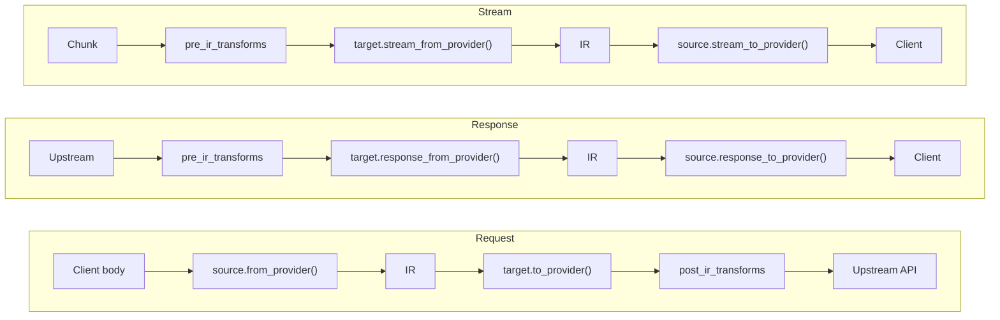

# Provider Shims

LLM-Rosetta uses only four **converters** — one per API standard (OpenAI Chat, OpenAI Responses, Anthropic, Google). But the LLM ecosystem has many more *providers* (DeepSeek, xAI, Qwen, Moonshot, …) that follow one of those standards with minor variations.

The **shim layer** bridges this gap. A shim is a lightweight identity card that declares which converter a provider uses, along with connection defaults and optional **transforms** that adapt request/response fields to match the provider's dialect.

## Architecture

```text
ProviderShim ("deepseek--chat_completions")
├── name: "deepseek--chat_completions"
├── model_type: "llm"                     → the capability category
├── format: "chat_completions"            → selects the converter
├── connection.base_url: "https://api.deepseek.com"
├── connection.api_key_env: "DEEPSEEK_API_KEY"
├── logo: "https://cdn.jsdelivr.net/..."
├── post_ir_transforms: (strip_fields("n", "logit_bias", "seed"),)
└── pre_ir_transforms: ()
```

- **ProviderShim** — provider identity: name, model type, wire format, default URL, default API key env var, logo URL, and optional transforms.
- **Transforms** — pure `dict → dict` functions applied around converters. `post_ir_transforms` adapt outgoing requests to the provider's dialect; `pre_ir_transforms` normalize incoming responses.

!!! note "The 0.13 spellings are removed"
    `ProviderShim(...)` raises a `TypeError` that names the replacement for `base`, `to_transforms`, `from_transforms` and the flat connection and tool keywords (`default_base_url`, `default_api_key_env`, `models_path`, `default_path`, `model_id_field`, `supports_custom_tools`, `max_tool_description_length`, `tool_search_mode`, `multimodal_tool_result`). A `provider.yaml` that declares `base:` or a flat connection or tool key, and a `transforms.py` that exports `to_transforms` or `from_transforms`, is refused at load with the same kind of message. See [Migrating to 0.14](migrating-to-0.14.md#removed-shim-declarations).

### Declarative Provider Directory

Built-in shims are defined as a directory structure under `shims/builtin/`.
One shape covers every vendor; the three rules below are what the loader
accepts.

```text
<vendor>/
├── provider.yaml            # vendor manifest, never a leaf
├── auth.py                  # optional: the vendor's credential exchange
├── quota.py                 # optional: probes shared by every type
└── [<lane>/]                # optional: named instances of one vendor
    └── <type>/              # llm | embeddings | rerank | decisions
        └── [<format>/]      # only when the type holds more than one lane
            └── provider.yaml
```

1. **A lane level exists only for a vendor with several named instances** —
   ALCF's clusters (`alcf/metis/`, `alcf/minerva/`). The loader recurses into a
   directory that is neither a type directory nor a leaf, up to three levels,
   and still skips names that begin with `_` or `.`.
2. **`<type>/` is always present**, named the way the endpoint is spelled:
   `llm/`, `embeddings/`, `rerank/`, `decisions/`. The loader compares the
   directory with the shim's `model_type:` and refuses a shim filed under the
   wrong type. The category uses the directory's spelling (`embeddings`);
   the retired `embedding` spelling is refused in `model_type:` and as the
   per-type section name, with the replacement named in the error.
3. **`<format>/` appears only when that type holds more than one lane.** A chat
   vendor normally serves several dialects, so it keeps the format level; a
   vendor with one lane of a type puts `provider.yaml` directly in the type
   directory — `anthropic/llm/provider.yaml`. Add the second lane and the first
   moves down into its own format directory, which is what `shims migrate` does.

The built-in tree, in that shape:

```text
packages/llm-rosetta/src/llm_rosetta/shims/builtin/
├── __init__.py
├── anthropic/
│   └── llm/provider.yaml        # one lane: the type directory holds the leaf
├── deepseek/
│   ├── provider.yaml            # vendor manifest: the shared credential
│   ├── quota.py                 # vendor-level probe, every type shares it
│   └── llm/
│       ├── chat_completions/    # provider.yaml + transforms.py
│       └── open_responses/      # provider.yaml + transforms.py
├── openai/
│   ├── provider.yaml            # vendor manifest: the shared credential
│   ├── llm/
│   │   ├── chat_completions/    # provider.yaml + transforms.py
│   │   └── open_responses/      # provider.yaml + transforms.py
│   ├── embeddings/provider.yaml
│   └── decisions/provider.yaml
└── ...
```

**The file rule.** The gateway reads five names and nothing else:
`provider.yaml`, `auth.py`, `quota.py`, `transforms.py` inside a shim
directory, and `shims.yaml` at a package root. Everything else in the tree is
private to the package and is never imported — an `__init__.py` a package keeps
for its own imports is fine and stays unread. `auth.py` and `quota.py` execute
as flat modules, so they must be self-contained; `transforms.py` may use
relative imports.

**Check a tree, then move it.** `llm-rosetta-gateway shims check --root
<providers dir>` reports a tree the loader would misread — a leaf that is not
at a canonical path, a vendor directory used as a leaf, a type directory that
mixes the leaf and format levels, a file outside the allow-list — and exits
non-zero. `shims migrate --root <dir>` prints the moves that would put the tree
right and applies them with `--write`; it moves directories and rewrites
`shims.yaml` paths, but not relative imports, which the package's own tests
will catch. `shims new` scaffolds from the same template. The full contract,
with the scaffold's output and its placeholder list, is in
`llm_rosetta/devtools/_shim_template/README_en.md`.

Each leaf directory contains:

- **`provider.yaml`** (required) — declares `name`, `model_type`, `format`, connection settings (`connection.base_url`, `connection.api_key_env`, `connection.auth_header`, `connection.keyless`, `connection.models_path`, `connection.default_path`, `connection.token_command`, and — for a lane whose upstream is not HTTP — `connection.transport` with `connection.acp_argv` and optional `connection.acp_env`), plus optional `logo`, `display_name`, `hint_msg`, and `free_source`.  `connection.acp_env` maps environment names to strings and is layered over the gateway's own environment when the agent starts; a provider entry's own `acp_env` is merged on top, so the operator's value wins.  The loader validates the `(model_type, format)` pair against the converter registry; both keys are required, and `base:` is refused.  A non-chat shim declares `connection.default_path` for the endpoint it serves (e.g. `/v1/embeddings`), and a provider can name it through `embeddings_shim` / `rerank_shim` / `decisions_shim` instead of a bare format.
- **`transforms.py`** (optional) — exports `post_ir_transforms` and/or `pre_ir_transforms` tuples (a module that exports the old names `to_transforms` / `from_transforms` is refused)

#### The vendor manifest (optional)

A `provider.yaml` at the vendor root — one
that declares no `name` and no `format` — is a *manifest*, not a shim: it holds
the `connection:` defaults every leaf below it inherits. Authentication is a
fact about the provider, not about each dialect it speaks, so that is where a
credential goes: one `api_key_env` for every OpenAI lane, one Globus
`token_command` for the three ALCF clusters, one `token_command_env` for the
four AskSage dialects.

```yaml
# alcf/provider.yaml
logo: https://cdn.jsdelivr.net/gh/Oaklight/llm-rosetta-shim-alcf@main/assets/alcf.svg
group: alcf            # one top-level group for three clusters
group_label: ALCF
connection:
  api_key_env: ALCF_API_KEY
  token_command: [python3, token.py]   # resolved against this file's directory
  token_refresh_interval: 3600
```

The merge is uniform: the manifest supplies the defaults, the leaf wins per
field, and `headers` merges per key. A vendor whose lanes genuinely differ keeps
the difference where it belongs — ALCF declares `base_url` per cluster, AskSage
keeps `auth_header: x-access-tokens` on its `google_generate` leaf only.

Besides `connection:`, a manifest may declare the three fields that describe the
*vendor* rather than one lane — `logo`, `group` and `group_label` — on the same
terms. They are worth hoisting because each is identical across a vendor's
leaves by construction: without `group`, the admin derives one from every shim
name, so ALCF's `alcf_metis` / `alcf_minerva` / `alcf_sophia` would render as
three top-level groups instead of one. A leaf may still state its own; anything
else (`name`, `format`, `tools`, …) is refused at load time, because it is a
shim's fact rather than the vendor's.

The manifest is optional and may declare any subset. Without one, a vendor keeps
declaring everything per leaf exactly as before, so an existing shim needs no
change. A leaf may also override a credential field for one lane; the built-in
tree keeps credentials in the manifest only, and a test enforces that so the
copies cannot come back.

A relative `token_command` argument resolves against the directory that
declared it — the vendor directory for a manifest command, the leaf directory
for an override — so `token.py` sits beside whichever file names it.

`auth.py` follows the same rule: beside the vendor manifest it is the vendor's
exchange, attached to every leaf; beside a leaf it belongs to that leaf. A
vendor declares one exchange, and one leaf declaring another is a load error.

**Scaffolding.** `llm-rosetta-gateway shims new` writes the files for a new
shim — the leaf, the vendor manifest when the vendor has none, the package's
`shims.yaml` entry when it ships one — and then loads the result through the real
loader, so a shape no gateway could use fails there instead of at startup. With
no flags on a terminal it asks for each field; **interactive is the default**,
and `--no-input` plus flags does the same in a script. Everything is written in
the contract shape: `--lane` puts a named instance between the vendor and its
type directory, `--auth` and `--quota` write the vendor-level stubs, `--package`
adds the external package shell, and `--transform` adds a `transforms.py` stub.
Inside a checkout, `scripts/dev/new_shim.py` is the same command with the
built-in tree as its default root. A logo URL is offered for saving into the
package's `assets/`, and what gets written is the jsDelivr URL of that file, so a
shipped mark never points at the vendor's host. The wire format is picked from
what the converter registry lists for the model type, and a pasted base URL is
normalised and then asked whether it answers — a negative answer is a warning,
not a refusal. An existing tree is read first, so the type's first lane lands in `<type>/`
and a vendor that already holds one gets `<type>/<format>/`; a vendor still
keeping format directories under itself is noted with the `shims check` command
rather than copied. A lane that would never load — below a directory that is
itself a shim, under a name another file already declares, or under a vendor
name the loader skips — is refused before anything is written. The mark is offered from the lobehub icon set on jsDelivr
when the vendor name matches one, and a URL already on jsDelivr is left alone
instead of being copied into `assets/`. Ctrl+C re-asks the current question once,
a second press cancels, and Ctrl+D cancels at once. See
[`shims new`](../gateway/cli.md#shims-new-vendor).

**Per-type parameter defaults.** A non-chat shim may declare the request fields its vendor differs on, in a section named after its own model type:

```yaml
# cohere/embeddings/provider.yaml
embeddings:
  task_type: retrieval_document
```

The keys are IR field names, so the converter writes them in the vendor's dialect; a declared value is a *default* — it fills a field the client omitted and never overrides one the client sent. The whitelist is the set of fields measured against the live endpoints: embedding `task_type`, `dimensions`, `encoding_format`, `truncation`; rerank `top_n`, `return_documents`, `max_tokens_per_doc`, `truncation`; decision none. A key outside the list, or a section for another model type, is refused at load time. `cohere--embedding` ships `task_type: retrieval_document` because Cohere rejects a `/v2/embed` request without `input_type`.

`connection.keyless` marks an upstream that accepts requests with no credential: the
provider sends no auth header while no `api_key` is configured, and falls back to the
base type's auth when one is supplied. `free_source: true` marks a shim whose gateway
serves a free model pool — the admin UI groups its keyless entry under a "Free
Resource" section and titles it `<display_name> (Free)`.

**A note in the provider form.** `hint_msg` is a line the admin panel shows under the
Base URL field when the shim is selected — the place to explain a configuration step
the connection defaults cannot express. Declare one string per language; a bare string
is stored as `en`:

```yaml
hint_msg:
  en: "Defaults to the Go lane. For the Zen lane set Base URL to https://opencode.ai/zen/v1."
  zh: "默认走 Go lane。Zen lane 请把 Base URL 改为 https://opencode.ai/zen/v1。"
```

The panel picks the current interface language, falls back to `en`, then to the first
declared language. The note is plain text (inserted as text, never HTML) and renders on
one line: a short note reads inline, a longer one truncates with an ellipsis and the full
text appears on hover. Nothing in the proxy path reads it.

**Credential exchange.** Some upstreams do not accept an account API key on their
inference endpoints — AskSage takes a short-lived access token minted from the
account key, ALCF a Globus bearer token that expires and has to be refreshed. The
exchange is a fact about the vendor, so the vendor manifest can declare it once
instead of leaving every operator — and every leaf — to write it:

```yaml
# <vendor>/provider.yaml — inherited by every leaf below it
connection:
  api_key_env: VENDOR_API_KEY
  token_command: [python3, token.py]
  token_refresh_interval: 7200
```

The gateway runs the command at startup, again every `token_refresh_interval`
seconds (`3600` when the shim and the provider both stay silent, minimum `60`),
and immediately after an upstream `401`; its stdout becomes the credential sent
upstream. A relative argument that names a file in the declaring directory is
resolved to its absolute path, so the vendor ships the script beside the
`provider.yaml` that names it — `python3` and any flag stay as written. A
provider that names its own `token_command` still wins, and while a command owns
the credential the shim's `api_key_env` is not used as a static key.

**An exchange that consumes the operator's key** declares the variable to hand
it over in:

```yaml
# <vendor>/provider.yaml
connection:
  api_key_env: VENDOR_API_KEY
  token_command: [python3, token.py]
  token_command_env: VENDOR_ACCOUNT_KEY
```

With `token_command_env` set, the key the operator configured (or `api_key_env`
supplied) is passed to the command under that name — never in argv, where the
process table would expose it — and the command's stdout, not the key, is what
goes upstream. It also lifts the `api_key`/`token_command` mutual exclusion for
this shim: the key is an *input*, not a second credential. Without it the
command runs with the gateway's environment and must find its own credentials,
which is the ALCF case (`~/.globus`).

**An exchange that needs code.** `token_command` describes an exchange that fits
in an argv. Sign in with ChatGPT does not: it has an interactive first run, a
refresh token that rotates on every use, and a credential record rather than one
string. A vendor in that position ships `auth.py` beside its `provider.yaml` —
the same trust level and loading path as `transforms.py` and `quota.py` — and
exports `EXCHANGE`:

```python
# auth.py
from llm_rosetta.contracts.auth import BaseAuthExchange


class Exchange(BaseAuthExchange):
    kind = "oauth"

    def needs_interactive_setup(self, ctx):
        return not (ctx.state_dir and os.path.exists(_record_path(ctx)))

    async def credential(self, ctx):
        return await _refresh_or_load(ctx)  # raise InteractiveSetupRequired

    def account_id(self, ctx):
        return _subject(ctx)  # opaque; the gateway hashes it


EXCHANGE = Exchange()
```

| Member | Called | Must |
|--------|--------|------|
| `credential(ctx)` | startup seed, scheduled refresh, once after an upstream `401` | return the string to send upstream; `await` network I/O |
| `needs_interactive_setup(ctx)` | config build, before any request | read local state only |
| `account_id(ctx)` | config build | return an opaque account identity, or `None` |
| `kind` | reporting | be a short label such as `"oauth"` |
| `consumes_key` | config build | say whether `ctx.input_key` is an input |
| `login(ctx)` | the CLI, on a machine with a browser | run the interactive sign-in and return the record; blocking, never called by the gateway |
| `install(ctx, record)` | `PUT …/credential` | validate what it is handed and store it; return a summary, never a token |
| `describe(ctx)` | `GET …/credential` | return the token-free summary, or `None` |
| `revoke(ctx)` | `DELETE …/credential` | remove the record, revoking upstream when the vendor allows it |

`login`, `install`, `describe` and `revoke` are optional. Each exists on
`BaseAuthExchange` and raises, so "has the attribute" is never the question: an
exchange says what it implements through `can_install()`, `can_login()` and
`can_revoke()` (all default to `False`), and the gateway refuses that operation
rather than calling a stub: a provider that cannot install answers `501` to the
`PUT`, and one that cannot sign out answers `501` to the `DELETE` rather than a
`200` that changed nothing. `describe()` is the exception — it returns `None`
rather than raising, and `None` is exactly what "nothing to say" means.

`ctx` carries the provider's config key (`ctx.provider`), the credential record's
directory (`ctx.state_dir` — `server.data_dir` resolved against the config file,
then `/shim-auth/<provider>`; `None` only when a programmatic caller supplies no
data directory), and
the operator's key (`ctx.input_key`) when `consumes_key` is set. Two providers of
one shim are two accounts, so an exchange that picks its own default for
`state_dir` must namespace it by `ctx.provider`; that directory is the only thing
keeping their records apart. There is one
`credential()` rather than a separate seed and refresh because the gateway never
distinguishes the two: a credential is usable now or it is not.

The gateway drives the same machinery for both forms — startup seeding under
`/health/ready`, the background refresher, and the reactive `401` retry — so an
exchange needs no scheduling of its own. When `credential()` raises
`InteractiveSetupRequired`, the provider is reported as needing a sign-in
instead of failing upstream on every request, and it is not retried on the seed
pass.

The shipped reference implementation is the OpenAI plan route's
`openai_chatgpt/auth.py` (issue
[#1057](https://github.com/Oaklight/llm-rosetta/issues/1057)): dynamic client
registration, PKCE, a loopback callback, ID-token verification against the
discovery JWKS, a `0600` credential record written atomically under an exclusive
lock, rotating refresh tokens, and a host id that survives re-signing in. It is
standard library only — RS256 is verified with `hashlib` and integer `pow`, and
HTTP is `urllib` on a worker thread — which is the shape a shim module has to
keep to, since the shim layer loads before the gateway and core has no
dependencies.

A record can also be installed after the fact: `llm-rosetta-gateway credential
<name>` runs `login()` on a machine that has a browser, and `PUT
/admin/api/config/providers/<name>/credential` hands the exchange the record it
printed — which is how a remote gateway gets one without binding its own
loopback.  The command never contacts the gateway; the record is the whole
handover. The exchange validates it — the OpenAI
module verifies the ID token and takes the subject from the verified claims —
and stores it where its own `credential()` will look. Paste the record promptly:
verification happens on arrival, so a record left lying around overnight is
refused and the sign-in has to be repeated.

A vendor declares one form or the other: `auth.py` and `connection.token_command`
together is a load error. A provider's own `token_command` still wins, and an
`api_key` beside an exchange that does not declare `consumes_key` is rejected —
the two are alternative sources for one credential.

#### Declaring the credential's inputs

An exchange that needs more than the key — AskSage needs the account email the
key was issued to — declares those inputs as data, in the same vendor manifest:

```yaml
# <vendor>/provider.yaml
fields:
  - key: email
    label: Account email
    placeholder: you@example.gov
    help: The address the AskSage account key was issued to.
```

Each entry becomes one input beside the key in the provider drawer's Auth pane,
and one **Save** writes the key and the values into the provider entry under
`auth_fields`, which is where the exchange reads them. A leaf may add a key or
reword an entry; the merge is attribute by attribute, so a leaf that changes
only `label` keeps the vendor's `help` and `required`.

| Key | Required | Meaning |
|-----|----------|---------|
| `key` | yes | The entry key the value is stored under. Letters, digits, `_`, `.`, `-`, at most 64 characters — it is also the input's element id. |
| `label` | yes | What the operator sees. |
| `placeholder` | no | An example, never a secret. |
| `help` | no | One sentence under the input. |
| `required` | no | `true` refuses a save that leaves the input empty — while the shim's own sign-in is the credential source, because a static key or a command reads none of these values. |

The declaration is validated at load, before an operator ever sees it: a block
that is not a list of mappings, an entry without a usable `key` or `label`, a key
declared twice, a key or description longer than 200 characters, more than eight
entries, or a key the schema does not define (`secret`, `type`, …) is a load error
naming the file. None of these values is a secret: they are stored verbatim in the
provider entry and printed back in the panel, so the credential itself still
belongs in `api_key`, `token_command`, or the exchange's own record.

A shim that ships an exchange may also declare the same inputs in code, from
`AuthExchange.fields()`; the YAML wins per key, and an entry declared only in
code is appended after the YAML ones. The shipped reference is the AskSage
shim: four lanes, one `email` in its vendor manifest, no form code in `auth.py`.

**How the admin panel groups shims.** The provider-type picker has two levels: a
top level (the *group*) and one row per shim under it. Both strings can be
declared, because they are not always derivable from the name:

| Field | Meaning | Default |
|-------|---------|---------|
| `display_name` | This shim's own label, shown in the second column — for a shim that also declares `group` or `group_label` | the name segment after `--` |
| `group` | The top-level key this shim is filed under | the name segment before `--` |
| `group_label` | Title of that top level | the group key |

The defaults are the old behaviour — the shim name split on its first `--` — so a
shim that declares none of these renders exactly as it always has, and neither
third-party nor external shims need to change. Declaring `group` is what lets one
vendor own several clusters × several formats: ALCF's three clusters each declare
`group: alcf` and `display_name: metis` / `minerva` / `sophia`, and the picker shows
one `alcf` top level whose rows read `metis · chat_completions`.

A row that shows `label · base` is the picker saying the shim's label is not its
base format — an affordance any shim can use, not a special case for one family.

`display_name` did not always mean this. Before `group` existed it named the
shim's **top level** — the vendor — and a shim written against that older schema
still says so. Which reading applies is decided by whether the shim declares a
grouping field: declaring neither `group` nor `group_label` keeps the older
meaning, so such a shim renders exactly as it did before (`display_name` titles
the group, and the row label still comes from the name). Declaring either makes
`display_name` this shim's own row label. Without that split, an older shim's
vendor name would be printed twice — once as the group title and again on its
only row. The related consequence: the group title is also the brand shown on
free-source buttons (`<Brand> (Free)`), so a grouped vendor that wants more than
its capitalized group key there declares `group_label`.

Example `provider.yaml`:

```yaml
name: deepseek
model_type: llm
format: chat_completions
logo: https://cdn.jsdelivr.net/npm/@lobehub/icons-static-svg@latest/icons/deepseek.svg

connection:
  base_url: https://api.deepseek.com
  api_key_env: DEEPSEEK_API_KEY
```

Example `transforms.py`:

```python
from llm_rosetta.contracts.transform import strip_fields

# DeepSeek does not support n, logit_bias, or seed
post_ir_transforms = (strip_fields("n", "logit_bias", "seed"),)
pre_ir_transforms = ()
```

At import time, `shims/__init__.py` scans all provider directories and registers them automatically, then discovers any plugin shims via entry points.

### What a shim may import {#what-a-shim-may-import}

A shim's sidecars (`transforms.py`, `auth.py`, `quota.py` and any helper module beside them) and the `register_shims` entry point of a shim package import `llm_rosetta` only through `llm_rosetta.contracts` and its submodules:

| Need | Import from |
| --- | --- |
| `ProviderShim`, `ConnectionConfig`, `load_providers_from_dir` | `llm_rosetta.contracts.shim` |
| Transform primitives and the hook types | `llm_rosetta.contracts.transform` |
| The credential exchange of `auth.py` | `llm_rosetta.contracts.auth` |
| The allowance probe of `quota.py` | `llm_rosetta.contracts.quota` |
| The sidecar hook names (`PRE_IR_TRANSFORMS`, `QUOTA_PROBES`, …) | `llm_rosetta.contracts` |

Not `llm_rosetta.api`, and no internal module. The loader runs plugin entry points and sidecars while `import llm_rosetta` is still in progress. `llm_rosetta.api` needs the finished package, so it cannot load at that point; the contract modules can. The contracts are also the stable part: within a minor release they only gain names, and an internal module may move in any release. A vendor directory does not import another vendor's directory either, so that each one can move out of core on its own.

For the built-in shims, `tests/test_shim_sidecar_boundary.py` enforces the rule over every `.py` file under `shims/builtin/<vendor>/`, over the scaffold templates and over what the scaffolder writes. See [The core surface](../api/index.md#the-core-surface) for the tiers.

## Shim Lifecycle

```mermaid
flowchart LR
    subgraph Registration["Registration (startup)"]
        direction TB
        A["load_providers()"] --> B["load_providers_from_dir()
        scan built-in YAML dirs"]
        A --> C["_load_plugin_shims()
        scan entry points"]
        B --> D["register_shim()
        _SHIM_REGISTRY[name] = shim"]
        C --> D
    end

    subgraph Usage["Usage (per request)"]
        direction TB
        E["get_shim(name)"] --> F["_SHIM_REGISTRY.get(name)"]
        F --> G["inject reasoning_cap
        into ConversionContext"]
        F --> H["apply post_ir_transforms
        / pre_ir_transforms"]
    end

    Registration --> Usage
```



- **Registration** happens once at import time. `load_providers()` scans the built-in `providers/` directory, then discovers `llm_rosetta.shim_providers` entry points to load plugin shims.
- **Usage** happens per request. `get_shim(name)` looks up the registry; the gateway injects reasoning config and applies transforms around the converter.

## Plugin Shims

Downstream packages can register their own shims without modifying llm-rosetta. Two approaches:

### Entry Point (recommended)

Declare an entry point in your `pyproject.toml`:

```toml
[project.entry-points."llm_rosetta.shim_providers"]
my_provider = "my_package.shims:register_shims"
```

The callable scans a local YAML directory and returns the registered shims:

```python
# my_package/shims/__init__.py
from pathlib import Path
from llm_rosetta.contracts.shim import load_providers_from_dir

def register_shims():
    return load_providers_from_dir(Path(__file__).parent / "providers")
```

### Conditional Registration

For advanced use cases (environment-specific shims, dynamic config), call `register_shim()` directly:

```python
import os
from llm_rosetta.shims import ConnectionConfig, register_shim, ProviderShim

def register_shims():
    if os.getenv("MY_INTERNAL_PROVIDER"):
        register_shim(ProviderShim(
            name="my-internal",
            format="chat_completions",
            connection=ConnectionConfig(base_url="http://internal:8080/v1"),
        ))
```

!!! note
    When a plugin registers a shim with the same name as a built-in, the built-in is silently overridden (INFO log emitted). This is intentional — it allows plugins to customize built-in provider behavior.

### Config-declared directories

A directory of shims can also be consumed **without installing a plugin**. The
gateway's top-level `shims` config section scans extra directories — useful
when the official image is used as-is (it ships no `pip` and no `git`) and the
shims live next to the config:

```jsonc
"shims": {
  "paths": ["/config/shims"]   // dirs holding <vendor>/<type>/provider.yaml (or the older flat/grouped shapes)
}
```

A shim set published in a repository is installed from a manifest source
instead (see [Manifest sources](#manifest-sources)). See
[Gateway → External Shim Sources](../gateway/configuration.md#external-shim-sources)
for the full field list, caching behaviour, precedence, and the security note.
Programmatically, use `llm_rosetta.shims.rebuild_shims()` (no config file
needed) or `llm_rosetta_gateway.apply_shim_sources(raw, config_path)`.

An unknown `<source>:` qualifier in `shims.install` is skipped with a warning
unless `shims.strict` is `true`, which refuses it, so a config written by a
newer build still starts on an older one. A malformed section is refused when
the config loads rather than at startup. The retired keys (`presets`,
`include`, `exclude`, `remotes`) are refused as well; see
[Retired keys](#retired-keys).


### Manifest sources { #manifest-sources }

Since 0.14.0 the standalone packages are published from two curated source
repositories, each with a versioned `manifest.json` on its `dist` branch:
[llm-rosetta-shim-argonne](https://github.com/Oaklight/llm-rosetta-shim-argonne)
(`alcf`, `argo`, `asksage`) and
[llm-rosetta-shim-contrib](https://github.com/Oaklight/llm-rosetta-shim-contrib)
(the free endpoints and `opendesign`). The manifest has one record per released
vendor version: its shims, tags, maturity, the archive and its sha256, and the
core it needs (`requires: {surface, ir}`). The format is
`llm_rosetta.contracts.shim_manifest` and its schema ships with core.

```jsonc
"shims": {
  "sources": ["contrib", "argonne"],               // catalogue ids or manifest URLs
  "install": ["opendesign", "tag:tier:free", "argonne:*"]
}
```

`install` entries:

| Entry | Selects |
|-------|---------|
| `opendesign` | the vendor of that name, in every source |
| `tag:tier:free` | every vendor whose newest record carries that tag; tags are matched whole (`tier:free`, `tier:subscription`, `auth:oauth`, `org:argonne`) |
| `*` | every vendor |
| `argonne:*`, `argonne:alcf`, `contrib:tag:tier:free` | any of the above, limited to one source |

`install` without `sources` reads `contrib` and `argonne`. A source may also be
a manifest URL, or an object `{"url": …, "fallback": …, "token_env": …}`.

For each selected vendor the gateway installs the newest **stable** version
whose `requires` this core satisfies — `surface` equal to
`llm_rosetta.contracts.SURFACE_VERSION` and `ir` not above `IR_VERSION` — and
logs a WARNING for each newer incompatible version it passed over, with the
reason. A pre-release (`0.5.0-rc.1`) is installed only when no stable version
is installable, so one pre-release on `dist` does not upgrade every gateway.
Versions are `MAJOR.MINOR.PATCH` with an optional pre-release and no build
metadata (`+build` makes the manifest invalid). A tag selector reads the tags
of the vendor's newest installable record. The
archive is checked against the record's sha256 before it is installed into the
shim cache. The release record is authoritative for what registers: an
archive without a `shims.yaml` loads only the shim names its record lists, and
any other name is refused with a WARNING. The installed version is kept until
a newer *installable* version appears; re-reading the manifest never
downgrades it, and an installed version the manifest no longer lists is kept
with a WARNING. The manifest is read from
jsDelivr (`…@dist/manifest.json`), with `raw.githubusercontent.com` as the
fallback, and reused for `remote_ttl`; **Refetch** reads it at once. When the
source cannot be reached the cached manifest and the last good install are used,
and a digest mismatch never installs (the previous version stays, marked
stale). A CDN can answer with an old copy after a publish, so the gateway
checks the answer's `generated_at` and the vendors it lists. The check covers
an explicit `<source>:<vendor>` selector, and a vendor
that moved out of core; a plain tag or `*` selector is not checked, and a
vendor whose every record is invalid counts as missing. When the answer is
older than the cached manifest or lacks one of those vendors, the other URL is
fetched once and the manifest with the newer `generated_at` is used; on a tie
the first answer is kept, even when it is the copy that lacks the vendor. One
INFO line names the URL used and the reason. A cached manifest within
`remote_ttl` that lacks one of those vendors is refetched; when the fetch still
finds it absent, the check is not repeated for the same vendors for 10
minutes (**Refetch** ignores that window). The URL that served last is tried
first only while its copy is within `remote_ttl`; after that the primary is
first again. A cached manifest is never replaced by an older one, whatever
URL served it: it is kept, the source is marked `stale` with both
`generated_at` values in the reason, and every later apply refetches until a
manifest at least as new arrives.

**Core wins, per shim.** A shim name core already registers is not loaded
from the source, and the log names the source, the vendor and the ignored
names; the vendor's other shims still install (a vendor all of whose shims core
registers is skipped). `promoted_to: core@X` is read from the record that
would be installed, so a later release without it un-promotes the vendor. The
claim is honoured only when the running core is at `X` or later — a dev or
pre-release of `X` (`0.14.0.dev35`) is before `X` — and core registers the
record's shims; a claim that is due but not borne out is logged and the vendor
installs normally. A manifest install loads before
`paths`, so a local directory still overrides it.

**Retired keys.** The 0.14.x `shims.presets`, `shims.include`, `shims.exclude`
and `shims.remotes` keys were removed in 0.15.0; see [Retired keys](#retired-keys).

**Display fields.** A release record may carry `label` (1–80 characters, no
control characters or `<`/`>`) and `logo` (an `https://` URL of at most 512
characters); the source's builder reads them from the vendor's root
`provider.yaml` (`group_label`, `logo`). The gateway reads them from the record
it would install — the pinned one when a pin holds — so a vendor that is not
installed is still drawn with its name and mark; core keeps no copy. A
producer's validation refuses a bad value; a gateway drops only the bad field,
with a WARNING, and keeps the record. Older gateways ignore both keys.

**One bad record does not take a source down.** The gateway reads a published
manifest record by record. An invalid top level — not an object, an unknown
`manifest_version`, a missing required key, `vendors` not an object — fails the
whole source (the cached manifest is used, or nothing on a cold cache). An
invalid vendor entry or release record is skipped with one WARNING naming the
vendor, the version and the JSON-path reason, and the rest of the manifest is
used, so a record written by a newer producer does not cost the free tier its
other vendors; selection only ever sees valid records. A record's shim names
must belong to its vendor: the vendor key itself (the bare `xai`, `qwen`,
`moonshot` and `zhipu`), `<vendor>--<name>`, or `<vendor>_<lane>--<name>`
(`alcf_sophia--chat_completions` under `alcf`); a name with another vendor's
prefix invalidates the record, and so does a lane prefix that is itself
another vendor key of the same manifest (`openai` may not publish
`openai_chatgpt--x` when `openai_chatgpt` is a vendor there too). A selected
vendor whose every record is invalid is reported as *no valid release:
<first reason>*; when it already has a good install, that install is kept,
marked stale with the same reason — a record that goes bad never uninstalls a
working vendor.

**A vendor that moved out of core is installed by itself.** When a config
names a shim or quota probe of a vendor that left core
([Migrating to 0.14](migrating-to-0.14.md#moved-to-contrib)), the gateway adds
`contrib:<vendor>` to this selection, with or without a `shims` section. It
adds the `contrib` source too only when the config declares no
`shims.sources`. An explicit `sources` list is the operator's choice of where
to fetch from (a mirror, or no egress), so only the selector is added: a
declared source whose manifest calls itself `contrib` — a mirror — still
serves the vendor, and when none does, the startup WARNING names `contrib` as
where the vendor is published.

Which vendors live in core and which in a source, and how a vendor moves
between the two, is described in [Shim Placement and Maturity](shim-placement.md).

#### Adding a source { #adding-a-source }

A source is any repository that publishes a manifest in the
`llm_rosetta.contracts.shim_manifest` format: `dist/manifest.json`, with each
vendor archive at the relative path its record names. Three spellings are
accepted in `shims.sources`:

```jsonc
"shims": {
  "sources": [
    "contrib",                                              // a catalogue id
    "https://shims.example.org/dist/manifest.json",         // a manifest URL
    {                                                       // a URL with options
      "url": "https://cdn.example.org/acme@dist/manifest.json",
      "fallback": "https://raw.example.org/acme/dist/manifest.json",
      "token_env": "ACME_SHIMS_TOKEN"
    }
  ],
  "install": ["contrib:opendesign", "acme:*", "tag:tier:free"]
}
```

- A catalogue id (`contrib`, `argonne`) expands to the jsDelivr URL of the
  repository's `dist` branch, with `raw.githubusercontent.com` as the
  fallback.
- A URL must be HTTPS. The archives are resolved against the directory that
  holds the manifest, first on the URL that served it, then on the other one.
- `token_env` names an environment variable whose value is sent as a bearer
  token, and only to the primary URL's origin.
- The selector prefix of a URL source is the manifest's own `source` field
  (`acme` above), not the URL.
- Declaring `sources` replaces the defaults. To keep reading `contrib` and
  `argonne`, list them too.

`install` entries use one grammar for every source:

| Entry | Selects |
|-------|---------|
| `<vendor>` | that vendor, in every source |
| `tag:<tag>` | every vendor whose installable record carries the tag; the tag is matched whole |
| `*` | every vendor |
| `<source>:` + one of the above | the same, in that source only |
| `!<vendor>`, `!<source>:<vendor>` | **exclusion**: the vendor is not installed, whatever else selects it |
| `<source>:<vendor>@<version>` | **pin**: exactly that version |

The vendor is the install unit (one archive, one version, one record) and the
shim the enable unit inside it (`shims.disabled`). The rule is deterministic:
an exclusion always wins, wherever it is listed; an explicit vendor entry beats
a tag or `*` entry, and a pinned one beats an unpinned one; otherwise the first
matching entry speaks. Only a vendor can be excluded or pinned — `!tag:…`,
`!*`, a pinned tag and a pinned exclusion are refused. A pin installs exactly
that version, below the installed one too, and nothing newer replaces it. A pin
the manifest does not list, or whose `requires` this core cannot meet, logs a
WARNING and keeps what runs (stale, with the reason); with nothing installed the
vendor's row fails. Two pins of one vendor with different versions are refused
the same way, with both named, rather than decided by their order. An entry an
exclusion or another entry overrode is reported with the winning entry
(*excluded by shims.install ('!contrib:kilo'); removing that entry brings it
back*, *already selected by contrib:kilo@0.5.1*), not as *not in the manifest*;
when a configured provider names an excluded vendor, one WARNING says so and
the provider's auto-disable reason names the exclusion.

Tags are free-form and written by the source. The two curated sources use
`tier:free`, `tier:subscription`, `auth:oauth`, `auth:device`,
`auth:account`, `auth:token-exchange`, `org:argonne`,
`access:institutional` and `network:ssh-tunnel`. The vendor cards on the
Shims page list each vendor's tags.

A source is code execution at the trust level of whoever publishes it: an
installed vendor may ship `auth.py`, `quota.py` and `transforms.py`, which run
inside the gateway process. Add only sources you trust.

#### Managing sources from the admin panel { #panel }

**Shims → Available** opens with one section per source the gateway reads;
A source the config only implies (the defaults) is tagged *default*. A source that
did not answer is tagged *unreachable* and shows the error; one served from
the cache after a failed fetch is tagged *cached copy*.

Every vendor in a source has a card. Closed, it shows the vendor, its maturity,
its state (*Installed*, *Selected*, *Skipped*, *Failed* or *Available*) and its
version. Open, it shows:

- the source, the installed version, a newer installable version, and the
  newest published version, with the reason when this core cannot run it;
- whether the installed release's `requires` matches this core;
- maturity and the date it was reached, the last conformance result and any
  `promoted_to`;
- the tags, and the shims the release registers, each marked installed or not;
- the `install` entry that selects the vendor, the reason a
  selected vendor was skipped (*not in the manifest*, *core provides …*,
  *promoted to …*), and the earlier source that provides the same vendor.

**Install** adds `<source>:<vendor>` to `shims.install` and reloads, which
installs the vendor. When the declared `shims.sources` does not name the
source, the source is written into it too. A config with no `sources` key gets
the defaults written out with it, so the saved file names every source it
reads and does not depend on the built-in default list.

**Install** also removes an exclusion of the vendor, and adds the entry only
when nothing else then installs it, so removing a tag-selected vendor and
installing it back restores the list (a pin is not restored: the toast that
removed it said *pin dropped*).

**Remove** never refuses. It drops this source's own entries for the vendor
(pinned or not) and, when a tag, `*` or an unqualified entry would still select
it, writes `!<source>:<vendor>`. A vendor the gateway installed because a
provider names one of its shims names those providers and has no **Remove**.

**Pin this version** writes `<source>:<vendor>@<installed>`; on a pinned
vendor **Update to X** moves the pin to the newest installable release and
**Follow latest** drops it. A pin replaces any earlier pin of the vendor. Each
loaded shim on the card has its enable switch (`shims.disabled`).

**Shims → Sources → Manifest sources** edits both keys at once. Each source has
a block with a checkbox for every vendor (`<source>:*`), one per tag and one per
vendor. The field under the blocks adds a catalogue id or a manifest URL, and
*Remove source* drops a source together with the entries qualified with its id.
A new URL source is read after the first save. The edits stay a draft until
**Save**, which writes `shims.sources` and `shims.install` through the
config-save path (under the config lock) and reloads the sources. Only the
edited source's qualified entries are rebuilt; every other entry, duplicates
included, stays as written. An unqualified entry (`opendesign`,
`tag:tier:free`) reads every source, so it is listed as written; edit it in the
config file. The source list is written whenever it differs from the declared
one, so a config that only implied the defaults gets them written out.
**Re-read manifests** fetches every manifest again. The *Directories* field
below the group edits `shims.paths`.

A save from the panel rewrites the config file as plain JSON, without its
comments. The file it replaces is kept beside it as `<config>.prev`: one rolling
copy of the file as it was before the last gateway write, replaced on every
save and not written when the file is created. The gateway never writes
`<config>.bak`, which belongs to `llm-rosetta-migrate --write` (the
pre-migration original) and to any copy you make yourself. The editor states
this under its blocks.
#### Retired keys { #retired-keys }

0.15.0 removed the 0.14.x install path. The gateway reads `sources`,
`install`, `paths`, `disabled`, `cache_dir`, `remote_ttl` and `strict` and
nothing else. These keys are **refused when the config loads**, with
`config: 'shims.<key>' was removed in 0.15.0: <advice>`:

| Removed key | Replace it with |
|-------------|-----------------|
| `shims.presets` | `shims.install` entries: `alcf` → `argonne:alcf`, `argo` → `argonne:argo`, `asksage` → `argonne:asksage`, `free` → `contrib:tag:tier:free`, `opendesign` → `contrib:opendesign` |
| `shims.include` | explicit `<source>:<vendor>` entries in `shims.install`, plus `shims.disabled` for a shim of a kept vendor |
| `shims.exclude` | `!<source>:<vendor>` entries in `shims.install`, plus `shims.disabled` for a single shim |
| `shims.remotes` | nothing: an explicit archive URL (`ref`, `sha256`, `mirror`, `path`, `token_env`, `refresh`) has no manifest equivalent. Publish a manifest source and list it in `shims.sources`, or point `shims.paths` at a local copy |

Run `llm-rosetta-migrate --config config.jsonc` (dry run) and then `--write`:
each preset becomes its selector, an `include` one `<source>:<vendor>` per kept
vendor, an `exclude` one `!<source>:<vendor>` per dropped vendor, and a shim
dropped from a kept vendor goes to `shims.disabled`. Comments outside the
rewritten keys stay. A source is added to a declared `shims.sources` only when
no entry names it by id or by its catalogue manifest URL; an unknown URL may be
a mirror, so the tool reports it instead. A `remotes` entry cannot be
rewritten: the tool reports it and exits 1 so a person decides.

The scheduled removal of built-in shims (advisories, `make check-shim-removals`
and the `shim-removal-check` CI job) was removed in 0.15.0 as well; a vendor
leaves core through the move described in
[Shim Placement and Maturity](shim-placement.md).

!!! warning
    A declared source may ship a `transforms.py` that is executed on load — the
    same trust level as installing a plugin package. Only add sources you
    trust.

## Built-in Shims

LLM-Rosetta ships with 21 built-in provider shims, one directory per shim under
`packages/llm-rosetta/src/llm_rosetta/shims/builtin/<vendor>/<model-type>/`. `list_shims()` prints the live set; this is
that set. Core keeps the model makers' own API-key lanes and one real vendor per
non-chat format ([Shim placement](shim-placement.md)). Every other vendor —
including OpenCode, OpenRouter, Qwen, Volcengine, xAI and Zhipu, which
were built in before 0.14 — installs from the contrib source under the same
name, automatically when a config names it
([Migrating to 0.14](migrating-to-0.14.md#moved-to-contrib)). The ALCF,
AskSage and Argo shims install from the argonne source — see
[Standalone shim packages](#standalone-shim-packages).

| Name | Format | Default Base URL | API Key Env | Transforms |
|------|--------|-----------------|-------------|------------|
| `anthropic--messages` | `messages` | `https://api.anthropic.com` | `ANTHROPIC_API_KEY` | — |
| `cohere--chat_completions` | `chat_completions` | `https://api.cohere.com/compatibility/v1` | `COHERE_API_KEY` | — |
| `cohere--embedding` | `cohere` | `https://api.cohere.com` | `COHERE_API_KEY` | — |
| `cohere--rerank` | `cohere` | `https://api.cohere.com` | `COHERE_API_KEY` | — |
| `deepseek--chat_completions` | `chat_completions` | `https://api.deepseek.com` | `DEEPSEEK_API_KEY` | strips `n`, `logit_bias`, `seed`, penalties; declares reasoning replay (`replay_missing`) |
| `deepseek--open_responses` | `open_responses` | `https://api.deepseek.com` | `DEEPSEEK_API_KEY` | strips `n`, `logit_bias`, `seed` |
| `google--embedding` | `google_generate` | `https://generativelanguage.googleapis.com` | `GOOGLE_API_KEY` | — |
| `google--google_generate` | `google_generate` | `https://generativelanguage.googleapis.com` | `GOOGLE_API_KEY` | — |
| `google--google_interactions` | `google_interactions` | `https://generativelanguage.googleapis.com` | `GOOGLE_API_KEY` | — |
| `jina--embedding` | `jina` | `https://api.jina.ai` | `JINA_API_KEY` | — |
| `jina--rerank` | `jina` | `https://api.jina.ai` | `JINA_API_KEY` | — |
| `minimax--chat_completions` | `chat_completions` | `https://api.minimaxi.com/v1` | `MINIMAX_API_KEY` | strips `logprobs`, `top_logprobs`, `seed`, `stop`; injects `reasoning_split`; parses `think` tags |
| `minimax--embedding` | `minimax` | `https://api.minimaxi.com` | `MINIMAX_API_KEY` | — |
| `minimax--messages` | `messages` | `https://api.minimaxi.com/anthropic` | `MINIMAX_API_KEY` | — |
| `openai--chat_completions` | `chat_completions` | `https://api.openai.com/v1` | `OPENAI_API_KEY` | — |
| `openai--embedding` | `openai` | `https://api.openai.com/v1` | `OPENAI_API_KEY` | — |
| `openai--open_responses` | `open_responses` | `https://api.openai.com/v1` | `OPENAI_API_KEY` | — |
| `openai--openai_decisions` | `openai_decisions` | `https://api.openai.com` | `OPENAI_API_KEY` | — |
| `typesafe--systemone` | `systemone` | `https://api.typesafe.ai` | `TYPESAFE_API_KEY` | — |
| `voyage--embedding` | `voyage` | `https://api.voyageai.com` | `VOYAGE_API_KEY` | — |
| `voyage--rerank` | `voyage` | `https://api.voyageai.com` | `VOYAGE_API_KEY` | — |

The column lists field-level transforms. `hoist_late_system_messages()`, which
rewrites mid-conversation system/developer messages so the prompt-cache prefix
stays stable, is declared by most `chat_completions` shims and is not repeated
here; every shim's full declaration is in its own `transforms.py`.

### Standalone shim packages

Five shim sets live in their own repositories rather than in core:

| Package | Shim names | Repository |
|---------|------------|------------|
| ALCF | `alcf_metis--chat_completions`, `alcf_minerva--chat_completions`, `alcf_sophia--chat_completions` | [llm-rosetta-shim-alcf](https://github.com/Oaklight/llm-rosetta-shim-alcf) |
| Argo | `argo--chat_completions`, `argo--messages`, `argo--open_responses` | [llm-rosetta-shim-argonne](https://github.com/Oaklight/llm-rosetta-shim-argonne) (formerly `-argo`) |
| AskSage | `asksage--chat_completions`, `asksage--messages`, `asksage--open_responses`, `asksage--google_generate` | [llm-rosetta-shim-asksage](https://github.com/Oaklight/llm-rosetta-shim-asksage) |
| Open Design | `opendesign--chat_completions`, `opendesign--open_responses`, `opendesign--messages` | [llm-rosetta-shim-opendesign](https://github.com/Oaklight/llm-rosetta-shim-opendesign) |
| Free Endpoints | `kilo_free--chat_completions`, `llm7--chat_completions`, `opencode_zen_free--chat_completions`, `ovhcloud--chat_completions` | [llm-rosetta-shim-contrib](https://github.com/Oaklight/llm-rosetta-shim-contrib) (formerly `-free`) |

ALCF and AskSage were introduced during the 0.14.0 development cycle and never
appeared in a stable release's built-in set; Argo had shipped built in since
v0.6.3. All three left core in 0.14.0. The OpenCode free lane left core after
0.14 because the upstream gate changes independently of a release cycle — see
[OpenCode](providers/opencode.md#public-free-lane) for its measured status; it
now ships in the keyless free-endpoint package, under an unchanged shim name.
Their packages register the same canonical shim names, so a provider's `shim`
value does not change — only the source declaration is new.

**Install a vendor from its card.** **Gateway → Shims → Available** shows one
section per manifest source and one card per vendor it publishes, with the
vendor's maturity, version and tags (see
[Managing sources from the admin panel](#panel)). **Install** adds
`<source>:<vendor>` to `shims.install`. To declare a package by hand:

| Package | `shims.install` entry |
|---------|-----------------------|
| ALCF | `argonne:alcf` |
| Argo | `argonne:argo` |
| AskSage | `argonne:asksage` |
| Free Endpoints | `contrib:tag:tier:free` |
| Open Design | `contrib:opendesign` |

**Updates.** An installed vendor moves only when its manifest lists a newer
version that this core can run. The vendor's card states the installed version
and the newest installable one, and **Update to X** (on a pinned vendor) or a
manifest re-read applies it. Update checking is manifest-only: the gateway
compares each installed vendor with its source's manifest and reports the
verdict on the vendor's row.

**CI keeps the source list in step.** `scripts/dev/check_shim_catalog.py` lists
the `llm-rosetta-shim-*` repositories the account publishes, compares them with
the manifest sources the gateway knows (`SHIM_SOURCES`), and prints the entry
to paste when a repository is missing or has moved. It runs in the
`shim-catalog` CI job on every push and exits non-zero on drift.

Legacy spellings do **not** resolve to a shim any more: `argo--openai_chat`,
`argo--anthropic` and `argo--openai_responses` were aliases of the built-in
shims, and the standalone packages register canonical names only. A config
that still spells one fails at load with the retired-names error, which names
the canonical shim, the `shims.install` entry to declare and the
`llm-rosetta-migrate` command that rewrites the config; see
[Migrating to 0.14](migrating-to-0.14.md#retired-names).

## Argo Shims

`argo--chat_completions`, `argo--messages` and `argo--open_responses` target the **Argo gateway** — a proxy layer used at certain institutions (such as Argonne National Laboratory) that fronts multiple upstream LLM providers behind a single endpoint.

They are **not built in**. Declare the standalone package first:

```jsonc
{
  "shims": { "install": ["argonne:argo"] }
}
```

All three shims declare `connection.model_id_field: internal_id` — the model identifier is sent as `internal_id` instead of `model`.

### `argo--chat_completions`

OpenAI-compatible shim with one transform: `max_tokens` → `max_completion_tokens` (newer OpenAI models reject the deprecated name).

### `argo--messages`

- **Model-level `thinking_type` override**: `thinking_type: enabled` by default, with `model_overrides` for `claudeopus47: thinking_type: adaptive` (Vertex AI backend). Handled declaratively via reasoning config.
- **`unsigned_reasoning_blocks: preserve`**: Prior thinking blocks without valid signatures are preserved in metadata instead of being forwarded (avoids Argo 400 errors).
- **`pre_ir_transforms` — OpenAI response normalization**: Argo may return OpenAI Chat format from `/v1/messages`. The transform converts it to Anthropic format before the converter sees it.

### `argo--open_responses`

The Responses-format lane, with per-model temperature stripping for the GPT/o-series models that reject it.

### Configuration

Override the shim's `connection.base_url` in your gateway config:

```jsonc
{
  "providers": {
    "argo": {
      "shim": "argo--messages",
      "base_url": "https://your-argo-instance.example.com/",
      "api_key": "${ARGO_API_KEY}"
    }
  }
}
```

!!! note
    The default URL (`https://apps.inside.anl.gov/argoapi/`) is only reachable from within the ANL network. The three Argo shims ship in the standalone [`llm-rosetta-shim-argonne`](https://github.com/Oaklight/llm-rosetta-shim-argonne) source (formerly `llm-rosetta-shim-argo`) — declare `"shims": {"install": ["argonne:argo"]}` and the names in your config keep working. **Gateway → Shims → Available** offers that package as a card.

## Reasoning Configuration

Since v0.6.8, provider shims can declare how they handle reasoning effort and disabled state via the `reasoning` section in `provider.yaml`. This replaces the previously hardcoded effort mapping branches in each converter.

### `ReasoningCapability` Fields

| Field | Type | Default | Description |
|-------|------|---------|-------------|
| `disabled` | `"omit"` \| `"thinking_disabled"` | `"omit"` | How to serialize `mode: "disabled"` — omit the field entirely, or emit a provider-specific disabled marker |
| `effort_field` | `"reasoning_effort"` \| `"output_config.effort"` \| ... | `"reasoning_effort"` | Where the provider expects the effort value in the request body |
| `thinking_type` | `"enabled"` \| `"adaptive"` \| `null` | `null` | Force `thinking.type` to this value; `null` means no override |
| `max_effort` | effort level or `null` | `null` | Highest effort level this shim should emit; higher values are clamped |
| `effort_map` | `{IR_level: provider_string}` | identity | Mapping from IR effort levels to provider-specific effort strings |

### Example: Declaring Reasoning in `provider.yaml`

```yaml
name: anthropic--messages
model_type: llm
format: messages
connection:
  base_url: https://api.anthropic.com
  api_key_env: ANTHROPIC_API_KEY
reasoning:
  disabled: thinking_disabled
  effort_field: output_config.effort
  effort_map:
    minimal: low
    low: low
    medium: medium
    high: high
    xhigh: xhigh
    max: max
```

```yaml
name: openai--chat_completions
model_type: llm
format: chat_completions
connection:
  base_url: https://api.openai.com/v1
  api_key_env: OPENAI_API_KEY
reasoning:
  disabled: omit
  effort_field: reasoning_effort
  max_effort: high
  effort_map:
    minimal: low
    low: low
    medium: medium
    high: high
    xhigh: high
    max: high
```

### Per-Model Overrides (`model_overrides`)

When models under the same provider have different reasoning capabilities, use `model_overrides` to declare per-model config. Each override inherits provider-level defaults for unset fields, keyed by **upstream model ID** (post-alias):

```yaml
name: argo--messages
model_type: llm
format: messages
reasoning:
  thinking_type: enabled       # default for most models
  effort_map: { ... }
  model_overrides:
    claudeopus47:
      thinking_type: adaptive  # Vertex AI requires adaptive
```

The gateway resolves the upstream model ID after alias resolution (e.g. `argo:claude-opus-4.7` → `claudeopus47`) and applies the matching override if found.

### How It Works

1. The gateway injects the shim's `ReasoningCapability` into `ConversionContext` before conversion. If the upstream model has a `model_overrides` entry, that override takes precedence
2. All four converters call the shared `apply_reasoning_config()` helper, which:
    - Looks up the IR effort in the shim's `effort_map`
    - Clamps to `max_effort` if set
    - Serializes `mode: "disabled"` according to the `disabled` strategy
    - Places the effort value in the correct field via `effort_field`
    - Applies `thinking_type` override if set (e.g. forces `enabled` → `adaptive` for Vertex AI models)
3. Input normalization (`normalize_reasoning_input()`) converts provider-native values like `"none"`, `"xhigh"`, `"max"` to IR-canonical form before conversion begins

!!! note "Safety: `thinking_type: enabled` without `budget_tokens`"
    Anthropic requires `budget_tokens` when `thinking.type = "enabled"`. If a `thinking_type: enabled` override is applied but the request has no `budget_tokens`, the helper automatically falls back to `"adaptive"` to avoid an invalid payload.

If a shim does not declare a `reasoning` section, default behavior is used (effort passed through as-is, disabled → omitted).

For full details on the IR effort ladder and per-provider mapping tables, see [Reasoning / Thinking Parameters](reasoning.md).

## Capability Flags

Beyond reasoning, shims can declare provider-level capability flags that control converter behavior:

| Field | Type | Default | Description |
|-------|------|---------|-------------|
| `tools.custom_tools` | `bool` | `False` | Whether the provider's API natively accepts `{type: "custom"}` tool definitions. When `False`, custom tools are downgraded to function wrappers with a synthesized JSON schema. |
| `hoist_system_messages` | `bool` | `True` | Rewrite mid-conversation system/developer messages as user-role `[System: ...]` envelopes to preserve prompt cache prefix stability. |
| `tools.multimodal_result` | `bool \| None` | `None` | Whether the provider supports multimodal content (images, files) in tool results natively. `None` defers to the converter's class-level default. `True` forces native pass-through; `False` forces dual-encoding (text fallback + synthetic user message). |

Example in `provider.yaml`:

```yaml
name: my-provider
model_type: llm
format: chat_completions
tools:
  custom_tools: true
  multimodal_result: false
hoist_system_messages: true
```

These flags are injected into `ConversionContext.options` at conversion time, so converters can query them without knowing which shim is active.

## Request Constraints

Three different things can be true of a request field, and until #1460 only
one of them had a home:

| What the upstream says | Where it is declared | Example |
| --- | --- | --- |
| it **refuses** the field | a transform (`strip_fields`, `drop_refused_fields`) | the ChatGPT plan route drops `temperature` |
| it **requires** the field and has no default of its own | `request_constraints` on the converter, overridable per shim | the Messages API requires `max_tokens` |
| it **restricts** the value | `request_constraints` (`ranges`) | zhipu accepts `temperature` up to 1.0, not 2.0 |

The dialect's requirement lives on the converter
(`MessagesConverter.request_constraints`), because every shim that speaks that
format — including shims shipped outside this repository — needs the same
value. A vendor speaks for its own upstream, so a shim's `request:` section
overrides the dialect per path:

```yaml
request:
  # IR path → the value written when the client names none
  defaults:
    generation.max_tokens: 2048   # this vendor caps lower than the dialect's 4096
  # IR path → the range this upstream accepts
  ranges:
    generation.temperature: { min: 0.0, max: 1.0, on_out_of_range: clamp }
```

- Keys are **IR paths** (`generation.max_tokens`), not wire field names: the
  constraint is applied to the IR before a dialect writes it, so one entry
  covers every chat format, and a conversion warning files the change under
  that path.
- An explicit `null` counts as "the client named no value", for every field of
  the IR generation config. It is removed before the defaults apply, so a
  `null` never reaches a writer (#1459).
- `on_out_of_range` is `clamp` (write the nearest bound), `drop` (remove the
  field so the upstream default applies) or `reject` (fail the conversion).
  Each is reported — a clamp is otherwise invisible. The key is **required**
  in `provider.yaml`: a range without a policy fails to load, because a
  default policy would change a value the client sent without the declaration
  saying so. (A programmatically built `Range` still defaults to `clamp`.)
- A path that does not name a real IR field is refused when the shim loads: a
  declaration that silently matches nothing is worse than one that fails.
- An absent or empty declaration leaves the dialect's value in place, so a shim
  with no `request:` section produces exactly the body it did before.

The target converter applies the constraints to the request it is about to
write — its own dialect's when used directly, and the merged dialect-plus-shim
declaration when the conversion pipeline hands one over. The pipeline's own IR
keeps what the source request carried, so an injected default is recorded in
the request log's `injected` field rather than read back as a client value.

zhipu is the first shim to declare a range: that lane accepts `temperature` up
to 1.0 (OpenAI allows 2.0) and `top_p` within `[0.01, 1.0]`, so an out-of-range
value is clamped and reported instead of reaching an upstream that would reject
it or read a different value than the client asked for.

## Transforms

Transforms are pure `dict → dict` functions that bridge the gap between a provider's actual API dialect and the "ideal" standard that the corresponding base converter expects. They handle field-level quirks (strip unsupported fields, rename parameters, inject defaults) — **not** semantic API-standard translation, which is the converter's job.

### Built-in Transform Primitives

| Primitive | Description | Example |
|-----------|-------------|---------|
| `strip_fields(*keys)` | Remove unsupported fields from the body | `strip_fields("logprobs", "top_logprobs")` |
| `rename_field(old, new)` | Rename a top-level field | `rename_field("max_tokens", "max_length")` |
| `set_defaults(**kv)` | Set fields only when absent (idempotent) | `set_defaults(temperature=0.7)` |
| `force_fields(**kv)` | Set fields unconditionally — for a value the upstream refuses | `force_fields(store=False)` |
| `default_tool_description(text)` | Inject a placeholder description for tools with empty descriptions | `default_tool_description("No description provided")` |

### Response Body Transforms

In addition to request transforms (`post_ir_transforms` / `pre_ir_transforms`), shims can declare `response_body_transforms` — pure `dict → dict` functions applied to the raw upstream response body before any IR conversion. This is useful for fixing malformed responses from non-standard endpoints.

```yaml
# provider.yaml — declare that response transforms exist
response_body_transforms: true
```

```python
# transforms.py
from llm_rosetta.contracts.transform import rewrite_harmony_tool_calls

response_body_transforms = (rewrite_harmony_tool_calls(),)
```

Built-in response transform: `rewrite_harmony_tool_calls()` rewrites the raw harmony tool-call token that some vLLM-served models emit in the message content into a proper `tool_calls` field.

### How Transforms Apply

Transforms are applied at two levels:

**1. `convert()` public API** — automatically via `resolve_transforms()`:

```python
from llm_rosetta import convert

# Transforms are applied automatically when source/target is a shim name
result = convert(request_body, source="chat_completions", target="volcengine--chat_completions")
# → logprobs and top_logprobs stripped from the output
```

**2. Gateway proxy pipeline** — applied around the converter:



### Design Principles

- **Idempotent**: applying the same transform twice is harmless
- **Non-overlapping**: transforms should operate on different fields by convention
- **Composable**: multiple transforms are applied sequentially via `apply_transforms()`

## Using Shims

### Resolving a Converter by Shim Name

`get_converter_for_provider()` accepts both base converter type strings and shim names:

```python
from llm_rosetta import get_converter_for_provider

# Base type — works as before
converter = get_converter_for_provider("chat_completions")

# Shim name — resolved to "chat_completions" via the registry
converter = get_converter_for_provider("deepseek--chat_completions")
```

### Resolving the Format and the Model Type

Use `resolve_format()` to map a shim name to its wire format, and
`resolve_model_type()` to get its capability category:

```python
from llm_rosetta import resolve_format, resolve_model_type

resolve_format("deepseek--chat_completions")  # → "chat_completions"
resolve_format("chat_completions")            # → "chat_completions" (pass-through)
resolve_format("unknown")                     # → "unknown" (pass-through)

resolve_model_type("deepseek--chat_completions")  # → "llm"
resolve_model_type("typesafe--systemone")         # → "decisions"
resolve_model_type("embeddings")                  # → "embeddings"
resolve_model_type("openai")                      # → None (ambiguous: vendor and embeddings format)
resolve_model_type("embedding")                   # raises ValueError (retired spelling; names 'embeddings')
```

`resolve_base()` was removed in 0.14.0; call `resolve_format()`.

## Registering Custom Shims

### Programmatic Registration

Register a custom provider shim for any OpenAI-compatible service:

```python
from llm_rosetta import ConnectionConfig, ProviderShim, register_shim
from llm_rosetta.contracts.transform import strip_fields

my_shim = ProviderShim(
    name="my-provider",
    format="chat_completions",
    connection=ConnectionConfig(
        base_url="https://api.my-provider.com/v1",
        api_key_env="MY_PROVIDER_API_KEY",
    ),
    post_ir_transforms=(strip_fields("logprobs", "seed"),),
)
register_shim(my_shim)
```

After registration the shim name works everywhere — `get_converter_for_provider()`, `resolve_format()`, `convert()`, and gateway config.

### Adding a YAML-based Provider

To add a new provider to the built-in registry:

1. Create the leaf at `packages/llm-rosetta/src/llm_rosetta/shims/builtin/<vendor>/<type>/provider.yaml`, where `<type>` is the format's model type (`llm`, `embeddings`, `rerank`, `decisions`). A `<format>/` level appears below it only when the type holds a second lane, so a vendor serving `chat_completions` and `messages` keeps both under `llm/`; a vendor with several named instances puts a lane directory above the type (`<vendor>/<lane>/<type>/`). `llm-rosetta-gateway shims new` writes this shape, and `shims check` reports a tree that departs from it.
2. If the vendor's leaves share connection facts — the credential, usually — add `<vendor>/provider.yaml` with no `name`: it is the vendor manifest, and every leaf inherits it.

    ```yaml
    # <vendor>/provider.yaml
    connection:
      api_key_env: MY_PROVIDER_API_KEY
    ```

3. Add a `provider.yaml` per leaf with required fields:

    ```yaml
    name: my-provider
    model_type: llm
    format: chat_completions
    logo: https://example.com/logo.svg

    connection:
      base_url: https://api.my-provider.com/v1
    ```

4. Optionally add a `transforms.py` if the provider has field-level quirks:

    ```python
    from llm_rosetta.contracts.transform import strip_fields

    post_ir_transforms = (strip_fields("unsupported_field"),)
    pre_ir_transforms = ()
    ```

The provider is automatically discovered and registered at import time.

### Listing and Removing Shims

```python
from llm_rosetta import list_shims, unregister_shim

# List all registered shims
for shim in list_shims():
    print(f"{shim.name} → {shim.format}")

# Remove a shim
unregister_shim("my-provider")
```

## Gateway Integration

In a gateway configuration file, use the `"shim"` field to reference a registered shim instead of specifying `"type"` directly:

```jsonc
{
  "providers": {
    "my-deepseek": {
      "shim": "deepseek--chat_completions",
      "api_key": "${DEEPSEEK_API_KEY}"
      // base_url defaults to the shim's connection.base_url
    }
  },
  "models": {
    "deepseek-chat": "my-deepseek"
  }
}
```

Resolution order for provider type:

1. `"shim"` field — resolved via the shim registry to a base converter type
2. `"type"` field — used directly as the converter type
3. Provider config key name — used as fallback

When a shim is found:

- `connection.base_url` and `connection.api_key_env` serve as fallbacks if not set in config
- `post_ir_transforms` are applied to outgoing requests before sending to the upstream provider
- `pre_ir_transforms` are applied to incoming responses/stream chunks before conversion
