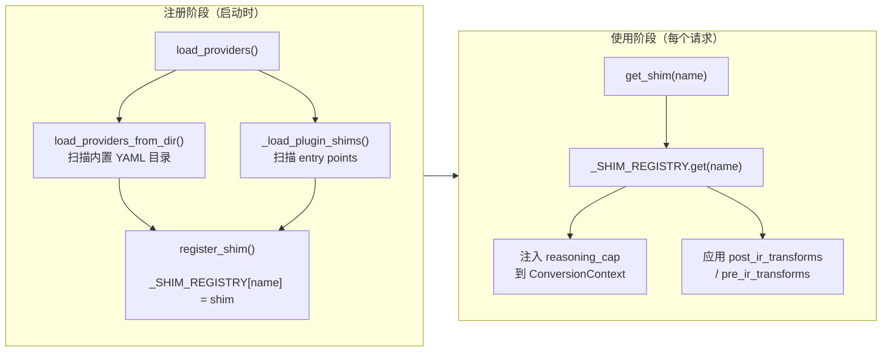
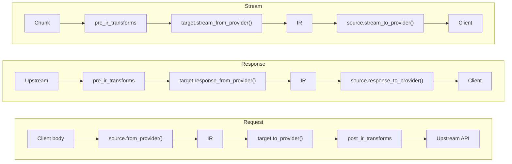

# 提供方 Shim

LLM-Rosetta 只有四个**转换器**——每种 API 标准一个（OpenAI Chat、OpenAI Responses、Anthropic、Google）。但实际的 LLM 提供方远不止这四家（DeepSeek、xAI、Qwen、Moonshot……），它们大多跟着某一标准走，只有一些字段级别的差异。

**Shim 层**就是用来处理这些差异的。一个 shim 本质上是一张身份卡：声明这个提供方用哪个转换器、默认连接到哪里，以及需要做哪些字段级的**转换规则（transforms）**。

## 架构

```text
ProviderShim ("deepseek--chat_completions")
├── name: "deepseek--chat_completions"
├── model_type: "llm"                     → 能力类别
├── format: "chat_completions"            → 选择转换器
├── default_base_url: "https://api.deepseek.com"
├── default_api_key_env: "DEEPSEEK_API_KEY"
├── logo: "https://cdn.jsdelivr.net/..."
├── post_ir_transforms: (strip_fields("n", "logit_bias", "seed"),)
└── pre_ir_transforms: ()
```

- **ProviderShim** — 提供方身份信息：名称、模型类型、wire format、默认 URL、API 密钥环境变量、Logo，以及转换规则。
- **Transforms** — 纯 `dict → dict` 函数，在转换器前后执行。`post_ir_transforms` 把输出请求调整成提供方的方言；`pre_ir_transforms` 把输入响应归一化回标准格式。

!!! note "向后兼容别名"
    旧字段名 `to_transforms` 和 `from_transforms` 仍作为别名被接受 —— 在 `ProviderShim` 构造函数参数和 `transforms.py` 导出中均可使用。

### 声明式提供方目录

内置 shim 以目录结构定义在 `shims/providers/` 下：

```text
packages/llm-rosetta/src/llm_rosetta/shims/providers/
├── __init__.py              # 自动发现：扫描子目录
├── openai/
│   └── provider.yaml        # 提供方身份（YAML）
├── deepseek/
│   ├── provider.yaml        # 提供方身份
│   └── transforms.py        # 字段级转换规则
├── volcengine/
│   ├── provider.yaml
│   └── transforms.py
└── ...
```

每个提供方子目录包含：

- **`provider.yaml`**（必需）—— 声明 `name`、`model_type`、`format`、连接设置（`connection.base_url`、`connection.api_key_env`、`connection.auth_header`、`connection.keyless`、`connection.models_path`、`connection.default_path`、`connection.token_command`），以及可选的 `logo`、`display_name`、`free_source`。`base` 是 `format` 的弃用别名；loader 会校验 `(model_type, format)` 对。使用 `format` 时必须同时声明 `model_type` —— 只有声明 `base` 且不写 `format` 的 shim 可以省略。非 chat shim 用 `connection.default_path` 声明它服务的端点（例如 `/v1/embeddings`），提供方可以通过 `embedding_shim` / `rerank_shim` / `decision_shim` 指向它，而不必写裸格式。
- **`transforms.py`**（可选）—— 导出 `post_ir_transforms` 和/或 `pre_ir_transforms` 元组（旧名 `to_transforms` / `from_transforms` 也可用）

`connection.keyless` 表示该上游无需凭据即可访问：未配置 `api_key` 时不发送任何鉴权头，
配置了则回退到基础类型的鉴权方式。`free_source: true` 表示该 shim 的网关提供免费模型池
—— 管理台会把它的 keyless 条目归入 "Free Resource" 分区，并命名为
`<display_name> (Free)`。

**凭据交换（Credential exchange）。** 有些上游的推理端点不接受账号 API key —— AskSage
接受由账号 key 换来的短期 access token，ALCF 接受会过期的 Globus bearer token 并需要
定时刷新。这个交换是厂商的事实，因此可以由 shim 自己声明，而不是让每个运维各写一遍：

```yaml
connection:
  base_url: https://api.vendor.example/v1
  api_key_env: VENDOR_API_KEY
  token_command: [python3, token.py]
  token_refresh_interval: 7200
```

网关在启动时运行该命令，之后每 `token_refresh_interval` 秒再运行一次（shim 与提供方都
未声明时为 `3600`，最小 `60`），并在上游返回 `401` 后立即重跑；命令的 stdout 就是发往
上游的凭据。参数中指向 shim 自身目录内文件的相对路径会被解析为绝对路径，因此 shim 可以
把脚本与 `provider.yaml` 放在一起；`python3` 之类的裸命令名与各种参数保持原样。提供方
自己声明的 `token_command` 仍然优先；当命令掌管凭据时，shim 的 `api_key_env` 不会被当作
静态密钥使用。

**需要读取运维所填 key 的交换**再声明一个变量名，网关据此把 key 递进去：

```yaml
connection:
  base_url: https://api.vendor.example/v1
  api_key_env: VENDOR_API_KEY
  token_command: [python3, token.py]
  token_command_env: VENDOR_ACCOUNT_KEY
```

设置 `token_command_env` 后，运维配置的 key（或由 `api_key_env` 提供的那份）会以该变量名
传给命令 —— 绝不放进 argv，因为进程表会把它暴露给机器上的其他进程 —— 而发往上游的是命令的
stdout，不是这个 key。它同时解除了该 shim 上 `api_key` 与 `token_command` 的互斥：这里的 key
是**输入**，不是第二个凭据。不声明它时，命令在网关自身的环境中运行、自行取得凭据，这正是
ALCF 的情形（`~/.globus`）。

**需要写代码的交换。** `token_command` 描述的是能用一条命令表达的交换。Sign in with
ChatGPT 不行：它有交互式首次登录、每次使用都会轮换的 refresh token，保存下来的是一个凭据
记录而不是一个字符串。这类 shim 在 `provider.yaml` 旁边附带 `auth.py` —— 与 `transforms.py`、
`quota.py` 同级同信任，走同一条加载路径 —— 并导出 `EXCHANGE`：

```python
# auth.py
from llm_rosetta.shims.auth_exchange import BaseAuthExchange


class Exchange(BaseAuthExchange):
    kind = "oauth"

    def needs_interactive_setup(self, ctx):
        return not (ctx.state_dir and os.path.exists(_record_path(ctx)))

    async def credential(self, ctx):
        return await _refresh_or_load(ctx)  # 需要登录时抛 InteractiveSetupRequired

    def account_id(self, ctx):
        return _subject(ctx)  # 不透明；网关会做哈希


EXCHANGE = Exchange()
```

| 成员 | 调用时机 | 要求 |
|------|----------|------|
| `credential(ctx)` | 启动填充、定时刷新、上游 `401` 后各一次 | 返回发往上游的字符串；网络 I/O 可以 `await` |
| `needs_interactive_setup(ctx)` | 构建配置时、任何请求之前 | 只读本地状态 |
| `account_id(ctx)` | 构建配置时 | 返回不透明的账号身份，或 `None` |
| `kind` | 报告用途 | 短标签，例如 `"oauth"` |
| `consumes_key` | 构建配置时 | 说明 `ctx.input_key` 是否为输入 |
| `login(ctx)` | CLI，在有浏览器的一侧 | 运行交互式登录并返回记录；阻塞调用，网关从不调用它 |
| `install(ctx, record)` | `PUT …/credential` | 校验交来的记录并存储；返回摘要，绝不返回令牌 |
| `describe(ctx)` | `GET …/credential` | 返回不含令牌的摘要，或 `None` |
| `revoke(ctx)` | `DELETE …/credential` | 删除记录，厂商允许时同时在上游撤销 |

`login`、`install`、`describe` 与 `revoke` 都是可选的。它们都定义在 `BaseAuthExchange` 上
且直接抛错，所以“有没有这个属性”从来不是问题：交换通过 `can_install()`、`can_login()` 与
`can_revoke()`（三者默认 `False`）说明自己实现了什么，网关会拒绝该操作，而不是去调用一个
空实现。`describe()` 是例外 —— 它返回 `None` 而不抛错，而 `None` 正是“无话可说”的含义。

`ctx` 携带提供方的配置键（`ctx.provider`）、凭据记录目录（`ctx.state_dir` —— 即
`server.data_dir` 相对配置文件解析后的路径再加 `/shim-auth/<provider>`；只有程序化调用方
未提供数据目录时才为 `None`），以及 `consumes_key` 为真时运维填写的 key（`ctx.input_key`）。同一
shim 下的两个提供方是两个账号，因此自行决定 `state_dir` 默认值的交换必须按 `ctx.provider`
分目录 —— 只有这个目录能把它们的凭据记录区分开。只有
一个 `credential()` 而没有分开的 seed 与 refresh：网关从不区分这两件事 —— 凭据要么现在
可用，要么不可用。

两种形式由同一套机制驱动 —— `/health/ready` 之下的启动填充、后台刷新器、以及 `401` 后的
被动重试 —— 因此交换本身不需要自己安排调度。当 `credential()` 抛出
`InteractiveSetupRequired` 时，提供方会被标记为“需要交互式登录”，不参与启动重试，也不会
让每个请求都在上游失败。

已随包发布的参考实现是 OpenAI 套餐通道的
`openai_chatgpt/open_responses/auth.py`（issue
[#1057](https://github.com/Oaklight/llm-rosetta/issues/1057)）：动态客户端注册、PKCE、
loopback 回调、基于 discovery JWKS 的 ID token 验签、在排他锁下原子写入的 `0600`
凭据记录、轮换的 refresh token，以及跨重新登录保留的 host id。它只用标准库 —— RS256
用 `hashlib` 与大整数 `pow` 验签，HTTP 用工作线程上的 `urllib` —— 这也是 shim 模块必须
遵守的形态：shim 层先于网关加载，而核心没有任何依赖。

记录也可以在事后装入：`llm-rosetta-gateway credential <name>` 在有浏览器的一侧运行
`login()`，而 `PUT /admin/api/config/providers/<name>/credential` 把它打印出的记录交给
交换 —— 远端网关因此无需绑定自己的 loopback。命令不联系网关；记录本身就是交接的全部。交换负责
校验（OpenAI 模块会验签 ID token，并从验签后的 claims 取 subject），并把记录存到自己
`credential()` 会读取的位置。记录要尽快粘贴：校验在收到时进行，放了一夜的记录会被拒绝，
只能重新登录。

一个 shim 只能声明其中一种形式：同时提供 `auth.py` 与 `connection.token_command` 会加载
失败。提供方自己写的 `token_command` 仍然优先；若交换未声明 `consumes_key`，在同一提供方
再配置 `api_key` 会被拒绝 —— 两者是同一个凭据的两种来源。

**管理台如何分组 shim。** 提供方类型选择器分两级：顶层（*group*）以及其下每个 shim
一行。两个字符串都可以声明，因为它们并非总能从名称推导出来：

| 字段 | 含义 | 默认值 |
|------|------|--------|
| `display_name` | 该 shim 自身的标签，显示在第二列 —— 适用于同时声明了 `group` 或 `group_label` 的 shim | `--` 之后的那段名称 |
| `group` | 该 shim 归入的顶层键 | `--` 之前的那段名称 |
| `group_label` | 该顶层的标题 | group 键本身 |

默认值就是旧行为 —— shim 名称按第一个 `--` 切分 —— 因此不声明这些字段的 shim，渲染结果
与以往完全一致，第三方 shim 和外部 shim 都无需改动。声明 `group` 才让一个厂商能拥有多个
集群 × 多种格式：ALCF 的三个集群各自声明 `group: alcf` 与 `display_name: metis` /
`minerva` / `sophia`，选择器便显示一个 `alcf` 顶层，其条目读作 `metis · chat_completions`。

一行显示 `label · base`，是选择器在说明该 shim 的标签并非它的基础格式 —— 这是任何 shim
都可使用的呈现方式，而非针对某一族的特例。

`display_name` 并非一直取此含义。在 `group` 出现之前，它命名的是 shim 的**顶层** ——
也就是厂商 —— 按旧 schema 编写的 shim 至今如此。采用哪种解读，取决于该 shim 是否声明了
分组字段：`group` 与 `group_label` 都未声明时沿用旧含义，因此这类 shim 的渲染与引入这些
字段之前完全一致（`display_name` 作为顶层标题，行标签仍取自名称）。声明其中任一，则
`display_name` 表示该 shim 自身的行标签。若不这样区分，按旧 schema 编写的 shim 会把厂商名
打印两次 —— 一次作为顶层标题，一次出现在它唯一的那一行上。随之而来的一个推论：顶层标题
同时也是免费资源按钮上的品牌（`<Brand> (Free)`），因此希望按钮上显示的不只是首字母大写的
group 键的厂商，需要声明 `group_label`。

`provider.yaml` 示例：

```yaml
name: deepseek
model_type: llm
format: chat_completions
default_base_url: https://api.deepseek.com
default_api_key_env: DEEPSEEK_API_KEY
logo: https://cdn.jsdelivr.net/npm/@lobehub/icons-static-svg@latest/icons/deepseek.svg
```

`transforms.py` 示例：

```python
from llm_rosetta.transforms import strip_fields

# DeepSeek 不支持 n、logit_bias 和 seed
post_ir_transforms = (strip_fields("n", "logit_bias", "seed"),)
pre_ir_transforms = ()
```

导入时，`shims/__init__.py` 自动扫描所有提供方目录并注册，然后发现通过 entry point 声明的插件 shim。

## Shim 生命周期



- **注册阶段**在导入时执行一次。`load_providers()` 扫描内置 `providers/` 目录，然后发现 `llm_rosetta.shim_providers` entry point 以加载插件 shim。
- **使用阶段**在每个请求中执行。`get_shim(name)` 查询注册表；gateway 注入推理配置并在转换器前后应用 transforms。

## 插件 Shim

下游包可以在不修改 llm-rosetta 的情况下注册自己的 shim。两种方式：

### Entry Point（推荐）

在 `pyproject.toml` 中声明 entry point：

```toml
[project.entry-points."llm_rosetta.shim_providers"]
my_provider = "my_package.shims:register_shims"
```

callable 扫描本地 YAML 目录并返回注册的 shim：

```python
# my_package/shims/__init__.py
from pathlib import Path
from llm_rosetta.shims import load_providers_from_dir

def register_shims():
    return load_providers_from_dir(Path(__file__).parent / "providers")
```

### 条件注册

高级场景（按环境注册、动态配置）可以直接调用 `register_shim()`：

```python
import os
from llm_rosetta.shims import register_shim, ProviderShim

def register_shims():
    if os.getenv("MY_INTERNAL_PROVIDER"):
        register_shim(ProviderShim(
            name="my-internal",
            format="chat_completions",
            default_base_url="http://internal:8080/v1",
        ))
```

!!! note
    当插件注册了与内置同名的 shim 时，内置 shim 会被静默覆盖（输出 INFO 日志）。这是有意设计——允许插件定制内置提供方的行为。

### 配置声明的目录与远程源

一套 shim 也可以**无需安装插件**就被消费。gateway 的顶层 `shims` 配置段会扫描额外目录，
并把远程归档拉取到本地缓存 —— 这在直接使用官方镜像（既没有 `pip` 也没有 `git`）而 shim
维护在独立仓库时特别有用：

```jsonc
"shims": {
  "presets": ["alcf"],                            // 下方 catalog remote 的简写
  "paths": ["/config/shims"],                     // 存放 <name>/provider.yaml 的目录
  "remotes": [
    {
      "url": "https://github.com/Oaklight/llm-rosetta-shim-alcf",
      // "ref": "v0.1.0",                          // 仓库打 tag 后再固定；省略则取 HEAD，首次拉取时固化
      "path": "src/llm_rosetta_shim_alcf/providers",
      "token_env": "GITHUB_TOKEN"                  // 可选；仅私有镜像需要
    }
  ]
}
```

`presets` 条目命名源 catalog 中的包（ALCF、Argo、AskSage），并展开为下方所示的
remote；同一 URL 的显式 remote 会合并到预设上（显式键优先）。远程源的 `path` 是归档内存放提供方目录的路径（对
`llm-rosetta-shim-*` 包来说是 `src/<package>/providers`）。完整字段、缓存与刷新行为、优先级和安全提示见
[Gateway → 外部 Shim 源](../gateway/configuration.md#external-shim-sources)。
编程方式可用 `llm_rosetta.shims.rebuild_shims()`（无需配置文件）或
`llm_rosetta_gateway.apply_shim_sources(raw, config_path)`。

!!! warning
    声明的源可能携带在加载时被执行的 `transforms.py` —— 与安装插件包是同一信任级别。
    请固定 ref，并只添加你信任的源。

## 内置 Shim

LLM-Rosetta 内置 33 个提供方 shim，每个 shim 对应 `packages/llm-rosetta/src/llm_rosetta/shims/providers/`
下的一个目录。`list_shims()` 会打印当前实际的集合；下表即是该集合。ALCF、AskSage 与 Argo
的 shim 作为独立包发布 —— 参见[独立 Shim 包](#standalone-shim-packages)。

| 名称 | 格式 | 默认 Base URL | API Key 环境变量 | 转换规则 |
|------|------|--------------|-----------------|---------|
| `anthropic--messages` | `messages` | `https://api.anthropic.com` | `ANTHROPIC_API_KEY` | — |
| `cohere--embedding` | `cohere` | `https://api.cohere.com` | `COHERE_API_KEY` | — |
| `cohere--rerank` | `cohere` | `https://api.cohere.com` | `COHERE_API_KEY` | — |
| `deepseek--chat_completions` | `chat_completions` | `https://api.deepseek.com` | `DEEPSEEK_API_KEY` | 剥离 `n`、`logit_bias`、`seed`、penalties；声明推理回放（`replay_missing`） |
| `deepseek--open_responses` | `open_responses` | `https://api.deepseek.com` | `DEEPSEEK_API_KEY` | 剥离 `n`、`logit_bias`、`seed` |
| `google--embedding` | `google_generate` | `https://generativelanguage.googleapis.com` | `GOOGLE_API_KEY` | — |
| `google--google_generate` | `google_generate` | `https://generativelanguage.googleapis.com` | `GOOGLE_API_KEY` | — |
| `google--google_interactions` | `google_interactions` | `https://generativelanguage.googleapis.com` | `GOOGLE_API_KEY` | — |
| `jina--embedding` | `jina` | `https://api.jina.ai` | `JINA_API_KEY` | — |
| `jina--rerank` | `jina` | `https://api.jina.ai` | `JINA_API_KEY` | — |
| `kilo--chat_completions` | `chat_completions` | `https://api.kilo.ai/api/gateway` | *（keyless）* | — |
| `minimax--chat_completions` | `chat_completions` | `https://api.minimaxi.com/v1` | `MINIMAX_API_KEY` | 剥离 `logprobs`、`top_logprobs`、`seed`、`stop`；注入 `reasoning_split`；解析 `think` 标签 |
| `minimax--messages` | `messages` | `https://api.minimaxi.com/anthropic` | `MINIMAX_API_KEY` | — |
| `moonshot` | `chat_completions` | `https://api.moonshot.cn/v1` | `MOONSHOT_API_KEY` | 剥离 `logprobs`、`top_logprobs`、`logit_bias`、`seed` |
| `openai--chat_completions` | `chat_completions` | `https://api.openai.com/v1` | `OPENAI_API_KEY` | — |
| `openai--embedding` | `openai` | `https://api.openai.com/v1` | `OPENAI_API_KEY` | — |
| `openai--open_responses` | `open_responses` | `https://api.openai.com/v1` | `OPENAI_API_KEY` | — |
| `openai--openai_decisions` | `openai_decisions` | `https://api.openai.com` | `OPENAI_API_KEY` | — |
| `opencode--chat_completions` | `chat_completions` | `https://opencode.ai/zen/go/v1` | `OPENCODE_API_KEY` | — |
| `opencode--messages` | `messages` | `https://opencode.ai/zen/go/v1` | `OPENCODE_API_KEY` | — |
| `opencode--open_responses` | `open_responses` | `https://opencode.ai/zen/go/v1` | `OPENCODE_API_KEY` | — |
| `openrouter--chat_completions` | `chat_completions` | `https://openrouter.ai/api/v1` | `OPENROUTER_API_KEY` | 重命名 `reasoning` → `reasoning_content` |
| `openrouter--messages` | `messages` | `https://openrouter.ai/api` | `OPENROUTER_API_KEY` | — |
| `openrouter--open_responses` | `open_responses` | `https://openrouter.ai/api/v1` | `OPENROUTER_API_KEY` | — |
| `qwen` | `chat_completions` | `https://dashscope.aliyuncs.com/compatible-mode/v1` | `DASHSCOPE_API_KEY` | 剥离 `frequency_penalty`、`logit_bias` |
| `typesafe--systemone` | `systemone` | `https://api.typesafe.ai` | `TYPESAFE_API_KEY` | — |
| `volcengine--chat_completions` | `chat_completions` | `https://ark.cn-beijing.volces.com/api/v3` | `ARK_API_KEY` | 剥离 `logprobs`、`top_logprobs` |
| `volcengine--open_responses` | `open_responses` | `https://ark.cn-beijing.volces.com/api/v3` | `ARK_API_KEY` | — |
| `voyage--embedding` | `voyage` | `https://api.voyageai.com` | `VOYAGE_API_KEY` | — |
| `voyage--rerank` | `voyage` | `https://api.voyageai.com` | `VOYAGE_API_KEY` | — |
| `xai` | `chat_completions` | `https://api.x.ai/v1` | `XAI_API_KEY` | 剥离 `logit_bias` |
| `zhipu` | `chat_completions` | `https://open.bigmodel.cn/api/paas/v4` | `ZHIPU_API_KEY` | 剥离 `n`、penalties、`logprobs`、`logit_bias`、`seed` |

本列给出字段级转换规则。`hoist_late_system_messages()` 会改写对话中途的 system/developer
消息以保持 prompt cache 前缀稳定，多数 `chat_completions` shim 都声明了它，此处不再重复；
每个 shim 的完整声明见其自身的 `transforms.py`。

### 独立 Shim 包 { #standalone-shim-packages }

有三套 shim 维护在各自的仓库中，而不在核心包内：

| 包 | Shim 名称 | 仓库 |
|----|----------|------|
| ALCF | `alcf_metis--chat_completions`、`alcf_minerva--chat_completions`、`alcf_sophia--chat_completions` | [llm-rosetta-shim-alcf](https://github.com/Oaklight/llm-rosetta-shim-alcf) |
| Argo | `argo--chat_completions`、`argo--messages`、`argo--open_responses` | [llm-rosetta-shim-argo](https://github.com/Oaklight/llm-rosetta-shim-argo) |
| AskSage | `asksage--chat_completions`、`asksage--messages`、`asksage--open_responses`、`asksage--google_generate` | [llm-rosetta-shim-asksage](https://github.com/Oaklight/llm-rosetta-shim-asksage) |

ALCF 与 AskSage 是在 0.14.0 开发周期中引入的，从未出现在任何稳定版的内置集合中；Argo 则自
v0.6.3 起一直作为内置 shim 发布。三者均已在 0.14.0 离开核心。独立包注册相同的规范 shim
名称，因此提供方的 `shim` 值无需改动 —— 新增的只是源声明。

**按名称预载一个包。** `shims.presets` 会把 catalog 键展开为仓库、路径与 token 变量，
因此一行即可替代完整的 remote 配置：

```jsonc
"shims": {
  "presets": ["argo"]
}
```

```jsonc
// 等价的显式 remote
"shims": {
  "remotes": [
    {
      "url": "https://github.com/Oaklight/llm-rosetta-shim-argo",
      "path": "src/llm_rosetta_shim_argo/providers"
    }
  ]
}
```

预设先于显式 remote 应用，同一 URL 的显式 remote 会合并到对应预设上（显式键优先），
因此固定 `ref` 时无需重复 `path`。三个仓库都是公开的，预设不带 `token_env`；只有私有镜像
才需要添加。预设中不固定 `ref`，因为这些仓库都还
没有打 tag：不带 `ref` 的远程源会先把 `HEAD` 解析为某个 commit 并记录进缓存 stamp。等它们
打上 tag 后再固定该 tag —— 参见 [ref 解析](../gateway/configuration.md#external-shim-sources)。

**Settings → Shim Sources** 将每个 catalog 包提供为一键预设（并为同样的键提供文本框）；
保存时会把 `presets` 或展开后的 remote 写入配置。若配置仍使用这些 shim 却没有声明源，
启动时会得到一条错误，指明包名、预设与展开后的 remote；源加载成功后错误即消失。

旧拼写**不再**解析到 shim：`argo--openai_chat`、`argo--anthropic` 和
`argo--openai_responses` 是内置 shim 的别名，独立包只注册规范名称。别名仍作为拼写映射保留，
因此旧值会先规范化，再进入那条指明包名的“配置滞留”错误；声明预设时请改成规范名称。
声明预设时请把旧值改为规范名称。

CI 检查（`scripts/check_shim_removals.py`、`make check-shim-removals`）仍会约束未来的移除：
它读取 `SHIM_REMOVALS`，若某个 shim 在其 `removed_in` 版本之前消失则失败；而当版本到达该
版本时，只要该 shim 仍被注册，或仍被示例、Docker 文件、文档或源码引用，同样会失败。目前没有
任何计划中的内置移除。

## 推理配置 { #reasoning-configuration }

从 v0.6.8 起，shim 可以通过 `provider.yaml` 中的 `reasoning` 段声明推理能力配置。运行时由 `apply_reasoning_config()` 读取该配置，替代了之前硬编码在各转换器中的 effort 降级逻辑。

### ReasoningCapability 字段

| 字段 | 类型 | 说明 |
|------|------|------|
| `disabled` | `"omit"` \| `"thinking_disabled"` \| `"thinking_budget_zero"` | `mode: disabled` 时的序列化策略：`omit` 不发送任何参数，`thinking_disabled` 发送 `{"thinking": {"type": "disabled"}}`，`thinking_budget_zero` 发送 `{"thinking_config": {"thinking_budget": 0}}` |
| `effort_field` | `"reasoning_effort"` \| `"reasoning.effort"` \| `"output_config.effort"` \| `"thinking_level"` \| `"none"` | effort 值在提供方请求中的序列化位置；`"none"` 表示提供方不支持 effort |
| `max_effort` | `EffortLevel` \| `null` | 最高允许的归一化 effort 级别；超过此值的 effort 会被截断到该级别 |
| `thinking_type` | `"enabled"` \| `"adaptive"` \| `null` | 强制 `thinking.type` 为该值；`null` 表示不覆盖 |
| `effort_map` | `dict[str, str]` | 从归一化 IR effort 到提供方特定 effort 字符串的映射 |

### 配置示例

=== "Anthropic"

    ```yaml
    # provider.yaml
    reasoning:
      disabled: thinking_disabled
      effort_field: output_config.effort
      effort_map:
        minimal: low
        low: low
        medium: medium
        high: high
        xhigh: xhigh
        max: max
    ```

=== "OpenAI"

    ```yaml
    # provider.yaml
    reasoning:
      disabled: omit
      effort_field: reasoning_effort
      max_effort: high
      effort_map:
        minimal: minimal
        low: low
        medium: medium
        high: high
        xhigh: high
        max: high
    ```

### 按模型覆盖（`model_overrides`）

当同一提供方下不同模型有不同推理能力时，使用 `model_overrides` 声明按模型的配置。每个覆盖项继承提供方级默认值，按**上游模型 ID**（别名解析后）为键：

```yaml
name: argo--messages
model_type: llm
format: messages
reasoning:
  thinking_type: enabled       # 大多数模型的默认值
  effort_map: { ... }
  model_overrides:
    claudeopus47:
      thinking_type: adaptive  # Vertex AI 要求 adaptive
```

网关在别名解析后确定上游模型 ID（如 `argo:claude-opus-4.7` → `claudeopus47`），并应用匹配的覆盖配置。

### 运行机制

当网关代理处理请求时：

1. `_inject_shim_reasoning()` 从目标提供方的 shim 中提取 `ReasoningCapability`，注入转换上下文的 `ctx.options["reasoning_cap"]`。如果上游模型有 `model_overrides` 条目，则使用该覆盖配置
2. 各转换器的 `request_to_provider` 将 `reasoning_cap` 传给 `ir_reasoning_config_to_p`
3. `ir_reasoning_config_to_p` 委托给 `apply_reasoning_config()`，按 shim 配置执行：
    - 输入归一化（`none` → disabled）
    - disabled 序列化（按 `cap.disabled` 策略）
    - effort 截断（按 `cap.max_effort`）
    - effort 映射（按 `cap.effort_map`）
    - `thinking_type` 覆盖（如强制 `enabled` → `adaptive`，用于 Vertex AI 模型）
    - 结构化传透（mode、budget_tokens 等提供方特定字段）

没有声明 `reasoning` 段的 shim 使用基础转换器类型的内置默认配置。

!!! note "安全机制：`thinking_type: enabled` 但缺少 `budget_tokens`"
    Anthropic 要求 `thinking.type = "enabled"` 时必须提供 `budget_tokens`。如果 `thinking_type: enabled` 覆盖生效但请求中没有 `budget_tokens`，helper 会自动回退到 `"adaptive"` 以避免产出不合法的请求。

## Argo Shim

`argo--chat_completions`、`argo--messages` 和 `argo--open_responses` 面向 **Argo 网关** —— 这是某些机构（如 Argonne 国家实验室）使用的代理层，将多个上游 LLM 提供方统一暴露在单一端点之后。

它们**不是**内置的。请先声明独立包：

```jsonc
{
  "shims": { "presets": ["argo"] }
}
```

三个 shim 都使用 `model_id_field: internal_id` —— 模型标识符通过 `internal_id` 而非 `model` 字段传递。

### `argo--chat_completions`

OpenAI 兼容 shim，附带一个 transform：`max_tokens` → `max_completion_tokens`（新版 OpenAI 模型拒绝旧字段名）。

### `argo--messages`

- **模型级 `thinking_type` 覆盖**：默认 `thinking_type: enabled`，通过 `model_overrides` 为 `claudeopus47` 设置 `thinking_type: adaptive`（Vertex AI 后端）。声明式处理。
- **`unsigned_reasoning_blocks: preserve`**：历史消息中没有有效签名的 thinking block 保存在 metadata 中而非转发（避免 Argo 400 错误）。
- **`pre_ir_transforms` —— OpenAI 响应格式归一化**：Argo 可能从 `/v1/messages` 返回 OpenAI Chat 格式响应，该 transform 在转换器处理前将其归一化为 Anthropic 格式。

### `argo--open_responses`

Responses 格式通道，为拒绝 temperature 的 GPT/o 系列模型按模型剥离 temperature。

### 配置

在网关配置中覆盖 `default_base_url`：

```jsonc
{
  "providers": {
    "argo": {
      "shim": "argo--messages",
      "base_url": "https://your-argo-instance.example.com/",
      "api_key": "${ARGO_API_KEY}"
    }
  }
}
```

!!! note
    默认 URL（`https://apps.inside.anl.gov/argoapi/`）仅在 ANL 内网可达。三个 Argo shim 位于独立的 [`llm-rosetta-shim-argo`](https://github.com/Oaklight/llm-rosetta-shim-argo) 包中 —— 声明 `"shims": {"presets": ["argo"]}`，配置中的名称即可继续使用。**Settings → Shim Sources** 已将该源作为预设提供。

## 能力标志

除推理配置外，shim 还可以声明影响转换器行为的提供方级能力标志：

| 字段 | 类型 | 默认值 | 描述 |
|------|------|--------|------|
| `supports_custom_tools` | `bool` | `False` | 提供方 API 是否原生支持 `{type: "custom"}` 工具定义。`False` 时，自定义工具降级为函数包装并合成 JSON schema。 |
| `hoist_system_messages` | `bool` | `True` | 将对话中间的 system/developer 消息改写为 user 角色 `[System: ...]` 信封，保持 prompt cache 前缀稳定。 |
| `multimodal_tool_result` | `bool \| None` | `None` | 提供方是否原生支持工具结果中的多模态内容（图片、文件）。`None` 使用转换器的类级默认值。`True` 强制原生透传；`False` 强制双重编码（文本回退 + 合成 user 消息）。 |

`provider.yaml` 示例：

```yaml
name: my-provider
model_type: llm
format: chat_completions
supports_custom_tools: true
hoist_system_messages: true
multimodal_tool_result: false
```

这些标志在转换时注入 `ConversionContext.options`，转换器无需知道当前使用的是哪个 shim 即可查询。

## 转换规则（Transforms）

转换规则是纯 `dict → dict` 函数，用于弥合提供方实际 API 方言与对应基础转换器所期望的"标准"格式之间的差异。它们处理字段级差异（剥离不支持的字段、重命名参数、注入默认值）—— **不**处理语义级 API 标准转换，那是转换器的职责。

### 内置转换原语

| 原语 | 描述 | 示例 |
|------|------|------|
| `strip_fields(*keys)` | 从请求体中移除不支持的字段 | `strip_fields("logprobs", "top_logprobs")` |
| `rename_field(old, new)` | 重命名顶层字段 | `rename_field("max_tokens", "max_length")` |
| `set_defaults(**kv)` | 仅在字段不存在时设置（幂等） | `set_defaults(temperature=0.7)` |
| `force_fields(**kv)` | 无条件设置字段 —— 用于上游拒绝的取值 | `force_fields(store=False)` |
| `default_tool_description(text)` | 为描述为空的工具注入占位描述 | `default_tool_description("No description provided")` |

### 响应体变换

除了请求变换（`post_ir_transforms` / `pre_ir_transforms`），shim 还可以声明 `response_body_transforms`——在 IR 转换之前应用于原始上游响应体的纯 `dict → dict` 函数。用于修复非标准端点返回的畸形响应。

```yaml
# provider.yaml — 声明响应变换存在
response_body_transforms: true
```

```python
# transforms.py
from llm_rosetta.transforms import harmony_tool_call_safeguard

response_body_transforms = (harmony_tool_call_safeguard(),)
```

内置响应变换：`harmony_tool_call_safeguard()` 修复 Harmony/vLLM 端点返回的畸形工具调用 JSON。

### 应用方式

转换规则在两个层面应用：

**1. `convert()` 公共 API** —— 通过 `resolve_transforms()` 自动应用：

```python
from llm_rosetta import convert

# 当 source/target 是 shim 名称时，转换规则自动应用
result = convert(request_body, source="chat_completions", target="volcengine--chat_completions")
# → logprobs 和 top_logprobs 从输出中剥离
```

**2. 网关代理管线** —— 围绕转换器应用：



### 设计原则

- **幂等**：重复应用同一转换规则无副作用
- **不重叠**：按约定，不同转换规则应操作不同字段
- **可组合**：多个转换规则通过 `apply_transforms()` 顺序应用

## 使用 Shim

### 通过 Shim 名称解析转换器

`get_converter_for_provider()` 同时接受基础转换器类型字符串和 shim 名称：

```python
from llm_rosetta import get_converter_for_provider

# 基础类型 —— 与之前一样
converter = get_converter_for_provider("chat_completions")

# Shim 名称 —— 通过注册表解析为 "chat_completions"
converter = get_converter_for_provider("deepseek--chat_completions")
```

### 解析格式与模型类型

使用 `resolve_format()` 将 shim 名称映射到 wire format，使用
`resolve_model_type()` 获取能力类别：

```python
from llm_rosetta import resolve_format, resolve_model_type

resolve_format("deepseek--chat_completions")  # → "chat_completions"
resolve_format("chat_completions")            # → "chat_completions"（直接透传）
resolve_format("unknown")                     # → "unknown"（直接透传）

resolve_model_type("deepseek--chat_completions")  # → "llm"
resolve_model_type("typesafe--systemone")         # → "decision"
resolve_model_type("typesafe")                    # → "decision"（旧别名）
resolve_model_type("openai")                      # → None（歧义：既是厂商名也是 embedding format）
```

`resolve_base()` 是 `resolve_format()` 的弃用别名。

## 注册自定义 Shim

### 编程式注册

为任何 OpenAI 兼容服务注册自定义提供方 shim：

```python
from llm_rosetta import ProviderShim, register_shim
from llm_rosetta.transforms import strip_fields

my_shim = ProviderShim(
    name="my-provider",
    format="chat_completions",
    default_base_url="https://api.my-provider.com/v1",
    default_api_key_env="MY_PROVIDER_API_KEY",
    post_ir_transforms=(strip_fields("logprobs", "seed"),),
)
register_shim(my_shim)
```

注册后，shim 名称可在所有地方使用 —— `get_converter_for_provider()`、`resolve_format()`、`convert()` 和网关配置。

### 添加 YAML 提供方

要向内置注册表添加新提供方：

1. 在 `packages/llm-rosetta/src/llm_rosetta/shims/providers/<name>/` 下创建目录
2. 添加 `provider.yaml`，包含必填字段：

    ```yaml
    name: my-provider
    model_type: llm
    format: chat_completions
    default_base_url: https://api.my-provider.com/v1
    default_api_key_env: MY_PROVIDER_API_KEY
    logo: https://example.com/logo.svg
    ```

3. 如果提供方有字段级差异，可选添加 `transforms.py`：

    ```python
    from llm_rosetta.transforms import strip_fields

    post_ir_transforms = (strip_fields("unsupported_field"),)
    pre_ir_transforms = ()
    ```

提供方在导入时自动发现并注册。

### 列出和移除 Shim

```python
from llm_rosetta import list_shims, unregister_shim

# 列出所有已注册的 shim
for shim in list_shims():
    print(f"{shim.name} → {shim.format}")

# 移除 shim
unregister_shim("my-provider")
```

## 网关集成

在网关配置文件中，使用 `"shim"` 字段引用已注册的 shim，而非直接指定 `"type"`：

```jsonc
{
  "providers": {
    "my-deepseek": {
      "shim": "deepseek--chat_completions",
      "api_key": "${DEEPSEEK_API_KEY}"
      // base_url 默认使用 shim 的 default_base_url
    }
  },
  "models": {
    "deepseek-chat": "my-deepseek"
  }
}
```

提供方类型的解析顺序：

1. `"shim"` 字段 —— 通过 shim 注册表解析为基础转换器类型
2. `"type"` 字段 —— 直接用作转换器类型
3. 提供方配置键名 —— 作为后备

当找到 shim 时：

- `default_base_url` 和 `default_api_key_env` 在配置未明确指定时作为后备值使用
- `post_ir_transforms` 应用于发送给上游提供方的请求
- `pre_ir_transforms` 应用于接收到的响应/流式 chunk，在转换之前执行
