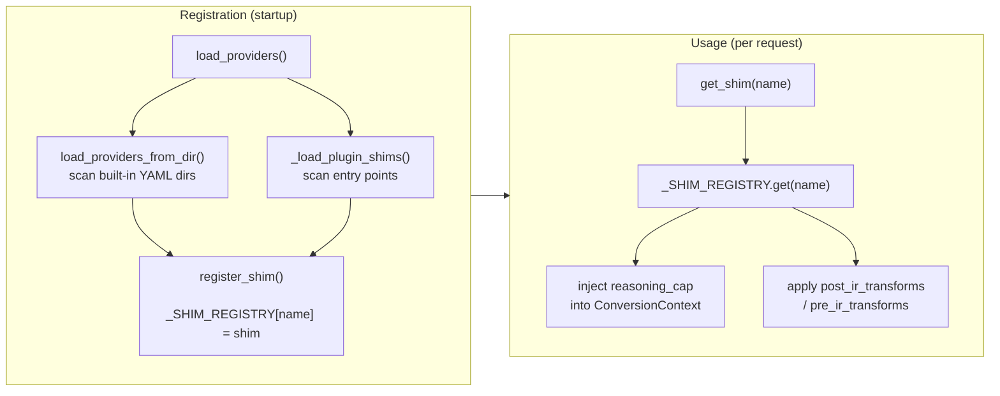
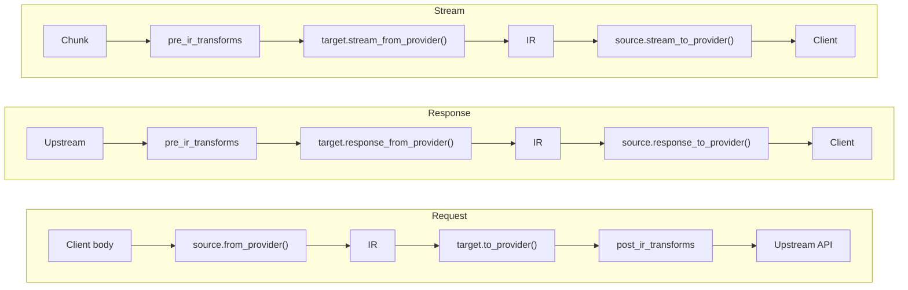

# Provider Shims

LLM-Rosetta uses only four **converters** — one per API standard (OpenAI Chat, OpenAI Responses, Anthropic, Google). But the LLM ecosystem has many more *providers* (DeepSeek, xAI, Qwen, Moonshot, …) that follow one of those standards with minor variations.

The **shim layer** bridges this gap. A shim is a lightweight identity card that declares which converter a provider uses, along with connection defaults and optional **transforms** that adapt request/response fields to match the provider's dialect.

## Architecture

```text
ProviderShim ("deepseek--chat_completions")
├── name: "deepseek--chat_completions"
├── model_type: "llm"                     → the capability category
├── format: "chat_completions"            → selects the converter
├── default_base_url: "https://api.deepseek.com"
├── default_api_key_env: "DEEPSEEK_API_KEY"
├── logo: "https://cdn.jsdelivr.net/..."
├── post_ir_transforms: (strip_fields("n", "logit_bias", "seed"),)
└── pre_ir_transforms: ()
```

- **ProviderShim** — provider identity: name, model type, wire format, default URL, default API key env var, logo URL, and optional transforms.
- **Transforms** — pure `dict → dict` functions applied around converters. `post_ir_transforms` adapt outgoing requests to the provider's dialect; `pre_ir_transforms` normalize incoming responses.

!!! note "Backward-compatible aliases"
    The old field names `to_transforms` and `from_transforms` are still accepted as aliases — both in `ProviderShim` constructor kwargs and in `transforms.py` exports.

### Declarative Provider Directory

Built-in shims are defined as a directory structure under `shims/providers/`:

```text
packages/llm-rosetta/src/llm_rosetta/shims/providers/
├── __init__.py              # Auto-discovery: scans subdirectories
├── openai/
│   └── provider.yaml        # Provider identity (YAML)
├── deepseek/
│   ├── provider.yaml        # Provider identity
│   └── transforms.py        # Field-level transforms
├── volcengine/
│   ├── provider.yaml
│   └── transforms.py
└── ...
```

Each provider subdirectory contains:

- **`provider.yaml`** (required) — declares `name`, `model_type`, `format`, connection settings (`connection.base_url`, `connection.api_key_env`, `connection.auth_header`, `connection.keyless`, `connection.models_path`, `connection.default_path`, `connection.token_command`), plus optional `logo`, `display_name`, and `free_source`.  `base` is the deprecated alias for `format`; the loader validates the `(model_type, format)` pair against the converter registry.  `model_type` is required whenever `format` is used — only a shim that declares `base` and no `format` may omit it.  A non-chat shim declares `connection.default_path` for the endpoint it serves (e.g. `/v1/embeddings`), and a provider can name it through `embedding_shim` / `rerank_shim` / `decision_shim` instead of a bare format.
- **`transforms.py`** (optional) — exports `post_ir_transforms` and/or `pre_ir_transforms` tuples (the old names `to_transforms` / `from_transforms` also work)

`connection.keyless` marks an upstream that accepts requests with no credential: the
provider sends no auth header while no `api_key` is configured, and falls back to the
base type's auth when one is supplied. `free_source: true` marks a shim whose gateway
serves a free model pool — the admin UI groups its keyless entry under a "Free
Resource" section and titles it `<display_name> (Free)`.

**Credential exchange.** Some upstreams do not accept an account API key on their
inference endpoints — AskSage takes a short-lived access token minted from the
account key, ALCF a Globus bearer token that expires and has to be refreshed. The
exchange is a fact about the vendor, so a shim can declare it instead of leaving
every operator to write it:

```yaml
connection:
  base_url: https://api.vendor.example/v1
  api_key_env: VENDOR_API_KEY
  token_command: [python3, token.py]
  token_refresh_interval: 7200
```

The gateway runs the command at startup, again every `token_refresh_interval`
seconds (`3600` when the shim and the provider both stay silent, minimum `60`),
and immediately after an upstream `401`; its stdout becomes the credential sent
upstream. A relative argument that names a file in the shim's own directory is
resolved to its absolute path, so the shim ships the script beside its
`provider.yaml` — `python3` and any flag stay as written. A provider that names
its own `token_command` still wins, and while a command owns the credential the
shim's `api_key_env` is not used as a static key.

**An exchange that consumes the operator's key** declares the variable to hand
it over in:

```yaml
connection:
  base_url: https://api.vendor.example/v1
  api_key_env: VENDOR_API_KEY
  token_command: [python3, token.py]
  token_command_env: VENDOR_ACCOUNT_KEY
```

With `token_command_env` set, the key the operator configured (or `api_key_env`
supplied) is passed to the command under that name — never in argv, where the
process table would expose it — and the command's stdout, not the key, is what
goes upstream. It also lifts the `api_key`/`token_command` mutual exclusion for
this shim: the key is an *input*, not a second credential. Without it the
command runs with the gateway's environment and must find its own credentials,
which is the ALCF case (`~/.globus`).

**An exchange that needs code.** `token_command` describes an exchange that fits
in an argv. Sign in with ChatGPT does not: it has an interactive first run, a
refresh token that rotates on every use, and a credential record rather than one
string. A shim in that position ships `auth.py` beside its `provider.yaml` — the
same trust level and loading path as `transforms.py` and `quota.py` — and exports
`EXCHANGE`:

```python
# auth.py
from llm_rosetta.shims.auth_exchange import BaseAuthExchange


class Exchange(BaseAuthExchange):
    kind = "oauth"

    def needs_interactive_setup(self, ctx):
        return not (ctx.state_dir and os.path.exists(_record_path(ctx)))

    async def credential(self, ctx):
        return await _refresh_or_load(ctx)  # raise InteractiveSetupRequired

    def account_id(self, ctx):
        return _subject(ctx)  # opaque; the gateway hashes it


EXCHANGE = Exchange()
```

| Member | Called | Must |
|--------|--------|------|
| `credential(ctx)` | startup seed, scheduled refresh, once after an upstream `401` | return the string to send upstream; `await` network I/O |
| `needs_interactive_setup(ctx)` | config build, before any request | read local state only |
| `account_id(ctx)` | config build | return an opaque account identity, or `None` |
| `kind` | reporting | be a short label such as `"oauth"` |
| `consumes_key` | config build | say whether `ctx.input_key` is an input |

`ctx` carries the provider's config key (`ctx.provider`), the credential record's
directory (`ctx.state_dir` — `server.data_dir` resolved against the config file,
then `/shim-auth/<provider>`; `None` only when a programmatic caller supplies no
data directory), and
the operator's key (`ctx.input_key`) when `consumes_key` is set. Two providers of
one shim are two accounts, so an exchange that picks its own default for
`state_dir` must namespace it by `ctx.provider`; that directory is the only thing
keeping their records apart. There is one
`credential()` rather than a separate seed and refresh because the gateway never
distinguishes the two: a credential is usable now or it is not.

The gateway drives the same machinery for both forms — startup seeding under
`/health/ready`, the background refresher, and the reactive `401` retry — so an
exchange needs no scheduling of its own. When `credential()` raises
`InteractiveSetupRequired`, the provider is reported as needing a sign-in
instead of failing upstream on every request, and it is not retried on the seed
pass.

A shim declares one form or the other: `auth.py` and `connection.token_command`
together is a load error. A provider's own `token_command` still wins, and an
`api_key` beside an exchange that does not declare `consumes_key` is rejected —
the two are alternative sources for one credential.

**How the admin panel groups shims.** The provider-type picker has two levels: a
top level (the *group*) and one row per shim under it. Both strings can be
declared, because they are not always derivable from the name:

| Field | Meaning | Default |
|-------|---------|---------|
| `display_name` | This shim's own label, shown in the second column — for a shim that also declares `group` or `group_label` | the name segment after `--` |
| `group` | The top-level key this shim is filed under | the name segment before `--` |
| `group_label` | Title of that top level | the group key |

The defaults are the old behaviour — the shim name split on its first `--` — so a
shim that declares none of these renders exactly as it always has, and neither
third-party nor external shims need to change. Declaring `group` is what lets one
vendor own several clusters × several formats: ALCF's three clusters each declare
`group: alcf` and `display_name: metis` / `minerva` / `sophia`, and the picker shows
one `alcf` top level whose rows read `metis · chat_completions`.

A row that shows `label · base` is the picker saying the shim's label is not its
base format — an affordance any shim can use, not a special case for one family.

`display_name` did not always mean this. Before `group` existed it named the
shim's **top level** — the vendor — and a shim written against that older schema
still says so. Which reading applies is decided by whether the shim declares a
grouping field: declaring neither `group` nor `group_label` keeps the older
meaning, so such a shim renders exactly as it did before (`display_name` titles
the group, and the row label still comes from the name). Declaring either makes
`display_name` this shim's own row label. Without that split, an older shim's
vendor name would be printed twice — once as the group title and again on its
only row. The related consequence: the group title is also the brand shown on
free-source buttons (`<Brand> (Free)`), so a grouped vendor that wants more than
its capitalized group key there declares `group_label`.

Example `provider.yaml`:

```yaml
name: deepseek
model_type: llm
format: chat_completions
default_base_url: https://api.deepseek.com
default_api_key_env: DEEPSEEK_API_KEY
logo: https://cdn.jsdelivr.net/npm/@lobehub/icons-static-svg@latest/icons/deepseek.svg
```

Example `transforms.py`:

```python
from llm_rosetta.transforms import strip_fields

# DeepSeek does not support n, logit_bias, or seed
post_ir_transforms = (strip_fields("n", "logit_bias", "seed"),)
pre_ir_transforms = ()
```

At import time, `shims/__init__.py` scans all provider directories and registers them automatically, then discovers any plugin shims via entry points.

## Shim Lifecycle



- **Registration** happens once at import time. `load_providers()` scans the built-in `providers/` directory, then discovers `llm_rosetta.shim_providers` entry points to load plugin shims.
- **Usage** happens per request. `get_shim(name)` looks up the registry; the gateway injects reasoning config and applies transforms around the converter.

## Plugin Shims

Downstream packages can register their own shims without modifying llm-rosetta. Two approaches:

### Entry Point (recommended)

Declare an entry point in your `pyproject.toml`:

```toml
[project.entry-points."llm_rosetta.shim_providers"]
my_provider = "my_package.shims:register_shims"
```

The callable scans a local YAML directory and returns the registered shims:

```python
# my_package/shims/__init__.py
from pathlib import Path
from llm_rosetta.shims import load_providers_from_dir

def register_shims():
    return load_providers_from_dir(Path(__file__).parent / "providers")
```

### Conditional Registration

For advanced use cases (environment-specific shims, dynamic config), call `register_shim()` directly:

```python
import os
from llm_rosetta.shims import register_shim, ProviderShim

def register_shims():
    if os.getenv("MY_INTERNAL_PROVIDER"):
        register_shim(ProviderShim(
            name="my-internal",
            format="chat_completions",
            default_base_url="http://internal:8080/v1",
        ))
```

!!! note
    When a plugin registers a shim with the same name as a built-in, the built-in is silently overridden (INFO log emitted). This is intentional — it allows plugins to customize built-in provider behavior.

### Config-declared directories and remotes

A shim set can also be consumed **without installing a plugin**. The gateway's
top-level `shims` config section scans extra directories and fetches remote
archives into a local cache — useful when the official image is used as-is (it
ships no `pip` and no `git`) and the shims live in their own repository:

```jsonc
"shims": {
  "presets": ["alcf"],                            // shorthand for the catalog remote below
  "paths": ["/config/shims"],                     // dirs holding <name>/provider.yaml
  "remotes": [
    {
      "url": "https://github.com/Oaklight/llm-rosetta-shim-alcf",
      // "ref": "v0.1.0",                          // pin once the repo is tagged; omit => HEAD, pinned on first fetch
      "path": "src/llm_rosetta_shim_alcf/providers",
      "token_env": "GITHUB_TOKEN"                  // optional; private mirror only
    }
  ]
}
```

A `presets` entry names a package from the source catalog (ALCF, Argo,
AskSage) and expands to the remote shown below; an explicit remote with the same
URL is merged onto it (explicit keys win). A remote `path` is the directory inside the archive that holds
the provider directories (for the `llm-rosetta-shim-*` packages that is
`src/<package>/providers`). See
[Gateway → External Shim Sources](../gateway/configuration.md#external-shim-sources)
for the full field list, caching and refresh behaviour, precedence, and the
security note. Programmatically, use `llm_rosetta.shims.rebuild_shims()` (no
config file needed) or `llm_rosetta_gateway.apply_shim_sources(raw, config_path)`.

!!! warning
    A declared source may ship a `transforms.py` that is executed on load — the
    same trust level as installing a plugin package. Pin a ref and only add
    sources you trust.

## Built-in Shims

LLM-Rosetta ships with 33 built-in provider shims, one directory per shim under
`packages/llm-rosetta/src/llm_rosetta/shims/providers/`. `list_shims()` prints the live set; this is
that set. The ALCF, AskSage and Argo shims ship as standalone packages — see
[Standalone shim packages](#standalone-shim-packages).

| Name | Format | Default Base URL | API Key Env | Transforms |
|------|--------|-----------------|-------------|------------|
| `anthropic--messages` | `messages` | `https://api.anthropic.com` | `ANTHROPIC_API_KEY` | — |
| `cohere--embedding` | `cohere` | `https://api.cohere.com` | `COHERE_API_KEY` | — |
| `cohere--rerank` | `cohere` | `https://api.cohere.com` | `COHERE_API_KEY` | — |
| `deepseek--chat_completions` | `chat_completions` | `https://api.deepseek.com` | `DEEPSEEK_API_KEY` | strips `n`, `logit_bias`, `seed`, penalties; declares reasoning replay (`replay_missing`) |
| `deepseek--open_responses` | `open_responses` | `https://api.deepseek.com` | `DEEPSEEK_API_KEY` | strips `n`, `logit_bias`, `seed` |
| `google--embedding` | `google_generate` | `https://generativelanguage.googleapis.com` | `GOOGLE_API_KEY` | — |
| `google--google_generate` | `google_generate` | `https://generativelanguage.googleapis.com` | `GOOGLE_API_KEY` | — |
| `google--google_interactions` | `google_interactions` | `https://generativelanguage.googleapis.com` | `GOOGLE_API_KEY` | — |
| `jina--embedding` | `jina` | `https://api.jina.ai` | `JINA_API_KEY` | — |
| `jina--rerank` | `jina` | `https://api.jina.ai` | `JINA_API_KEY` | — |
| `kilo--chat_completions` | `chat_completions` | `https://api.kilo.ai/api/gateway` | *(keyless)* | — |
| `minimax--chat_completions` | `chat_completions` | `https://api.minimaxi.com/v1` | `MINIMAX_API_KEY` | strips `logprobs`, `top_logprobs`, `seed`, `stop`; injects `reasoning_split`; parses `think` tags |
| `minimax--messages` | `messages` | `https://api.minimaxi.com/anthropic` | `MINIMAX_API_KEY` | — |
| `moonshot` | `chat_completions` | `https://api.moonshot.cn/v1` | `MOONSHOT_API_KEY` | strips `logprobs`, `top_logprobs`, `logit_bias`, `seed` |
| `openai--chat_completions` | `chat_completions` | `https://api.openai.com/v1` | `OPENAI_API_KEY` | — |
| `openai--embedding` | `openai` | `https://api.openai.com/v1` | `OPENAI_API_KEY` | — |
| `openai--open_responses` | `open_responses` | `https://api.openai.com/v1` | `OPENAI_API_KEY` | — |
| `openai--openai_decisions` | `openai_decisions` | `https://api.openai.com` | `OPENAI_API_KEY` | — |
| `opencode--chat_completions` | `chat_completions` | `https://opencode.ai/zen/go/v1` | `OPENCODE_API_KEY` | — |
| `opencode--messages` | `messages` | `https://opencode.ai/zen/go/v1` | `OPENCODE_API_KEY` | — |
| `opencode--open_responses` | `open_responses` | `https://opencode.ai/zen/go/v1` | `OPENCODE_API_KEY` | — |
| `openrouter--chat_completions` | `chat_completions` | `https://openrouter.ai/api/v1` | `OPENROUTER_API_KEY` | renames `reasoning` → `reasoning_content` |
| `openrouter--messages` | `messages` | `https://openrouter.ai/api` | `OPENROUTER_API_KEY` | — |
| `openrouter--open_responses` | `open_responses` | `https://openrouter.ai/api/v1` | `OPENROUTER_API_KEY` | — |
| `qwen` | `chat_completions` | `https://dashscope.aliyuncs.com/compatible-mode/v1` | `DASHSCOPE_API_KEY` | strips `frequency_penalty`, `logit_bias` |
| `typesafe--systemone` | `systemone` | `https://api.typesafe.ai` | `TYPESAFE_API_KEY` | — |
| `volcengine--chat_completions` | `chat_completions` | `https://ark.cn-beijing.volces.com/api/v3` | `ARK_API_KEY` | strips `logprobs`, `top_logprobs` |
| `volcengine--open_responses` | `open_responses` | `https://ark.cn-beijing.volces.com/api/v3` | `ARK_API_KEY` | — |
| `voyage--embedding` | `voyage` | `https://api.voyageai.com` | `VOYAGE_API_KEY` | — |
| `voyage--rerank` | `voyage` | `https://api.voyageai.com` | `VOYAGE_API_KEY` | — |
| `xai` | `chat_completions` | `https://api.x.ai/v1` | `XAI_API_KEY` | strips `logit_bias` |
| `zhipu` | `chat_completions` | `https://open.bigmodel.cn/api/paas/v4` | `ZHIPU_API_KEY` | strips `n`, penalties, `logprobs`, `logit_bias`, `seed` |

The column lists field-level transforms. `hoist_late_system_messages()`, which
rewrites mid-conversation system/developer messages so the prompt-cache prefix
stays stable, is declared by most `chat_completions` shims and is not repeated
here; every shim's full declaration is in its own `transforms.py`.

### Standalone shim packages

Three shim sets live in their own repositories rather than in core:

| Package | Shim names | Repository |
|---------|------------|------------|
| ALCF | `alcf_metis--chat_completions`, `alcf_minerva--chat_completions`, `alcf_sophia--chat_completions` | [llm-rosetta-shim-alcf](https://github.com/Oaklight/llm-rosetta-shim-alcf) |
| Argo | `argo--chat_completions`, `argo--messages`, `argo--open_responses` | [llm-rosetta-shim-argo](https://github.com/Oaklight/llm-rosetta-shim-argo) |
| AskSage | `asksage--chat_completions`, `asksage--messages`, `asksage--open_responses`, `asksage--google_generate` | [llm-rosetta-shim-asksage](https://github.com/Oaklight/llm-rosetta-shim-asksage) |

ALCF and AskSage were introduced during the 0.14.0 development cycle and never
appeared in a stable release's built-in set; Argo had shipped built in since
v0.6.3. All three left core in 0.14.0. Their packages register the same
canonical shim names, so a provider's `shim` value does not change — only the
source declaration is new.

**Preload a package by name.** `shims.presets` expands a catalog key into the
repository, path and token variable, so one line replaces the expanded remote:

```jsonc
"shims": {
  "presets": ["argo"]
}
```

```jsonc
// equivalent explicit remote
"shims": {
  "remotes": [
    {
      "url": "https://github.com/Oaklight/llm-rosetta-shim-argo",
      "path": "src/llm_rosetta_shim_argo/providers"
    }
  ]
}
```

Presets are applied before explicit remotes, and an explicit remote with the
same URL is merged onto its preset (explicit keys win), so a `ref` can be pinned
without restating the `path`. The three repositories are public, so a preset
carries no `token_env`; add one only for a private mirror. No `ref` is pinned
because none of them is tagged yet: a remote without a `ref` resolves `HEAD` to
a commit once and records it in the cache stamp. Once they are tagged, pin the
tag — see [Ref resolution](../gateway/configuration.md#external-shim-sources).

**Settings → Shim Sources** offers every catalog package as a one-click preset
(and a text field for the same keys); saving writes `presets` or the expanded
remote to the config. A config that still names one of these shims without a
declared source gets a startup error naming the package, the preset and the
expanded remote; once the source loads, the error goes away.

Legacy spellings do **not** resolve to a shim any more: `argo--openai_chat`,
`argo--anthropic` and `argo--openai_responses` were aliases of the built-in
shims, and the standalone packages register canonical names only. The aliases
remain as a spelling map, so an old value canonicalises first and reaches the
stranded-config error that names the package; change it to the canonical name
when declaring the preset.

A CI check (`scripts/check_shim_removals.py`, `make check-shim-removals`) still
guards future removals: it reads `SHIM_REMOVALS`, fails if a shim disappears
before its `removed_in` release, and once the version reaches that release it
fails while the shim is still registered or still named by an example, a Docker
file, the docs or the source. No built-in removal is scheduled today.

## Argo Shims

`argo--chat_completions`, `argo--messages` and `argo--open_responses` target the **Argo gateway** — a proxy layer used at certain institutions (such as Argonne National Laboratory) that fronts multiple upstream LLM providers behind a single endpoint.

They are **not built in**. Declare the standalone package first:

```jsonc
{
  "shims": { "presets": ["argo"] }
}
```

All three shims use `model_id_field: internal_id` — the model identifier is sent as `internal_id` instead of `model`.

### `argo--chat_completions`

OpenAI-compatible shim with one transform: `max_tokens` → `max_completion_tokens` (newer OpenAI models reject the deprecated name).

### `argo--messages`

- **Model-level `thinking_type` override**: `thinking_type: enabled` by default, with `model_overrides` for `claudeopus47: thinking_type: adaptive` (Vertex AI backend). Handled declaratively via reasoning config.
- **`unsigned_reasoning_blocks: preserve`**: Prior thinking blocks without valid signatures are preserved in metadata instead of being forwarded (avoids Argo 400 errors).
- **`pre_ir_transforms` — OpenAI response normalization**: Argo may return OpenAI Chat format from `/v1/messages`. The transform converts it to Anthropic format before the converter sees it.

### `argo--open_responses`

The Responses-format lane, with per-model temperature stripping for the GPT/o-series models that reject it.

### Configuration

Override the `default_base_url` in your gateway config:

```jsonc
{
  "providers": {
    "argo": {
      "shim": "argo--messages",
      "base_url": "https://your-argo-instance.example.com/",
      "api_key": "${ARGO_API_KEY}"
    }
  }
}
```

!!! note
    The default URL (`https://apps.inside.anl.gov/argoapi/`) is only reachable from within the ANL network. The three Argo shims ship in the standalone [`llm-rosetta-shim-argo`](https://github.com/Oaklight/llm-rosetta-shim-argo) package — declare `"shims": {"presets": ["argo"]}` and the names in your config keep working. **Settings → Shim Sources** offers that source as a preset.

## Reasoning Configuration

Since v0.6.8, provider shims can declare how they handle reasoning effort and disabled state via the `reasoning` section in `provider.yaml`. This replaces the previously hardcoded effort mapping branches in each converter.

### `ReasoningCapability` Fields

| Field | Type | Default | Description |
|-------|------|---------|-------------|
| `disabled` | `"omit"` \| `"thinking_disabled"` | `"omit"` | How to serialize `mode: "disabled"` — omit the field entirely, or emit a provider-specific disabled marker |
| `effort_field` | `"reasoning_effort"` \| `"output_config.effort"` \| ... | `"reasoning_effort"` | Where the provider expects the effort value in the request body |
| `thinking_type` | `"enabled"` \| `"adaptive"` \| `null` | `null` | Force `thinking.type` to this value; `null` means no override |
| `max_effort` | effort level or `null` | `null` | Highest effort level this shim should emit; higher values are clamped |
| `effort_map` | `{IR_level: provider_string}` | identity | Mapping from IR effort levels to provider-specific effort strings |

### Example: Declaring Reasoning in `provider.yaml`

```yaml
name: anthropic--messages
model_type: llm
format: messages
default_base_url: https://api.anthropic.com
default_api_key_env: ANTHROPIC_API_KEY
reasoning:
  disabled: thinking_disabled
  effort_field: output_config.effort
  effort_map:
    minimal: low
    low: low
    medium: medium
    high: high
    xhigh: xhigh
    max: max
```

```yaml
name: openai--chat_completions
model_type: llm
format: chat_completions
default_base_url: https://api.openai.com/v1
default_api_key_env: OPENAI_API_KEY
reasoning:
  disabled: omit
  effort_field: reasoning_effort
  max_effort: high
  effort_map:
    minimal: low
    low: low
    medium: medium
    high: high
    xhigh: high
    max: high
```

### Per-Model Overrides (`model_overrides`)

When models under the same provider have different reasoning capabilities, use `model_overrides` to declare per-model config. Each override inherits provider-level defaults for unset fields, keyed by **upstream model ID** (post-alias):

```yaml
name: argo--messages
model_type: llm
format: messages
reasoning:
  thinking_type: enabled       # default for most models
  effort_map: { ... }
  model_overrides:
    claudeopus47:
      thinking_type: adaptive  # Vertex AI requires adaptive
```

The gateway resolves the upstream model ID after alias resolution (e.g. `argo:claude-opus-4.7` → `claudeopus47`) and applies the matching override if found.

### How It Works

1. The gateway injects the shim's `ReasoningCapability` into `ConversionContext` before conversion. If the upstream model has a `model_overrides` entry, that override takes precedence
2. All four converters call the shared `apply_reasoning_config()` helper, which:
    - Looks up the IR effort in the shim's `effort_map`
    - Clamps to `max_effort` if set
    - Serializes `mode: "disabled"` according to the `disabled` strategy
    - Places the effort value in the correct field via `effort_field`
    - Applies `thinking_type` override if set (e.g. forces `enabled` → `adaptive` for Vertex AI models)
3. Input normalization (`normalize_reasoning_input()`) converts provider-native values like `"none"`, `"xhigh"`, `"max"` to IR-canonical form before conversion begins

!!! note "Safety: `thinking_type: enabled` without `budget_tokens`"
    Anthropic requires `budget_tokens` when `thinking.type = "enabled"`. If a `thinking_type: enabled` override is applied but the request has no `budget_tokens`, the helper automatically falls back to `"adaptive"` to avoid an invalid payload.

If a shim does not declare a `reasoning` section, default behavior is used (effort passed through as-is, disabled → omitted).

For full details on the IR effort ladder and per-provider mapping tables, see [Reasoning / Thinking Parameters](reasoning.md).

## Capability Flags

Beyond reasoning, shims can declare provider-level capability flags that control converter behavior:

| Field | Type | Default | Description |
|-------|------|---------|-------------|
| `supports_custom_tools` | `bool` | `False` | Whether the provider's API natively accepts `{type: "custom"}` tool definitions. When `False`, custom tools are downgraded to function wrappers with a synthesized JSON schema. |
| `hoist_system_messages` | `bool` | `True` | Rewrite mid-conversation system/developer messages as user-role `[System: ...]` envelopes to preserve prompt cache prefix stability. |
| `multimodal_tool_result` | `bool \| None` | `None` | Whether the provider supports multimodal content (images, files) in tool results natively. `None` defers to the converter's class-level default. `True` forces native pass-through; `False` forces dual-encoding (text fallback + synthetic user message). |

Example in `provider.yaml`:

```yaml
name: my-provider
model_type: llm
format: chat_completions
supports_custom_tools: true
hoist_system_messages: true
multimodal_tool_result: false
```

These flags are injected into `ConversionContext.options` at conversion time, so converters can query them without knowing which shim is active.

## Transforms

Transforms are pure `dict → dict` functions that bridge the gap between a provider's actual API dialect and the "ideal" standard that the corresponding base converter expects. They handle field-level quirks (strip unsupported fields, rename parameters, inject defaults) — **not** semantic API-standard translation, which is the converter's job.

### Built-in Transform Primitives

| Primitive | Description | Example |
|-----------|-------------|---------|
| `strip_fields(*keys)` | Remove unsupported fields from the body | `strip_fields("logprobs", "top_logprobs")` |
| `rename_field(old, new)` | Rename a top-level field | `rename_field("max_tokens", "max_length")` |
| `set_defaults(**kv)` | Set fields only when absent (idempotent) | `set_defaults(temperature=0.7)` |
| `default_tool_description(text)` | Inject a placeholder description for tools with empty descriptions | `default_tool_description("No description provided")` |

### Response Body Transforms

In addition to request transforms (`post_ir_transforms` / `pre_ir_transforms`), shims can declare `response_body_transforms` — pure `dict → dict` functions applied to the raw upstream response body before any IR conversion. This is useful for fixing malformed responses from non-standard endpoints.

```yaml
# provider.yaml — declare that response transforms exist
response_body_transforms: true
```

```python
# transforms.py
from llm_rosetta.transforms import harmony_tool_call_safeguard

response_body_transforms = (harmony_tool_call_safeguard(),)
```

Built-in response transform: `harmony_tool_call_safeguard()` fixes malformed tool call JSON from Harmony/vLLM endpoints.

### How Transforms Apply

Transforms are applied at two levels:

**1. `convert()` public API** — automatically via `resolve_transforms()`:

```python
from llm_rosetta import convert

# Transforms are applied automatically when source/target is a shim name
result = convert(request_body, source="chat_completions", target="volcengine--chat_completions")
# → logprobs and top_logprobs stripped from the output
```

**2. Gateway proxy pipeline** — applied around the converter:



### Design Principles

- **Idempotent**: applying the same transform twice is harmless
- **Non-overlapping**: transforms should operate on different fields by convention
- **Composable**: multiple transforms are applied sequentially via `apply_transforms()`

## Using Shims

### Resolving a Converter by Shim Name

`get_converter_for_provider()` accepts both base converter type strings and shim names:

```python
from llm_rosetta import get_converter_for_provider

# Base type — works as before
converter = get_converter_for_provider("chat_completions")

# Shim name — resolved to "chat_completions" via the registry
converter = get_converter_for_provider("deepseek--chat_completions")
```

### Resolving the Format and the Model Type

Use `resolve_format()` to map a shim name to its wire format, and
`resolve_model_type()` to get its capability category:

```python
from llm_rosetta import resolve_format, resolve_model_type

resolve_format("deepseek--chat_completions")  # → "chat_completions"
resolve_format("chat_completions")            # → "chat_completions" (pass-through)
resolve_format("unknown")                     # → "unknown" (pass-through)

resolve_model_type("deepseek--chat_completions")  # → "llm"
resolve_model_type("typesafe--systemone")         # → "decision"
resolve_model_type("typesafe")                    # → "decision" (legacy alias)
resolve_model_type("openai")                      # → None (ambiguous: vendor and embedding format)
```

`resolve_base()` is the deprecated alias for `resolve_format()`.

## Registering Custom Shims

### Programmatic Registration

Register a custom provider shim for any OpenAI-compatible service:

```python
from llm_rosetta import ProviderShim, register_shim
from llm_rosetta.transforms import strip_fields

my_shim = ProviderShim(
    name="my-provider",
    format="chat_completions",
    default_base_url="https://api.my-provider.com/v1",
    default_api_key_env="MY_PROVIDER_API_KEY",
    post_ir_transforms=(strip_fields("logprobs", "seed"),),
)
register_shim(my_shim)
```

After registration the shim name works everywhere — `get_converter_for_provider()`, `resolve_format()`, `convert()`, and gateway config.

### Adding a YAML-based Provider

To add a new provider to the built-in registry:

1. Create a directory under `packages/llm-rosetta/src/llm_rosetta/shims/providers/<name>/`
2. Add a `provider.yaml` with required fields:

    ```yaml
    name: my-provider
    model_type: llm
    format: chat_completions
    default_base_url: https://api.my-provider.com/v1
    default_api_key_env: MY_PROVIDER_API_KEY
    logo: https://example.com/logo.svg
    ```

3. Optionally add a `transforms.py` if the provider has field-level quirks:

    ```python
    from llm_rosetta.transforms import strip_fields

    post_ir_transforms = (strip_fields("unsupported_field"),)
    pre_ir_transforms = ()
    ```

The provider is automatically discovered and registered at import time.

### Listing and Removing Shims

```python
from llm_rosetta import list_shims, unregister_shim

# List all registered shims
for shim in list_shims():
    print(f"{shim.name} → {shim.format}")

# Remove a shim
unregister_shim("my-provider")
```

## Gateway Integration

In a gateway configuration file, use the `"shim"` field to reference a registered shim instead of specifying `"type"` directly:

```jsonc
{
  "providers": {
    "my-deepseek": {
      "shim": "deepseek--chat_completions",
      "api_key": "${DEEPSEEK_API_KEY}"
      // base_url defaults to shim's default_base_url
    }
  },
  "models": {
    "deepseek-chat": "my-deepseek"
  }
}
```

Resolution order for provider type:

1. `"shim"` field — resolved via the shim registry to a base converter type
2. `"type"` field — used directly as the converter type
3. Provider config key name — used as fallback

When a shim is found:

- `default_base_url` and `default_api_key_env` serve as fallbacks if not set in config
- `post_ir_transforms` are applied to outgoing requests before sending to the upstream provider
- `pre_ir_transforms` are applied to incoming responses/stream chunks before conversion
